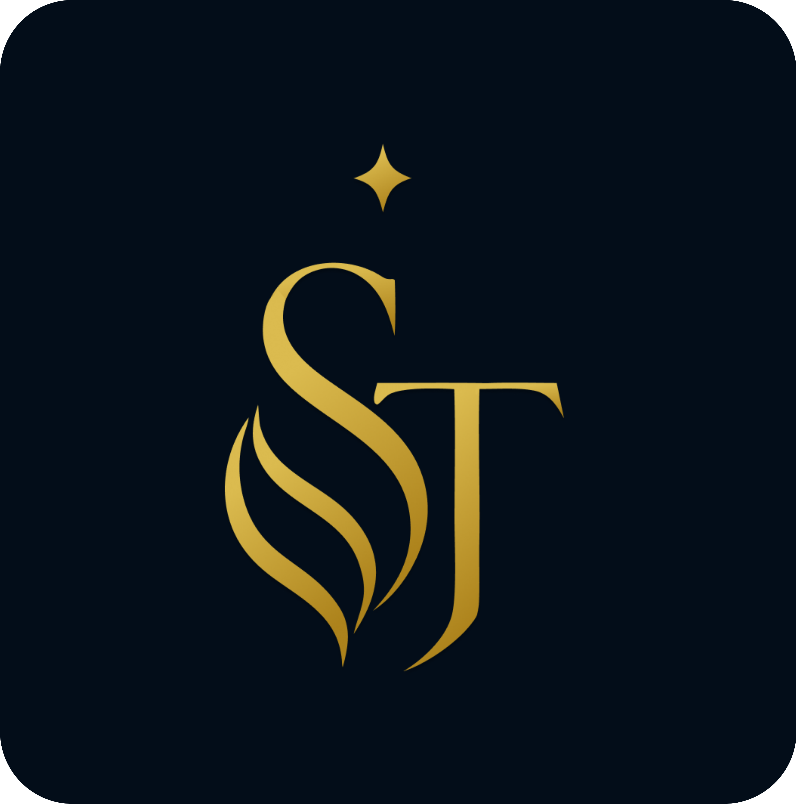
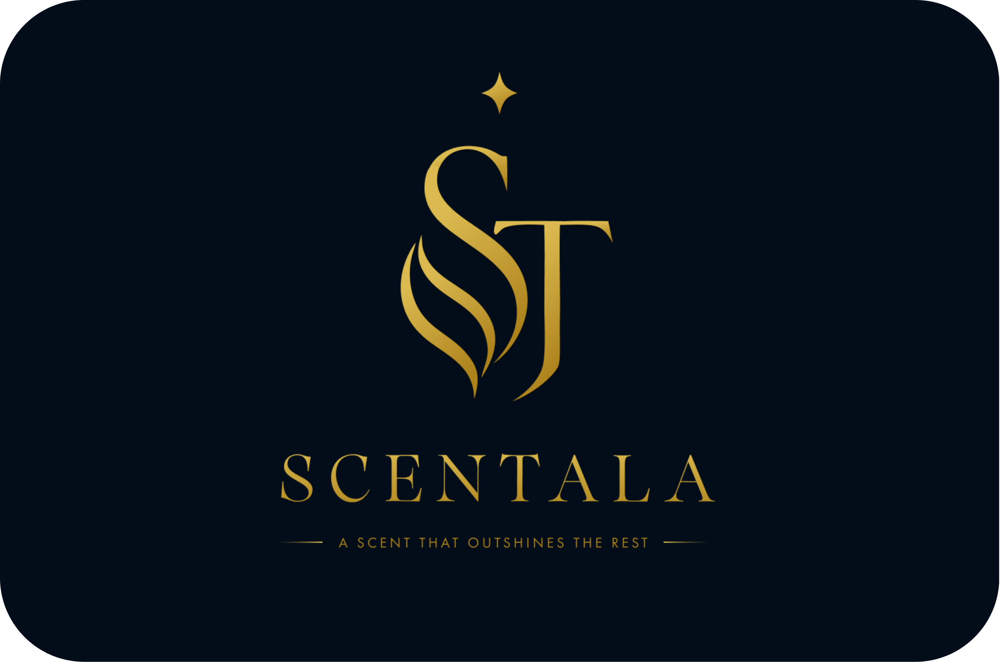
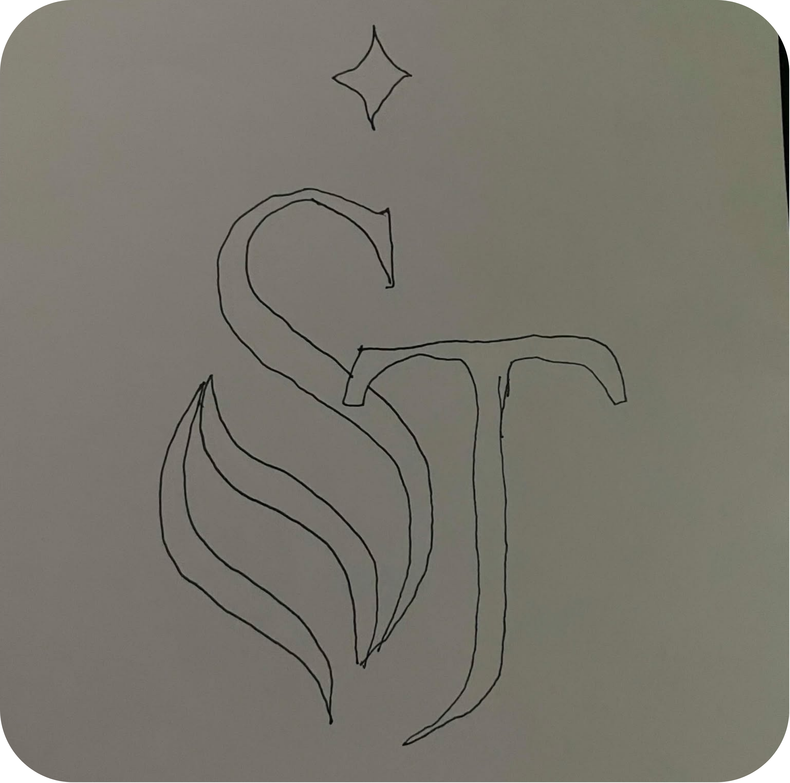

# Creative Task #1: Logo Design

## Activity Information

- **Brand:** SCENTALA
- **Students:** Bautista, Kerby S.; Lemence, John Carlo D.G.; Mendoza, Eiron P.; Ramoso, John Mathew T.
- **Date:** August 26, 2026
- **Program and Section:** BSIT 4-C

## Logo Design Assets

The following image files are referenced by filename. Keep them in the same folder as this Markdown file so the images display correctly.

### Primary Logo

### Secondary Logo

### Sketch / Draft Logo

## Short Reflection

### 1. Concept Development

**Question:** How did you come up with your logo idea? What inspired your design concept?

We came up with the SCENTALA logo by combining the letters S and T from the brand name and shaping them into a form that resembles a perfume bottle. The flowing curves of the S create the elegant body of the bottle, while the T helps form its structure and gives the symbol a distinctive appearance. We also added a small star above the logo to represent “Tala,” meaning star, which is an important part of the SCENTALA name. The gold color was chosen to give the logo a luxurious and elegant feel, reflecting our goal of offering a premium-quality fragrance at an affordable price.

### 2. Research and Brainstorming

**Question:** What research, sketching, or brainstorming activities did you conduct before creating your final logo? How did these activities influence your design?

Before creating the final logo, we looked at different perfume and luxury brand logos to understand how they use typography, symbols, shapes, and colors to create an elegant identity. We then brainstormed different ways to combine the S and T while keeping both letters recognizable. We explored flowing and curved forms to make the logo feel connected to fragrance and experimented with the placement of the star to represent “Tala.” Through sketching and refining our ideas, we arrived at a simpler and more balanced design that could work as both a primary logo and a secondary logo with the full SCENTALA name and tagline.

### 3. Application of Gestalt Principles

**Question:** Which Gestalt principle(s) did you apply to your logo? Explain how the principle(s) contribute to the logo’s clarity, visual appeal, and effectiveness.

We applied the Gestalt principles of Closure and Continuation to our logo. Closure can be seen in how the letters S and T are combined to create the overall shape of a perfume bottle, even though there is no complete bottle outline. Our eyes naturally complete the form and recognize it as a perfume bottle. For Continuation, the flowing curves of the S guide the viewer’s eyes upward toward the T and the star, creating a smooth sense of movement. These principles help make the logo unified, elegant, visually appealing, and easy to recognize.
