# A WEB-BASED AI-ASSISTED ORDINANCE INFORMATION SYSTEM FOR CABANATUAN CITY

*Capstone and Research Project, BSIT (Web Systems Technology), NEUST College of Information and Communications Technology, October 2026. Authors: Chris Karl M. Lacanilao, John Carlo DG. Lemence, Manny N. Agulto, Reyven B. Calara.*

## TABLE OF CONTENTS

| Chapter 1 | 1 |
|---|---|
| THE PROBLEM AND ITS BACKGROUND | 1 |
| Introduction | 1 |
| Review of Related Literature and Studies | 4 |
| Synthesis | 14 |
| Conceptual Framework | 16 |
| Statement of the Problem | 19 |
| Scope and Delimitations | 20 |
| Significance of the Study | 23 |
| Definition of Terms | 24 |
| Chapter 2 | 29 |
| METHODOLOGY | 29 |
| Research Design | 29 |
| Research Locale | 30 |
| Research Respondents | 32 |
| Research Instruments | 35 |
| Data Gathering Procedures | 37 |
| Data Analysis Techniques | 39 |
| Ethical Consideration | 58 |
| Chapter 3 | 61 |
| RESULTS AND DISCUSSION | 61 |
| 1. Development of the System Following the Agile SDLC Phases | 61 |
| 1.1 Planning and Requirements Gathering | 62 |
| 1.2 Design and Prototyping | 69 |
| System Architecture Overview | 69 |
| Wireframes and User Interface Architecture | 70 |
| Use Case Diagram | 87 |
| Context Diagram (Level 0 Data Flow Diagram) | 89 |
| Level 1 Data Flow Diagram (DFD) | 91 |
| Level 2 Data Flow Diagrams (DFD) | 93 |
| Entity Relationship Diagram (ERD) | 104 |
| Database Normalization | 107 |
| Data Dictionary | 109 |
| 1.3 Development and Implementation | 121 |
| Technical Implementation Stack | 122 |
| Core Functional Modules Developed | 123 |
| Agile Schedule and Implementation Timeline | 126 |
| 1.4 Testing | 128 |
| 1.5 Deployment | 130 |
| 2. Technical Quality Assessment by IT Experts (ISO/IEC 25010:2023) | 135 |
| 2.1 Functional Suitability | 136 |
| 2.2 Performance Efficiency | 138 |
| 2.3 Compatibility | 141 |
| 2.4 Interaction Capability | 143 |
| 2.5 Reliability | 149 |
| 2.6 Security | 152 |
| 2.7 Maintainability | 155 |
| 2.8 Flexibility | 159 |
| 2.9 Safety | 161 |
| 2.10 Summary of the Overall Assessment as Rated by IT Experts | 164 |
| 3. Assessment of Web Content Accessibility Guidelines (WCAG) by IT Experts | 169 |
| 3.1 Perceivable | 169 |
| 3.2 Operable | 172 |
| 3.3 Understandable | 175 |
| 3.4 Robust | 177 |
| 3.5 Overall Assessment on Accessibility by IT Experts | 179 |
| Discussion of IT Experts' Accessibility Findings | 180 |
| 4. Evaluation on the Usability of the System Based on the System Usability Scale Made by End-Users | 181 |
| 5. Evaluation on the Accessibility of the System Based on Web Content Accessibility Guidelines (WCAG) by End-Users | 186 |
| 5.1 Perceivable | 186 |
| 5.2 Operable | 189 |
| 5.3 Understandable | 191 |
| 5.4 Robust | 193 |
| 5.5 Overall Assessment on Accessibility by End-Users | 195 |
| Summary of Results | 196 |
| Chapter 4 | 199 |
| SUMMARY, CONCLUSIONS, AND RECOMMENDATIONS | 199 |
| Summary of Findings | 199 |
| Conclusions | 206 |
| Recommendations | 207 |
| REFERENCES | 211 |
| APPENDICES | 216 |
| Appendix A - Request Letter for Adviser | 216 |
| Appendix B - Research Instruments | 217 |
| Appendix C - User Manual | 238 |

## LIST OF TABLES

| Table No. | Table Title | Page No. |
|---|---|---|
| Table 1 | Scoring Rubric for Functional Suitability | 44 |
| Table 2 | Scoring Rubric for Performance Efficiency | 45 |
| Table 3 | Scoring Rubric for Compatibility | 47 |
| Table 4 | Scoring Rubric for Interaction Capability | 49 |
| Table 5 | Scoring Rubric for Reliability | 50 |
| Table 6 | Scoring Rubric for Security | 51 |
| Table 7 | Scoring Rubric for Maintainability | 52 |
| Table 8 | Scoring Rubric for Flexibility | 53 |
| Table 9 | Scoring Rubric for Safety | 55 |
| Table 10 | Interpretation of System Usability Scale (SUS) | 57 |
| Table 11 | Scoring Rubric for Web Content Accessibility Guidelines | 58 |
| Table 12 | Main System Requirements of the Cabanatuan City Ordinance Portal by User Group | 65 |
| Table 13 | Data Dictionary for Table users | 109 |
| Table 14 | Data Dictionary for Table barangays | 111 |
| Table 15 | Data Dictionary for Table ordinances | 112 |
| Table 16 | Data Dictionary for Table reports | 117 |
| Table 17 | Data Dictionary for Table news_items | 119 |
| Table 18 | Data Dictionary for Table chat_sessions | 121 |
| Table 19 | Projected Monthly Deployment Infrastructure, Service Specifications, and Operational Cost Breakdown | 132 |
| Table 20 | Functional Suitability - The degree to which the system provides functions that meet stated and implied needs when used under specified conditions. (As Rated by IT Experts, N = 10) | 136 |
| Table 21 | Performance Efficiency - Relative to the number of resources used under stated conditions. (As Rated by IT Experts, N = 10) | 139 |
| Table 22 | Compatibility - The degree to which a software system can exchange information with other systems whilst sharing the same software and hardware. (As Rated by IT Experts, N = 10) | 141 |
| Table 23 | Interaction Capability - The degree to which a system can be interacted with by specified users to exchange information through the user interface to complete the intended task. (As Rated by IT Experts, N = 10) | 144 |
| Table 24 | Reliability - The degree to which the system performs specified functions under specified conditions for a specified period of time. (As Rated by IT Experts, N = 10) | 149 |
| Table 25 | Security - The degree to which a system prevents unauthorized access to, or modification of, computer programs or data. (As Rated by IT Experts, N = 10) | 152 |
| Table 26 | Maintainability - Refers to how well a system can be modified to improve, correct or adapt to changes in the environment as well as requirements. (As Rated by IT Experts, N = 10) | 156 |
| Table 27 | Flexibility - The degree to which a product can be adapted to changes in its requirements, contexts of use or system environment. (As Rated by IT Experts, N = 10) | 159 |
| Table 28 | Safety - The degree to which a product avoids a state in which human life, health, property, or the environment is endangered. (As Rated by IT Experts, N = 10) | 162 |
| Table 29 | Summary of Overall Assessment on As Rated by IT Experts (N = 10) | 164 |
| Table 30 | Perceivable - Information and user interface components must be presentable to users in ways they can perceive. (As Rated by IT Experts, N = 10) | 170 |
| Table 31 | Operable - User interface components and navigation must be operable. (As Rated by IT Experts, N = 10) | 173 |
| Table 32 | Understandable - Information and the operation of the user interface must be understandable. (As Rated by IT Experts, N = 10) | 175 |
| Table 33 | Robust - Content must be robust enough to be interpreted reliably by a wide variety of user agents, including assistive technologies. (As Rated by IT Experts, N = 10) | 177 |
| Table 34 | Summary of Overall Assessment on Accessibility as Rated by IT Experts (N = 10) | 179 |
| Table 35 | System Usability Scale (SUS) Item Ratings (As Rated by End-Users, N = 100) | 182 |
| Table 36 | Overall System Usability Scale (SUS) Score (As Rated by End-Users, N = 100) | 184 |
| Table 37 | Perceivable - Information and user interface components must be presentable to users in ways they can perceive. (As Rated by End-Users, N = 100) | 186 |
| Table 38 | Operable - User interface components and navigation must be operable. (As Rated by End-Users, N = 100) | 189 |
| Table 39 | Understandable - Information and the operation of the user interface must be understandable. (As Rated by End-Users, N = 100) | 191 |
| Table 40 | Robust - Content must be robust enough to be interpreted reliably by a wide variety of user agents, including assistive technologies. (As Rated by End-Users, N = 100) | 193 |
| Table 41 | Summary of Overall Assessment on Accessibility as Rated by End-Users (N = 100) | 195 |

## LIST OF FIGURES

| Figure No. | Figure Title | Page No. |
|---|---|---|
| Figure 1 | Conceptual Framework of the Study | 17 |
| Figure 2 | Map of the Research Locale | 30 |
| Figure 3 | Data Gathering Procedures Flowchart | 37 |
| Figure 4 | Public Landing Page Wireframe of the Cabanatuan City Ordinance Portal | 71 |
| Figure 5 | Administrative and Barangay Login Page Wireframe | 73 |
| Figure 6 | Public Ordinance Explorer and Catalog Wireframe | 74 |
| Figure 7 | Ordinance Detail and PDF Document Viewer Wireframe | 76 |
| Figure 8 | Cabanatuan Ordinance AI Civic Assistant Wireframe | 77 |
| Figure 9 | Citizen Incident and Concern Reporting Wireframe | 79 |
| Figure 10 | Community News and Public Advisories Wireframe | 80 |
| Figure 11 | Administrative Command Center Wireframe | 82 |
| Figure 12 | Ordinance Management and AI Document Extractor Wireframe | 83 |
| Figure 13 | Legislative and Civic Reporting Analytics Studio Wireframe | 85 |
| Figure 14 | Use Case Diagram of the Cabanatuan City Ordinance Portal | 87 |
| Figure 15 | Context Diagram (Level 0 DFD) of the Cabanatuan City Ordinance Portal | 89 |
| Figure 16 | Level 1 Data Flow Diagram (DFD) of the Cabanatuan City Ordinance Portal | 91 |
| Figure 17 | Level 2 Data Flow Diagram for Process 1.0 (Browse Ordinances) | 93 |
| Figure 18 | Level 2 Data Flow Diagram for Process 2.0 (Query AI Chatbot) | 94 |
| Figure 19 | Level 2 Data Flow Diagram for Process 3.0 (Submit Community Report) | 95 |
| Figure 20 | Level 2 Data Flow Diagram for Process 4.0 (Manage Community Reports) | 96 |
| Figure 21 | Level 2 Data Flow Diagram for Process 5.0 (Manage Ordinances) | 97 |
| Figure 22 | Level 2 Data Flow Diagram for Process 6.0 (Monitor Analytics) | 98 |
| Figure 23 | Level 2 Data Flow Diagram for Process 7.0 (Manage System Accounts) | 99 |
| Figure 24 | Level 2 Data Flow Diagram for Process 8.0 (Authenticate Account) | 100 |
| Figure 25 | Entity Relationship Diagram (ERD) of the Cabanatuan City Ordinance Portal Database | 104 |
| Figure 26 | Unnormalized Form of the Cabanatuan City Ordinance Portal Database Structure | 107 |
| Figure 27 | First Normal Form (1NF) of the Cabanatuan City Ordinance Portal Database Structure | 108 |
| Figure 28 | Second Normal Form (2NF) of the Cabanatuan City Ordinance Portal Database Structure | 108 |
| Figure 29 | Third Normal Form (3NF) of the Cabanatuan City Ordinance Portal Database Structure | 109 |
| Figure 30 | Gantt Chart of the Agile SDLC Activities for the Web-Based AI-Assisted Ordinance Information System | 127 |
| Figure C-1 | Public Welcome Portal & Legislative Search Gateway | 239 |
| Figure C-2 | Secure Multi-Role Portal Sign-In & Authentication | 241 |
| Figure C-3 | Public Ordinance Explorer & Multi-Criteria Legal Filtering | 243 |
| Figure C-4 | Codified Ordinance Full Text & Articles Viewer | 244 |
| Figure C-5 | Official Legislative PDF Document Reader Modal | 246 |
| Figure C-6 | AI Legal Assistant Interactive Inquiry Console | 248 |
| Figure C-7 | Citizen Community Incident & Violation Reporting Form | 249 |
| Figure C-8 | Community Report Submission Confirmation & Incident Reference | 251 |
| Figure C-9 | Civic News, Public Advisories & Legislative Announcements Feed | 253 |
| Figure C-10 | Barangay Executive Governance Dashboard | 254 |
| Figure C-11 | Barangay Ordinance Management & Status Tracking Roster | 255 |
| Figure C-12 | Barangay Ordinance Proposal & Legislative Drafting Modal | 257 |
| Figure C-13 | AI-Powered Ordinance PDF Extraction & Auto-Structuring Suite | 258 |
| Figure C-14 | Barangay Community Incident Reports & Grievance Ledger | 260 |
| Figure C-15 | Barangay Incident Triage & Resolution Management | 261 |
| Figure C-16 | Barangay Legislative Reporting & Volume Analytics | 262 |
| Figure C-17 | LGU Executive Governance Dashboard & Legislative Pulse | 264 |
| Figure C-18 | LGU Central Legislative Repository & City Ordinance Archive | 265 |
| Figure C-19 | Legislative Review, Enactment & Official Approval Workflow | 267 |
| Figure C-20 | LGU Legislative PDF AI Digitization & Ingestion Suite | 268 |
| Figure C-21 | Official User Accounts & Role-Based Access Control (RBAC) Management | 269 |
| Figure C-22 | 89-Barangay Municipal Directory & Accreditation Roster | 270 |
| Figure C-23 | City-wide Civic Incident Monitoring & Cross-Barangay Oversight | 272 |
| Figure C-24 | City News Publishing & Public Advisory Broadcast Console | 273 |
| Figure C-25 | Official Legislative PDF Report Generator & Export Engine | 275 |
| Figure C-26 | Legislative Analytics, Category Breakdown & Compliance Charts | 276 |

# Chapter 1: THE PROBLEM AND ITS BACKGROUND

### Introduction
The rapid development of information and communication technology has greatly influenced the way governmental institutions deliver public services and conduct administrative activities. Across the globe, various local governments have shifted to digital platforms to improve public records management, citizen engagement, and the implementation of routine governance activities (Latupeirissa et al., 2024). In the Philippines, digital governance has gained momentum as a means of improving local government operations and ensuring public services are more responsive and accessible to the citizenry (Andaya et al., 2025). However, despite various initiatives to promote e-governance in the country, many LGUs in the Philippines, particularly at the barangay level, continue to rely on traditional methods of record management and service delivery (Espiritu et al., 2024).
Among the areas of LGU operations in the Philippines that remain largely unmodernized is the management and dissemination of ordinances at the barangay and city levels. Ordinances form the foundation of governance in various cities and towns across the country, as they govern how activities in a particular locality are conducted. However, in many LGUs, the processes for managing and disseminating these ordinances have remained largely unchanged. Ordinance records are usually kept in physical files, making them vulnerable to damage or misfiling over time (Abiva et al., 2025). The retrieval of specific ordinances is difficult and inefficient because it requires manually sifting through files to obtain information (Abiva et al., 2025). If a resident needs access to a specific ordinance, he or she must personally visit the barangay or LGU office during office hours to request a copy from a staff member (Batacandolo et al., 2024). This causes delays and limits public access to information (Batacandolo et al., 2024).
These problems are not isolated instances but are systemic across local governance systems in the Philippines. Research on local governance systems in Capiz, a province in the Philippines, revealed that although residents are aware that ordinances exist in their locality, compliance is only moderate (Batacandolo et al., 2024). This finding was attributed to the limited access that residents have to the actual texts of ordinances and the poor dissemination strategies employed by their LGUs (Batacandolo et al., 2024). Similarly, research on various local governance systems in the Philippines found persistent difficulties in communicating ordinances to the public, including language barriers, poor use of technology, and inadequate training in strategies for disseminating ordinances (Palingkod et al., 2025). These findings point to a systemic problem in the Philippines' local governance, in which existing systems are not equipped to ensure adequate public access to ordinances.
Data management at the barangay level in the Philippines has further compounded these problems. A study on barangay data management in Barangay San Juan ACCFA revealed a lack of data quality across functionality, usability, security, and performance, with scores ranging from 1.00 to 1.50, categorized as "critical" (Abiva et al., 2025). The study found that manual data management at the barangay level was affecting data accessibility and centralization. A scoping review on digital governance in the Philippines revealed that although digital transformation has shown potential to improve responsiveness, accessibility, and efficiency, Philippine LGUs face adoption challenges, including financial constraints, digital literacy gaps, and ICT infrastructure limitations (Andaya et al., 2025). A study on digital transformation in the LGU of Science City of Muñoz, Nueva Ecija, an area geographically close to Cabanatuan City, found that budget, skill, security, and adoption issues persist as challenges in local government digital transformation (Espiritu et al., 2024).
This study developed a web-based AI-assisted ordinance information system for Cabanatuan City. The system was designed to modernize the management of barangay and city-wide ordinances through a centralized digital platform. Individual barangays can upload and manage their respective ordinances, while the LGU can upload city-wide ordinances that apply to participating barangays. The system includes a resident reporting feature that allows residents to report common barangay concerns, such as improper waste disposal, noise pollution, and other local issues. These reports are forwarded to the respective barangay administrator. The system also includes an AI-assisted chatbot powered by Google Gemini, a large language model (LLM), and uses a Retrieval-Augmented Generation (RAG) approach. The chatbot retrieves relevant ordinance documents from the system’s database and provides them as context to the Gemini model when generating responses. This allows residents to ask questions about local ordinances in everyday language and receive context-grounded answers. The chatbot is limited to explaining the content of ordinances uploaded to the system; it does not provide legal advice, interpret ordinances beyond their stated content, or provide information about national laws and regulations. The system was developed using the Agile Development Model, which supported iterative development and continuous improvement.
Although the system includes a resident reporting module, the primary focus of the study remains on ordinance management, retrieval, dissemination, and AI-assisted ordinance inquiry. The reporting feature serves as a supplementary component that allows residents to submit community concerns related to common barangay issues and possible ordinance violations. These reports are not intended to replace official enforcement procedures but to support barangay officials in receiving and monitoring community concerns more efficiently.

### Review of Related Literature and Studies
This section presents an overview of the existing literature organized according to five thematic areas that directly inform the development of the proposed system: (1) ordinance management, AI-assisted systems, and digital governance, which establish the problem context and validate the need for the proposed system; (2) technologies used in related systems, which inform the technical decisions made in the system's development, including the selection of Google Gemini as the AI model and the use of Retrieval-Augmented Generation; (3) ordinance dissemination and inter-agency processes, which inform the system's ordinance workflow and reporting features; (4) benefits of digital transformation and AI in local governance, which provide the theoretical basis for why an AI-assisted approach can improve ordinance management; and (5) development methodologies in related studies, which justify the selection of the Agile Development Model and the developmental-quantitative research design..

### Ordinance Management, AI-Assisted Systems, and Digital Governance
Senadheira et al. (2025) examined the roles of chatbots in government services and identified four primary functions: distributing information, providing advice, streamlining administrative processes, and handling complaints. The study found that while chatbots can improve access to government services, concerns remain regarding the consistency of responses, accountability for errors, and the potential biases embedded in their design. The study also noted that organizational readiness is a significant factor in determining whether chatbot implementations succeed, and that iterative feedback loops rooted in human-centered design methods tend to produce services that are more aligned with community needs. These findings directly inform the design of the proposed system's AI chatbot, which is developed using iterative feedback from stakeholders and focuses on the information-distribution function identified by the study.
Ubaedila (2024) examined how AI-powered chat systems can address common issues in government service delivery, such as slow response times, understaffing, and disorganized communication. The study found that AI chat systems reduced waiting times by up to 75 percent compared to human-only handling, with accurate responses delivered approximately 60 percent of the time. However, the study also identified challenges, including privacy risks, user skepticism, technical difficulties during system integration, and unclear legal boundaries that raise questions about the long-term reliability of such systems. The reduced response times and automation benefits reported in this study support the decision to integrate an AI-assisted chatbot in the proposed ordinance information system, while the identified privacy and accuracy concerns informed the system's design decision to limit chatbot responses to the content of uploaded ordinances only.
Batacandolo et al. (2024) investigated the level of awareness and compliance with city ordinances among residents in the first district of Capiz, Philippines. Using a layered sampling method with 256 respondents, the study found that although most residents were aware that ordinances exist, few complied with them. The researchers attributed this gap not to ignorance of the rules' existence but to unfamiliarity with their actual content, combined with weak enforcement. The study concluded that improved methods of sharing ordinance information could help bridge the gap between awareness and compliance.
Abiva et al. (2025) explored the current state of barangay data management in the Philippines by examining practices in Barangay San Juan ACCFA. The results showed that a number of barangays still employ inefficient data management practices that compromise the security, accessibility, and centralization of barangay data. Using a community-based participatory action research framework, the study aimed to rebuild barangay records that had become inaccessible due to the loss of access to an earlier digital data management system. An evaluation of the previous system revealed major gaps in all dimensions of functionality, usability, security, and performance.
Andaya et al. (2025) conducted a scoping review of digital governance in the Philippines based on documents published between 2020 and 2025. The study found that digital governance can improve the responsiveness, accessibility, and efficiency of public services. However, it also identified adoption challenges, financial capacity issues, digital literacy gaps, and ICT infrastructure limitations that need to be addressed by Philippine LGUs. The study further identified blockchain technology and artificial intelligence as areas that require further research in the Philippine governance context.

### Technologies Used in Related Systems
Lin (2023) evaluated the performance of government chatbots in Guangdong Province, China, comparing them with generative AI models such as ChatGPT and Wenxin Ernie. The results revealed a significant gap in capacity between existing government chatbots and generative AI models, as the government chatbots in China were still in an exploratory stage and had not yet reached a state of functional intelligence. The study identified optimization paths for more effectively using generative AI in government chatbot applications, including improvements to natural language processing capabilities. This study's finding about the performance gap between traditional government chatbots and generative AI models supports the proposed system's decision to use Google Gemini, a state-of-the-art large language model, rather than a rule-based chatbot approach.
Mahardika and Maulana (2025) applied natural language processing technology to the management of government documents by developing a chatbot system using the PPKUKM Office's data center. The chatbot used the Laravel framework and the Python FastAPI library to implement NLP. The system allowed users to retrieve and read files through natural language queries, demonstrating the applicability of NLP technology in providing a more interactive interface for users of government document systems. The demonstrated applicability of NLP in government document systems validates the proposed system's use of a large language model with Retrieval-Augmented Generation to process and respond to user queries about ordinance documents.
Patil et al. (2024) implemented a chatbot-based AI tool with PDF management capabilities to create a document management system that could be classified as a full-stack AI software-as-a-service model. The system used a combination of machine learning, natural language processing, and OCR-based text extraction. The study reported measurable results: a 25 percent improvement in document accessibility, a 40 percent reduction in data entry operations, and a 30 percent reduction in customer response times. These results are relevant to the proposed system, which relies on artificial intelligence to process and interpret uploaded ordinance documents. The measurable improvements reported in this study, particularly in document accessibility and response times, provide empirical support for the proposed system's integration of AI for processing uploaded ordinance documents and responding to resident queries.
Albano (2023) developed a web-based platform for the municipal government of Cabagan, Isabela, using freely available tools such as PHP, HTML, JavaScript, Bootstrap, and MySQL. The platform aimed to make municipal accomplishments visible to the public through clear online reporting and to simplify residents' access to essential public services. User feedback was gathered through a structured questionnaire rated on a five-level scale assessing interface quality. The results indicated strong approval, particularly regarding visual organization and ease of navigation, suggesting that LGUs in the Philippines can rely on open-source technologies for functional digital transformation. This study demonstrates that Philippine LGUs can successfully implement web-based platforms using open-source tools, validating the technical feasibility of the proposed system's web-based architecture for Cabanatuan City.
Rathnayake et al. (2025) examined factors influencing AI chatbot adoption in Sri Lanka's government administration using an extended Technology Acceptance Model. Based on a sample of 207 responses and analyzed using covariance-based structural equation modeling, the study found that social influence has a significant positive impact on trust, and that trust and application design positively influence perceived ease of use. Perceived ease of use, in turn, positively influenced perceived usefulness and attitude toward behavioral intention to accept AI chatbot applications in government services. The finding that trust and application design influence AI chatbot acceptance in government contexts informs the proposed system's focus on providing accurate, ordinance-grounded responses and a user-friendly interface to build public trust.

### Ordinance Dissemination and Inter-Agency Processes
Wang et al. (2024) examined the operational effectiveness of AI chatbots in Taiwan's local governments through a literature review and in-depth interviews. The study found that human-robot collaboration, rather than full automation, is the most effective model for using AI in government service delivery. The researchers noted that government agencies must enhance organizational members' understanding of AI through education and training to support cross-domain communication and coordination activities.
Palingkod et al. (2025) evaluated the effectiveness of dissemination strategies used by Philippine LGUs in communicating newly enacted ordinances and examined the barriers barangay officials face in implementing those ordinances. Using PLS-SEM analysis, the study found that while strategies such as public consultations, town hall meetings, and digital communication improved the dissemination of ordinances, significant barriers persisted, including budget constraints, language barriers, limited access to technology, and insufficient training opportunities. The study further found that responsiveness to governance issues had a greater impact on implementation effectiveness than dissemination strategy alone.
Koniuszewska (2025) analyzed the communication flows involved in the process of local law-making by LGU bodies. The study examined how different forms of communication at various stages of the legislative procedure affect the final content of legal measures. The analysis found that authorities making local law need to communicate with both their external environment and within the administrative apparatus, and that the intensity of these communication activities varies at different stages of the legislative process. These findings are relevant to the design of the proposed system's ordinance request and approval workflow between barangays and the LGU.
Zabala (2023) examined the feasibility of AI implementation within local government units across the Zamboanga Peninsula in the Philippines. The study found that while many LGUs showed growing interest in AI tools, actual implementation remains slow due to limited access to skilled personnel, weak data-collection frameworks, and budget constraints. However, those LGUs that had begun experimenting with AI reported tangible improvements: services became more responsive when automated workflows were introduced, decision-making improved with algorithmic support, and resource distribution became more accurate under technology-assisted models. The study concluded that progress depends on overcoming structural barriers first.
Espiritu et al. (2024) examined digital transformation efforts within the local government of Science City of Muñoz, Nueva Ecija, the same region as Cabanatuan City. The study examined internet availability, training programs to boost staff capabilities, communication platforms, electronic record management, and an online public service gateway. Budget constraints slowed progress, and skill gaps persisted despite regular workshops. Cybersecurity threats also complicated wider acceptance across departments. The study found that inter-agency collaboration and partnerships with external organizations helped bridge weaknesses, while joint planning supported system upgrades.

### Benefits of Digital Transformation and AI in Local Governance
Latupeirissa et al. (2024) examined the process of digital transformation in the delivery of public services across different countries. The study found that digital transformation in public service delivery consistently improves efficiency and accountability in governance. According to the study, three main factors influence digital transformation in public services: improving organizational efficiency, aligning with citizens' expectations, and aligning with mandates from local government authorities. The study also identified technology readiness as an important factor in determining the progress of digital transformation in local governments.
Yigitcanlar et al. (2024) conducted a study based on grey literature that examined 262 real-world AI implementations across 170 local governments worldwide. The study found a clear trend of increasing AI adoption by local governments over the last decade, with China, the United States, and the United Kingdom leading the adoption drive. Among AI technologies, natural language processing and robotic process automation were the most frequently used. The major sectors where AI was being adopted were information management, back-office operations, and transportation and traffic management.
Asimakopoulos et al. (2024) examined 46 academic studies published between 1999 and 2024 on how information and communication technologies influence democracy and public involvement. The review found that digital platforms, online governance systems, and interactive civic tools appear to enhance transparency, performance, and standards within democratic functions. However, the study also identified concerns, including ethical questions about monitoring capabilities, security flaws in electronic voting systems, and imbalances in access between populations with and without adequate data resources and connectivity.
Aoki (2020) investigated public trust in AI chatbots in the public sector through an experimental online survey in Japan. The study found that public trust in chatbot responses depends on both the area of inquiry and the purposes for which governments communicate to citizens about introducing chatbot services. Communicating purposes that directly benefit citizens, such as achieving uniformity in response quality and timeliness, was shown to enhance public trust in chatbots. This finding is relevant to the proposed system's AI-assisted chatbot, which is designed to provide residents with consistent and understandable explanations of ordinance content.

### Development Methodologies in Related Studies
The choice of system development methodology is an important consideration in IT-based projects. Among the reviewed studies, different development approaches were employed depending on the nature of the project. Mahardika and Maulana (2025) used the Waterfall Model, which follows a sequential process of requirements analysis, system design, implementation, and testing, in developing their NLP-based chatbot for government document management. This approach was suitable for their project because the system requirements were well-defined from the outset.
Abiva et al. (2025) implemented a Community-Based Participatory Action Research framework to design a digital data management system for Barangay San Juan ACCFA, emphasizing the value of iterative development that incorporates stakeholder engagement, community involvement, inclusiveness, and empowerment. David et al. (2023) utilized the PRISMA framework to undertake a systematic review of digital technology adoption strategies in local government entities, providing a structured approach to analyzing existing research.
Doquilla et al. (2023) used a descriptive research design with survey questionnaires and weighted mean analysis in their study of Barangay Peacekeeping Action Teams in Cabanatuan City, the same locale as the present study. The research involved 605 respondents across 9 barangays, demonstrating the use of quantitative survey-based methodology for barangay-level research in Cabanatuan City.
The study used the Agile Development Model as its system development methodology. Agile was selected because it supports an iterative approach to development, allowing the development team to build and deploy functional parts of the system incrementally and make improvements throughout the process. The multi-module nature of the system, which includes ordinance management, resident reporting, an AI-assisted chatbot, and an administrative dashboard, made Agile a suitable choice because each module could be developed and tested individually before integration into the complete system.

### Synthesis
The literature reviewed established that local governments worldwide, including those in the Philippines, face persistent challenges in managing and disseminating ordinance information through traditional approaches. Studies confirmed that the public lacks adequate access to the actual content of local ordinances (Batacandolo et al., 2024) and that existing dissemination strategies are insufficient to achieve meaningful compliance (Palingkod et al., 2025). Local data management systems at the barangay level were found to be lacking in functionality, usability, security, and performance (Abiva et al., 2025). At the same time, the use of digital technologies, such as AI-powered chatbots, has been found to yield positive results in terms of response times and information accessibility in various government service contexts (Ubaedila, 2024; Patil et al., 2024).
However, gaps remain in the literature. The majority of existing studies on government chatbot adoption focus on city-level or country-level implementations in countries such as China, Taiwan, Sri Lanka, and Japan. There is limited research addressing barangay-level ordinance management in mid-level cities in the Philippines. The existing information systems implemented by Philippine LGUs, including those in Cabagan, Isabela, and Science City of Muñoz, Nueva Ecija, are web-based but do not incorporate AI for ordinance explanation (Albano, 2023; Espiritu et al., 2024). Furthermore, none of the reviewed studies combine ordinance digitization with a Retrieval-Augmented Generation (RAG) approach using a large language model to provide context-grounded ordinance explanations at the barangay level.
This gap is significant because ordinance information systems require not only digital storage but also accurate retrieval and understandable explanation of legal or technical content. Without an AI-assisted retrieval mechanism, residents may still experience difficulty locating the correct ordinance or understanding its meaning. Therefore, the proposed system contributes by combining ordinance digitization, structured document retrieval, and AI-assisted explanation within one platform designed for barangay and city-level use.
This study addressed these gaps by developing a web-based AI-assisted ordinance information system that combines ordinance digitization, an AI-assisted chatbot powered by Google Gemini and a RAG pipeline, and a resident reporting feature in a single platform designed for barangay operations in Cabanatuan City. The system’s use of Google Gemini as its large language model and its RAG approach, in which relevant ordinance documents are retrieved from the database and provided as context before a response is generated, addressed the accuracy and domain-specificity concerns identified in the literature (Lin, 2023; Senadheira et al., 2025). The developmental-quantitative research design supported the systematic development of the system and its objective evaluation using ISO 25010:2023 and the System Usability Scale. The study applied insights from research on AI governance, natural language processing, and digital transformation to the context of barangay-level local government administration in the Philippines.

### Conceptual Framework
The conceptual framework of this study illustrates the logical flow from the identification of the existing problem, through system development, to the evaluation of the proposed system. Figure 1 presents the conceptual framework diagram of the study.
**Figure 1.**
Conceptual Framework of the Study
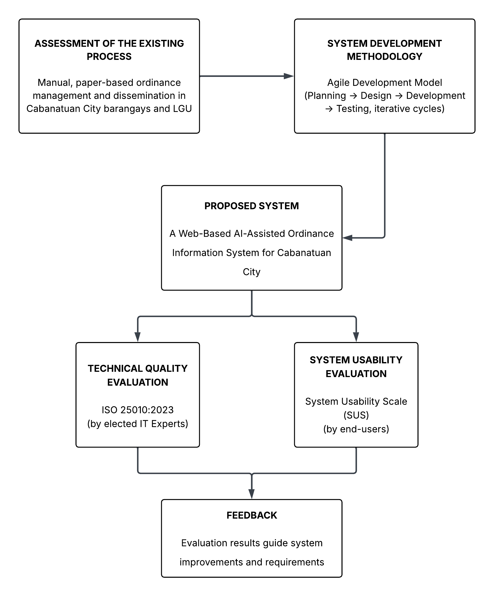

*[Figure/image placeholder: see linked image above if available]*
The first component of the framework is the assessment of the existing process. As described in the Introduction and validated by the preliminary needs assessment, the existing process for managing and disseminating ordinances in Cabanatuan City is primarily manual, paper-based, and inefficient, which limits public access and makes records prone to loss or damage. This component establishes the need for a system-based solution.
The second component is the system development methodology. The study used the Agile Development Model, which supports iterative development through incremental cycles of planning, design, implementation, and testing. This model was suitable for the system’s multiple modules, as described in Chapter 2.
The third component is the developed system: a web-based AI-assisted ordinance information system for Cabanatuan City. The system provides a centralized digital platform for ordinance management. Barangays can upload local ordinances, while the LGU can upload city-wide ordinances. The system also includes a resident reporting module for community concerns, an AI-assisted chatbot powered by Google Gemini that uses a Retrieval-Augmented Generation (RAG) approach to provide ordinance information in simple language, barangay administration features for managing reports and ordinances, and LGU oversight features for system-wide administration.
In this framework, the resident reporting module is treated as a support feature connected to ordinance awareness and local governance response. It allows residents to submit concerns that may be related to barangay rules or local community issues, while the ordinance information and AI-assisted inquiry modules remain the central components of the system. This distinction ensures that the study maintains its main focus on ordinance access and management while still supporting practical barangay-level reporting needs.
The fourth component covers the evaluation of the developed system and consists of two parts. The technical quality evaluation used ISO 25010:2023 and was conducted by the IT expert evaluators across nine quality characteristics: functional suitability, performance efficiency, compatibility, interaction capability, reliability, security, maintainability, flexibility, and safety. The system usability evaluation used the System Usability Scale (SUS) and was conducted by end-users to assess ease of use, efficiency, learnability, and user satisfaction. Together, these evaluations provided an assessment of the system’s technical quality and practical usability.
The fifth component is feedback. The results of both evaluations identify the system's strengths and areas for improvement. These findings guide recommendations for system refinements and inform future development iterations.

### Statement of the Problem
This study aims to design, develop, and evaluate a Web-Based AI-Assisted Ordinance Information System for Cabanatuan City to modernize and improve the efficiency, accessibility, and management of barangay and city-wide ordinances.
Specifically, this study seeks to answer the following questions:
1. How may the researchers develop the proposed system based on the following software development phases:
1.1 Planning and Requirements Gathering;
1.2 Design and Prototyping;
1.3 Development and Implementation; and
1.4 Testing and Deployment?
2. How may the elected IT consultants evaluate the developed system in terms of the following software quality characteristics based on ISO 25010:2023:
2.1 Functional suitability;
2.2 Performance efficiency;
Compatibility;
Interaction capability;
Reliability;
Security;
Maintainability;
Flexibility; and
Safety?
3. How may the end-users evaluate the developed system using the System Usability Scale (SUS) in terms of the following usability characteristics:
3.1 Ease of Use;
3.2 Efficiency;
3.3 Learnability; and
3.4 User Satisfaction?
4. How may the system’s accessibility be evaluated by IT experts and end-users based on established accessibility principles, in terms of:
4.1. Perceivable;
4.2. Operable;
4.3. Understandable; and
4.4. Robust?

### Scope and Delimitations
This study focuses on the design, development, and evaluation of a Web-Based AI-Assisted Ordinance Information System intended to modernize the management, dissemination, and accessibility of barangay and city-wide ordinances in Cabanatuan City, Nueva Ecija. The system provides modules for ordinance management, allowing individual barangays to upload, organize, and maintain their local ordinances, and for the LGU to add city-wide ordinances that apply across all participating barangays. The system also includes a resident reporting module that allows community members to submit concerns related to common barangay issues directly through the platform, a barangay administrative dashboard for managing reports and monitoring frequently reported issues, an AI-assisted chatbot that allows residents to ask questions about local ordinances in everyday language and receive simplified responses, and an LGU oversight module for system-wide administration, including the approval or rejection of ordinance submissions, management of user and barangay accounts, and access to consolidated analytics.
The system is intended for use by three primary user roles: residents, who can access ordinance information, interact with the AI-assisted chatbot, and submit community reports; barangay officials, who can manage ordinances, view and respond to resident reports, and monitor barangay-level data; and LGU administrators, who oversee the entire system, approve or reject ordinance submissions, manage accounts, and view city-wide analytics.
The developed system was evaluated by purposively selected IT experts using the ISO/IEC 25010:2023 Software Quality Model and by end-users selected through purposive sampling procedures appropriate to their respective groups. The barangay-based respondents were selected through multistage purposive sampling, while LGU officials were selected separately from the City Government of Cabanatuan. The respondent selection criteria and sampling procedures are discussed in detail in Chapter 2. The system was developed using the Agile Development Model, which supported iterative development and the incorporation of feedback throughout the process.
This study was limited to the development of a web-based application and did not include a native mobile application, although the web platform was designed to be responsive and accessible on mobile devices through a web browser. The AI-assisted chatbot is powered by Google Gemini, a large language model accessed through the Google GenAI API, and employs a Retrieval-Augmented Generation (RAG) approach to retrieve relevant ordinance content from the system’s database before generating responses. The chatbot is limited to answering questions based on ordinances uploaded to the system and does not provide legal advice, interpret ordinances beyond their stated content, or provide information about national laws and regulations. The system does not use fine-tuned or custom-trained models; it relies on Gemini’s general language-understanding capabilities combined with ordinance context supplied through RAG. The study was limited to Cabanatuan City; deployment and testing in other cities or municipalities were outside its scope.
The AI-assisted chatbot is designed as an information-support tool, not as a legal decision-making system. Its responses are limited to ordinance documents available in the system database. When the system cannot retrieve a relevant ordinance, the chatbot notifies the user that sufficient ordinance information is unavailable and advises the user to verify the concern with authorized barangay or LGU personnel. The chatbot does not determine violations, impose penalties, or replace the official interpretation and decision-making authority of local government officials.

### Significance of the Study
The following individuals and groups are expected to benefit from the results of this study:
Barangay Officials and Staff. The developed system will directly benefit barangay officials and staff by providing them with a centralized digital platform for uploading, organizing, and managing local ordinances. The system will replace manual paper-based filing with a digital repository that allows for faster retrieval of ordinance records and reduces the risk of document loss or damage. The administrative dashboard will enable barangay officials to view and respond to resident reports and to monitor recurring community issues through basic analytics, supporting more informed decision-making at the barangay level.
LGU Personnel. The system will provide LGU personnel with a super administrator account that allows them to oversee the entire platform, approve or reject barangay ordinance submissions, publish city-wide ordinances that apply across all participating barangays, manage user and barangay accounts, and access consolidated analytics across the city. This will improve the LGU's ability to ensure consistency, accuracy, and proper governance of ordinance information throughout Cabanatuan City.
Residents of Cabanatuan City. The system will benefit residents by providing them with online access to barangay and city-wide ordinances without the need to physically visit barangay or LGU offices. The AI-assisted chatbot will allow residents to ask questions about ordinances in simple, everyday language and receive understandable responses, addressing the documented difficulty of understanding legal terminology. The resident reporting module will allow community members to submit concerns about improper waste disposal, noise complaints, and other barangay-related matters directly through the platform.
The City Government of Cabanatuan. The system will contribute to the city's goal of modernizing local governance processes. By digitizing and centralizing ordinance management, the system supports transparency, accountability, and more efficient public service delivery. The consolidated analytics and reporting capabilities will provide the city government with data that can inform policy decisions and resource allocation.
Future Researchers and IT Students. This study may serve as a reference for future research related to the development of AI-assisted government information systems, digital governance at the barangay level, and the application of NLP technologies in public service contexts in the Philippines. IT students may also use this study as a guide for similar capstone projects involving web-based systems, AI-assisted chatbot integration, and multi-role user platforms for local government.

### Definition of Terms
The following terms are defined conceptually and operationally as used in this study to provide clarity and consistency in interpretation.
Agile Development Model — Conceptually, the Agile Development Model is an iterative and incremental approach to software development that emphasizes flexibility, collaboration, and continuous improvement. In this study, it refers to the methodology used to develop the proposed system through repeated cycles of planning, design, implementation, testing, and stakeholder feedback.
AI-Assisted Chatbot — Conceptually, an AI-assisted chatbot is a software application that utilizes artificial intelligence and natural language processing to simulate human conversation and provide automated responses to user queries. In this study, it refers to the system component that enables residents to inquire about barangay and city ordinances using everyday language and receive simplified explanations based solely on the ordinances uploaded into the system.
Barangay — Conceptually, a barangay is the smallest administrative division in the Philippines, responsible for local governance and community services. In this study, it refers to the individual local government units within Cabanatuan City that manage their respective ordinances and interact with the system for ordinance uploading, monitoring, and report handling.
Centralized Digital Platform — Conceptually, a centralized digital platform is a system that consolidates data and functionalities into a single accessible location. In this study, it refers to the web-based system that integrates ordinance management, resident reporting, and administrative functions for barangays and the city government.
End-Users — Conceptually, end-users are individuals who directly interact with a system or application. In this study, end-users refer to residents, barangay officials, and LGU personnel who utilize the system and participate in the usability evaluation using the System Usability Scale (SUS).
Functional Suitability — Conceptually, functional suitability is a software quality characteristic that measures the degree to which a system provides functions that meet user needs. In this study, it refers to the evaluation of whether the developed system delivers accurate, complete, and appropriate functionalities as assessed by IT experts based on ISO 25010:2023.
ISO 25010:2023 — An international standard for software product quality that defines nine quality characteristics used in this study to evaluate the technical quality of the developed system.
Large Language Model (LLM) — Conceptually, a large language model is a deep learning model trained on large-scale text data that can understand, generate, and reason about natural language (Zhao et al., 2023). LLMs are built on the transformer architecture and contain billions of parameters, enabling them to perform a wide range of natural language processing tasks, including text generation, summarization, translation, and question answering. In this study, the term refers to Google Gemini, the specific LLM used by the AI-assisted chatbot to process user queries and generate responses about ordinance content.
Google Gemini — Conceptually, Google Gemini is a family of multimodal large language models developed by Google DeepMind, designed to understand and generate text, images, audio, and other data types (Gemini Team et al., 2024). In this study, it refers to the specific AI model (Gemini 3.5 Flash Lite) accessed through the Google GenAI API that powers the AI-assisted chatbot. The Gemini model processes ordinance-related queries from residents and generates natural language responses based on ordinance content retrieved through the system's Retrieval-Augmented Generation pipeline.
Local Government Unit (LGU) — Conceptually, a Local Government Unit is a political and administrative body responsible for governance at the local level. In this study, it refers specifically to the City Government of Cabanatuan, which acts as the super administrator of the system, overseeing ordinance approval, user management, and system-wide operations.
Natural Language Processing (NLP) — Conceptually, natural language processing is a branch of artificial intelligence that enables computers to understand, interpret, and generate human language. In this study, it refers to the technology used by the AI-assisted chatbot to process user queries and generate understandable responses about ordinances.
Ordinance — Conceptually, an ordinance is a law or regulation enacted by a local government authority to govern activities within its jurisdiction. In this study, it refers to both barangay-level and city-wide regulations that are uploaded, stored, managed, and accessed through the proposed system.
Ordinance Management — Conceptually, ordinance management refers to the processes involved in organizing, storing, retrieving, updating, and disseminating ordinance records. In this study, it refers to the digital handling of these processes within the system, replacing manual paper-based methods with a centralized and efficient platform.
Performance Efficiency — Conceptually, performance efficiency is a software quality characteristic that evaluates system performance relative to resource usage. In this study, it refers to the system’s ability to provide fast response times, efficient processing, and stable operation under varying conditions as evaluated by IT experts.
Retrieval-Augmented Generation (RAG) — Conceptually, Retrieval-Augmented Generation is a framework for knowledge-intensive natural language processing tasks that combines a pre-trained language model with an external knowledge source, enabling the model to retrieve relevant documents before generating a response (Lewis et al., 2020). In this study, it refers to the technique used by the AI-assisted chatbot to search the system's database for relevant ordinance documents based on the user's query, and to provide these documents as context to the Google Gemini large language model when generating a response. This approach ensures that the chatbot's answers are grounded in the actual content of ordinances stored in the system rather than relying solely on the model's pre-trained knowledge.
Resident Reporting Module — Conceptually, a reporting module is a system feature that allows users to submit issues or concerns to an authority. In this study, it refers to the component of the system that enables residents to report barangay-related concerns such as improper waste disposal, noise complaints, and other local issues.
System Usability Scale (SUS) — Conceptually, the System Usability Scale is a standardized questionnaire used to evaluate the usability of a system. In this study, it refers to the instrument used to measure user perceptions of ease of use, efficiency, learnability, and overall satisfaction with the developed system.
Web-Based System — Conceptually, a web-based system is a software application accessed through a web browser over the internet. In this study, it refers to the proposed ordinance information system that allows users to access features such as ordinance browsing, chatbot interaction, and report submission online.

# Chapter 2: METHODOLOGY
This chapter presents the proposed research design, locale, respondents, sample, data-gathering procedures, data analysis techniques, and ethical considerations for the conduct of the proposed study.

### Research Design
The study used a developmental-quantitative research design to develop and evaluate the Web-Based AI-Assisted Ordinance Information System for Cabanatuan City. The developmental component was appropriate because the research involved creating a functional system through a structured process of identifying a problem, designing a solution, developing the system, and evaluating the finished product against recognized quality standards (Richey & Klein, 2014). The quantitative component was appropriate because the study employed structured evaluation instruments, including Likert-scale questionnaires based on ISO 25010:2023 and the System Usability Scale (SUS). IT experts and LGU officials were selected through purposive sampling, while the barangay-based end-user respondents were selected through multistage purposive sampling. Quantitative techniques, including weighted mean computation, frequency distribution, percentage analysis, and SUS score computation, were used to measure and interpret the system’s technical quality, usability, and accessibility. Together, the developmental and quantitative components provided a systematic basis for building the system and evaluating it using measurable data.
The system was developed using the Agile Development Model, an iterative and incremental software development methodology. Agile was selected because the system consisted of multiple modules, including ordinance management, resident reporting, an AI-assisted chatbot, a barangay administrative dashboard, and an LGU oversight module. These modules could be developed, tested, and refined independently before being integrated into the complete platform. Each development cycle produced a functional component that could be reviewed before the team proceeded to the next iteration.

### Research Locale
The study was conducted in Cabanatuan City, Nueva Ecija, Philippines. Cabanatuan City is a first-class component city in the province of Nueva Ecija and is one of the major urban centers in Central Luzon. The city is composed of 89 barangays, each with its own local ordinances governing community affairs, as well as city-wide ordinances enacted by the city government.
**Figure 2**
Map of the Research Locale
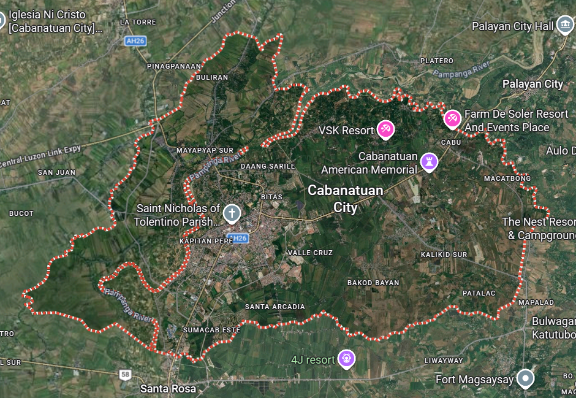

*[Figure/image placeholder: see linked image above if available]*
Cabanatuan City was selected as the research locale for several reasons. First, the preliminary needs assessment conducted during the planning phase confirmed that ordinance management in the city’s barangays relied predominantly on manual, paper-based processes. At the time of the assessment, ordinance records were stored in physical filing systems, retrieving records required staff intervention, and residents generally had to visit barangay or LGU offices in person to access ordinance information. These findings were consistent with documented challenges in barangay-level data management and digital governance in the Philippines (Abiva et al., 2025; Espiritu et al., 2024). Second, the city had a sufficiently large number of barangays to examine the suitability of a centralized ordinance management system accommodating multiple barangay accounts under a single LGU oversight structure. Third, the needs assessment indicated that most participating residents and officials had access to devices, internet connections, and the digital skills required to use an online system, as reflected in the weighted means of 1.25 for technology access and 1.43 for digital skills and readiness, both interpreted as “Strongly Agree.”
The needs assessment used a reverse-coded rating scale, in which lower mean scores indicated stronger agreement. Therefore, weighted mean scores of 1.25 for technology access and 1.43 for digital skills and readiness were interpreted as “Strongly Agree.” These results indicated that the respondents generally had access to the devices, internet connectivity, and basic digital skills considered necessary for using the proposed web-based system.
The system was demonstrated and evaluated within selected barangays in Cabanatuan City, with the City Government of Cabanatuan serving as the LGU super administrator of the platform.

### Research Respondents
The respondents of this study were divided into two groups based on the evaluation instruments used: IT expert evaluators and end-user evaluators.
IT Expert Evaluators. The technical quality of the developed system was evaluated by ten (10) IT professionals selected through purposive sampling. These evaluators assessed the system using the ISO 25010:2023 software quality model across nine quality characteristics: functional suitability, performance efficiency, compatibility, interaction capability, reliability, security, maintainability, flexibility, and safety. The IT expert evaluators were selected based on the following criteria:
Must hold a bachelor's degree or higher in Information Technology, Computer Science, or a related field;
Must have at least two (2) years of professional experience in software development, system evaluation, or IT project management; and
Must be familiar with software quality standards or system evaluation frameworks.
End-User Evaluators. The usability of the developed system was evaluated by one hundred (100) end-user respondents selected through purposive sampling procedures appropriate to their respective groups. The respondents represented three groups involved in the intended use of the system: residents, barangay officials or staff, and LGU officials. The selection of barangay-based respondents involved two stages, while LGU officials were selected separately from the City Government of Cabanatuan.
Stage 1: Selection of Barangays. nine (9) barangays were purposively selected from the eighty-nine (89) barangays of Cabanatuan City based on the following criteria:
The barangay must have an operational barangay hall or office where ordinance records are maintained;
The barangay must have at least one (1) barangay official or staff member willing to participate in the study; and
The barangay must be accessible to the researchers for the conduct of system demonstrations and evaluation sessions.
Stage 2: Selection of Respondents within Each Barangay. From each of the nine (9) selected barangays, ten (10) respondents were purposively selected, consisting of eight (8) residents and two (2) barangay officials or staff. This resulted in seventy-two (72) resident respondents and eighteen (18) barangay officials or staff respondents, for a combined total of ninety (90) barangay-based end-users.
For residents (8 per barangay):
Must be a resident of the selected barangay aged 18 years or older;
Must have had prior experience accessing or inquiring about barangay ordinances, services, or community concerns; and
Must be willing to participate in the system demonstration and complete the evaluation instruments.
For barangay officials (2 per barangay):
Must be a currently serving elected or appointed barangay official or staff member;
Must have direct involvement in or knowledge of ordinance management, record-keeping, or community affairs in the barangay; and
Must be willing to participate in the system demonstration and complete the evaluation instruments.
An additional ten (10) LGU officials were purposively selected from the City Government of Cabanatuan, bringing the total number of end-user respondents to one hundred (100). These respondents were selected separately from the nine barangays based on their involvement in or knowledge of local government administration, ordinance management, records management, or the oversight and administration of the proposed system. They were required to be willing to participate in the system demonstration and complete the applicable evaluation instruments.
The combined end-user sample therefore consisted of seventy-two (72) residents, eighteen (18) barangay officials or staff, and ten (10) LGU officials. All one hundred (100) end-user respondents participated in the usability evaluation using the System Usability Scale (SUS), and their accessibility assessment responses were analyzed collectively. The study did not aim to compare the three end-user groups separately; rather, their combined responses were used to determine the overall end-user assessment of the developed system.
The total sample consisted of one hundred ten (110) respondents, comprising ten (10) IT expert evaluators and one hundred (100) end-user evaluators. The end-user sample consisted of seventy-two (72) residents and eighteen (18) barangay officials or staff from nine (9) purposively selected barangays, together with ten (10) LGU officials selected separately from the City Government of Cabanatuan. The purposive selection procedures ensured that respondents had characteristics and responsibilities relevant to the intended use and evaluation of the system. The study focused on obtaining structured evaluations of the developed system rather than statistically generalizing the findings to all residents, barangay officials, or LGU officials in Cabanatuan City.

### Research Instruments
Three evaluation instruments were used to assess the developed system from technical, user-experience, and accessibility perspectives.
The first instrument was a structured questionnaire based on the ISO/IEC 25010:2023 Software Quality Model, which was administered to the selected IT expert evaluators. The instrument evaluated the system across nine quality characteristics: functional suitability, which concerns whether the system provides functions that meet stated and implied user needs; performance efficiency, which concerns system performance relative to resource use; compatibility, which concerns the ability to exchange information and operate in a shared environment; interaction capability, which concerns the effectiveness and satisfaction of user interaction; reliability, which concerns consistent performance under specified conditions; security, which concerns the protection of information and data according to authorization levels; maintainability, which concerns the ease of modifying or improving the system; flexibility, which concerns the system’s adaptability to other contexts or requirements; and safety, which concerns the prevention of harm to users, property, or the environment. Each questionnaire item was rated on a five-point Likert scale from 1 (Strongly Disagree) to 5 (Strongly Agree), with items derived from the model’s quality characteristics and sub-characteristics.
The second instrument used in the study was the System Usability Scale (SUS) questionnaire, which was administered to end-user respondents to measure perceived usability. Developed by Brooke (1996), the SUS is a widely recognized instrument for evaluating system usability. In this study, it was used to examine four usability characteristics: ease of use, efficiency, learnability, and user satisfaction. The SUS consists of ten standardized items rated on a five-point Likert scale from 1 (Strongly Disagree) to 5 (Strongly Agree). The responses were scored using the standard SUS procedure to produce a composite score from 0 to 100, with higher scores indicating better overall usability.
The third instrument was a WCAG-based Accessibility Evaluation Instrument, a self-devised questionnaire anchored on the Web Content Accessibility Guidelines (Olipas, 2026). It was administered to IT expert evaluators and end-user respondents to assess the accessibility of the developed system. The questionnaire covered four accessibility principles: perceivable, which concerns whether users can perceive the presented content; operable, which concerns whether interface components and navigation can be operated; understandable, which concerns the clarity of information and interface behavior; and robust, which concerns whether content can be interpreted reliably by a range of user agents and assistive technologies. The items were rated on a five-point scale from 1 (Not Accessible) to 5 (Highly Accessible).

### Data Gathering Procedures
The data gathering for this study was carried out in the following sequence:
**Figure 3**
Data Gathering Procedures Flowchart
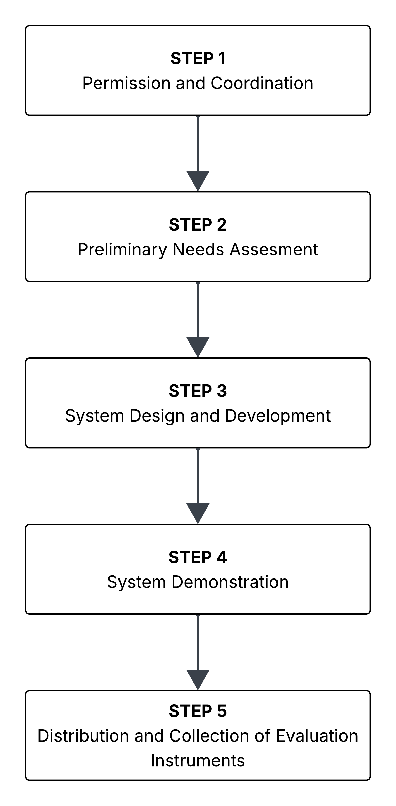

*[Figure/image placeholder: see linked image above if available]*
Step 1: Permission and Coordination. Before data collection, the researchers secured the necessary permissions from the relevant authorities. A letter of request was prepared and submitted to the nine selected barangays in Cabanatuan City and to the City Government of Cabanatuan to request approval to conduct the study within their jurisdictions. The researchers coordinated with barangay officials and LGU personnel to arrange schedules for system demonstrations and evaluation sessions.
Step 2: Preliminary Needs Assessment. A preliminary needs assessment survey was conducted among residents, barangay officials, and LGU personnel in Cabanatuan City. The survey was used to validate the identified problems, examine current ordinance management practices, assess target users’ technology access and digital readiness, and identify functional and non-functional requirements for the system. The results informed the system’s design and development.
Step 3: System Design and Development. Based on the needs-assessment findings, the researchers designed and developed the Web-Based AI-Assisted Ordinance Information System using the Agile Development Model. The system was built in iterative cycles, with functional modules internally tested before integration. Stakeholder feedback was incorporated at the end of each development iteration.
Step 4: System Demonstration. After the system was completed and internally tested, the researchers conducted a system demonstration for the respondents. IT expert evaluators were given access to the system and sufficient time to explore its modules and features. The one hundred end-user evaluators from the nine selected barangays were given a guided walkthrough and an opportunity to interact with the system, including searching for ordinances, using the AI chatbot, submitting sample reports, and navigating the platform. The demonstration provided the evaluators with an opportunity to become familiar with the system before completing the evaluation instruments.
Step 5: Distribution and Collection of Evaluation Instruments. After the system demonstration, the evaluation instruments were distributed to the respondents. The ISO/IEC 25010:2023-based questionnaire was administered to IT expert evaluators, the SUS questionnaire was administered to end-user evaluators, and the WCAG-based accessibility questionnaire was administered to the respondent groups specified in the study’s research instruments. Respondents were given time to complete the questionnaires. The completed instruments were collected, checked for completeness, and prepared for data analysis.

### Data Analysis Techniques
The data collected from the evaluation instruments were analyzed using descriptive statistics, including weighted mean, frequency distribution and percentage, and System Usability Scale (SUS) score computation. The analysis was organized according to the statements of the problem presented in Chapter 1.

### Agile Development Phases
The Web-Based AI-Assisted Ordinance Information System for Cabanatuan City was developed using the Agile Development Model. System requirements, design decisions, implementation work, and testing activities were reviewed throughout the development phases to ensure that the system addressed the identified inefficiencies in ordinance management in Cabanatuan City.
Planning and Requirements Gathering. During this phase, the researchers analyzed ordinance management workflows in Cabanatuan City to identify operational gaps, including delays in information retrieval, inaccessible ordinance records, limited public awareness of ordinance content, fragmented filing across barangays, and the absence of a centralized digital platform. The researchers identified and refined the functional and non-functional requirements. Functional requirements covered centralized management of barangay and city-wide ordinances, resident reporting, AI-assisted ordinance inquiries, a barangay administrative dashboard, and LGU oversight. Non-functional requirements covered security, data privacy, performance efficiency, reliability, usability, accessibility, compliance with the Web Content Accessibility Guidelines (WCAG), scalability, and maintainability. The researchers analyzed the preliminary needs-assessment results to validate the identified problems, examine technology access and digital readiness, and confirm system requirements. They also formulated sample user stories representing tasks such as searching for an ordinance, uploading an ordinance, asking the chatbot a question, and approving an ordinance submission. These user stories informed backlog creation, feature prioritization, and sprint planning.
Design and Prototyping. Design and Prototyping. During this phase, the refined requirements and user stories were translated into system representations. A Use Case Diagram was developed to illustrate the interactions between system actors and major functions. The identified actors included residents, barangay officials and staff, LGU administrators, and IT expert evaluators. A Data Flow Diagram (DFD) was also developed to describe data inputs, processing, storage in the centralized database, and outputs such as ordinance records, reports, chatbot responses, and administrative analytics. The researchers also examined the database structure, entity relationships, wireframes, user interface layouts, and system architecture to support data integrity, logical consistency, and scalability. Stakeholder feedback on the prototypes was considered when making design adjustments.
Development and Implementation. During this phase, prioritized backlog items derived from user stories and system models were implemented through iterative development cycles. The researchers reviewed the modules against the defined functional and non-functional requirements. The implemented features included ordinance management, resident reporting, the AI-assisted chatbot integrated with Google Gemini through the Google GenAI SDK and a Retrieval-Augmented Generation (RAG) pipeline, the barangay administrative dashboard, and the LGU oversight module. The chatbot workflow operates as follows: when a resident enters a question, the system processes the query and searches the database for relevant ordinance records or text segments. The retrieved ordinance content is provided as context to Google Gemini through the Google GenAI API, and the model generates a simplified response based on that context. The response is limited to uploaded ordinance content and includes a reminder that it is for informational purposes and is not legal advice. Each completed module was reviewed and internally tested before integration with the other modules.
Testing and Deployment. Testing and Deployment. During this phase, the researchers evaluated the results of functional and non-functional testing procedures. Functional testing checked whether system features operated according to the use cases and documented requirements. Non-functional testing examined system reliability, security controls, response time, usability, and accessibility requirements. Identified bugs, errors, and usability issues were documented and addressed. The testing results informed improvements made before the system was prepared for formal evaluation by the designated respondents.
The researchers reviewed requirements, design decisions, implementation work, and testing findings across the planning, design, development, and testing phases. This iterative process helped refine the system against the functional requirements, quality expectations, and stakeholder needs identified at the beginning of the study.

### Statistical Tools
To analyze the empirical data gathered through the evaluation instruments and address the research questions in the Statement of the Problem, the researchers applied descriptive statistical tools and standardized scoring rubrics. The statistical treatments used in the study are described below:
1. Frequency and Percentage Distribution. This was used to summarize the demographic and institutional profiles of the IT experts and end-users and to determine the proportion of responses across evaluation indicators relative to the total number of responses. The percentage distribution was computed using the formula:
P = (f / N) × 100
where P represents the percentage, f represents the frequency of responses, and N is the total number of respondents.
2. Weighted Mean. This was used to compute the average rating for each survey indicator, software quality characteristic, usability dimension, and accessibility principle evaluated by IT experts and end-users. The weighted mean summarized the evaluation responses. It was computed using the formula:
WM = Σ(f × x) / N
where WM represents the weighted mean, Σ represents the summation symbol, f is the frequency of responses per rating scale, x represents the scale weight ranging from 1 to 5, and N is the total number of respondents.
The computed weighted means were interpreted using the established evaluation scales and scoring rubrics to determine the system’s technical quality, usability, and accessibility.

### Technical Quality
To address the second statement of the problem, the IT expert evaluators assessed the developed system using a structured questionnaire based on the ISO/IEC 25010:2023 software quality model. The quantitative analysis examined nine quality characteristics: functional suitability, performance efficiency, compatibility, interaction capability, reliability, security, maintainability, flexibility, and safety. Frequency distribution, percentage, and weighted mean were computed for each characteristic to assess the system’s technical quality. The scoring rubrics were used to classify and interpret the results for each characteristic and provide a structured assessment of the system’s quality.
Table 1 presents the specific scoring rubric for Functional Suitability.
**Table 1.**
Scoring Rubric for Functional Suitability

| Range | Qualitative Remarks | Verbal Description |
|---|---|---|
| 4.21 – 5.00 | Highly Suitable | The Web-Based AI-Assisted Ordinance Information System meets or exceeds all functional requirements with a high accuracy, completeness, and efficiency. |
| 3.41 – 4.20 | Suitable | The Web-Based AI-Assisted Ordinance Information System meets most functional requirements with a satisfactory level of accuracy, completeness, and efficiency. |
| 2.61 – 3.40 | Somewhat Suitable | The Web-Based AI-Assisted Ordinance Information System meets some functional requirements but demonstrates low levels of accuracy, completeness, or efficiency. |
| 1.81 – 2.60 | Unsuitable | The Web-Based AI-Assisted Ordinance Information System meets very few functional requirements, with low accuracy, completeness, and efficiency. |
| 1.00 – 1.80 | Highly Unsuitable | The Web-Based AI-Assisted Ordinance Information System fails to meet most or all functional requirements, with very low accuracy, completeness, and efficiency. |

As shown in Table 1, functional suitability refers to the degree to which a system provides functions that meet stated and implied needs when used under specified conditions. It evaluates how well the system delivers the required features in terms of accuracy, completeness, and appropriateness, ensuring that users can effectively accomplish their intended tasks.
Table 2 presents the specific scoring rubric for Performance Efficiency.
**Table 2.**
Scoring Rubric for Performance Efficiency

| Range | Qualitative Remarks | Verbal Description |
|---|---|---|
| 4.21 – 5.00 | Highly Efficient | The Web-Based AI-Assisted Ordinance Information System's performance is exceptional, meeting or exceeding all efficiency requirements. Users experience no delays or errors, and the system performs consistently well under all operating conditions. |
| 3.41 – 4.20 | Efficient | The Web-Based AI-Assisted Ordinance Information System's performance is above average and meets most efficiency requirements. Users experience minimal delays or errors, and the system performs well under normal operating conditions. |
| 2.61 – 3.40 | Less Efficient | The Web-Based AI-Assisted Ordinance Information System's performance is average, with room for improvement. Users may experience occasional delays or errors, but overall, the system functions adequately. |
| 1.81 – 2.60 | Inefficient | The Web-Based AI-Assisted Ordinance Information System's performance is below average and fails to fully meet efficiency requirements. Users may experience delays or errors that affect productivity. |
| 1.00 – 1.80 | Highly Inefficient | The Web-Based AI-Assisted Ordinance Information System's performance is significantly below expectations, frequently causing delays, errors, or failures that disrupt normal operation. |

As presented in Table 2, performance efficiency refers to the degree to which a system delivers appropriate performance relative to the amount of resources used under stated conditions. It evaluates how well the system responds in terms of response time, processing speed, resource utilization, and stability, ensuring smooth and reliable operation during use.
Table 3 presents the specific scoring rubric for Compatibility.
**Table 3.**
Scoring Rubric for Compatibility

| Range | Qualitative Remarks | Verbal Description |
|---|---|---|
| 4.21 – 5.00 | Highly Compatible | The Web-Based AI-Assisted Ordinance Information System is fully compatible with other hardware or software and can seamlessly integrate without any issues or modifications. |
| 3.41 – 4.20 | Compatible | The Web-Based AI-Assisted Ordinance Information System can work with other hardware or software with minor adjustments or configurations. |
| 2.61 – 3.40 | Somewhat Compatible | The Web-Based AI-Assisted Ordinance Information System can work with other hardware or software but requires significant adjustments or configurations. |
| 1.81 – 2.60 | Less Compatible | The Web-Based AI-Assisted Ordinance Information System struggles to work with other hardware or software and needs major adjustments. |
| 1.00 – 1.80 | Not Compatible | The Web-Based AI-Assisted Ordinance Information System cannot work with other hardware or software and requires complete redesign or replacement. |

As shown in Table 3, compatibility refers to the degree to which a system can operate effectively with other systems, software, or hardware in a shared environment without conflict. It evaluates the system's ability to coexist, interoperate, and exchange information with other components while maintaining performance and functionality.
Table 4 presents the specific scoring rubric for Interaction Capability.
**Table 4.**
Scoring Rubric for Interaction Capability

| Range | Qualitative Remarks | Verbal Description |
|---|---|---|
| 4.21 – 5.00 | Highly Interactive | Users can perform tasks intuitively and efficiently, with smooth system responses and clear, immediate feedback. |
| 3.41 – 4.20 | Interactive | Users can perform tasks with some guidance or minor delays; system feedback is generally adequate. |
| 2.61 – 3.40 | Less Interactive | Users face difficulties interacting with the system, with delays or unclear feedback reducing task efficiency. |
| 1.81 – 2.60 | Poorly Interactive | Users experience significant difficulties, with delayed responses and confusing feedback. |
| 1.00 – 1.80 | Non-Interactive | Users cannot effectively interact with the system due to poor responsiveness, unclear instructions, or system errors. |

As shown in Table 4, interaction capability refers to the degree to which a system enables users to interact with it effectively and efficiently through intuitive controls, responsive feedback, and clear communication. It evaluates how well the system supports user input, system responsiveness, feedback mechanisms, and ease of navigation to accomplish tasks.
Table 5 presents the specific scoring rubric for Reliability.
**Table 5.**
Scoring Rubric for Reliability

| Range | Qualitative Remarks | Verbal Description |
|---|---|---|
| 4.21 – 5.00 | Highly Reliable | The Web-Based AI-Assisted Ordinance Information System performs consistently without failures, providing accurate and dependable outcomes under all conditions. |
| 3.41 – 4.20 | Reliable | The Web-Based AI-Assisted Ordinance Information System generally operates as expected, with only minor or occasional errors. |
| 2.61 – 3.40 | Slightly Reliable | The Web-Based AI-Assisted Ordinance Information System is prone to errors or interruptions, affecting performance and dependability. |
| 1.81 – 2.60 | Unreliable | The Web-Based AI-Assisted Ordinance Information System frequently experiences errors or interruptions, reducing overall dependability. |
| 1.00 – 1.80 | Non-Reliable | The Web-Based AI-Assisted Ordinance Information System frequently fails or produces inaccurate results, making it unreliable for intended use. |

As presented in Table 5, reliability refers to the degree to which a system consistently performs its intended functions without failure under specified conditions over time. It evaluates the system's ability to deliver accurate, stable, and dependable results, even during prolonged or varying usage conditions.
Table 6 presents the specific scoring rubric for Security.
**Table 6.**
Scoring Rubric for Security

| Range | Qualitative Remarks | Verbal Description |
|---|---|---|
| 4.21 – 5.00 | Strong Security | The Web-Based AI-Assisted Ordinance Information System has multiple layers of security measures that provide comprehensive protection against unauthorized access, data breaches, and other threats. Security features are regularly updated and tested to ensure effectiveness. |
| 3.41 – 4.20 | Adequate Security | The Web-Based AI-Assisted Ordinance Information System has basic security measures that prevent most common threats; however, some vulnerabilities may exist and require improvement. |
| 2.61 – 3.40 | Weak Security | The Web-Based AI-Assisted Ordinance Information System has significant security vulnerabilities, with gaps that may allow unauthorized access, data breaches, or other threats. Immediate improvements are needed. |
| 1.81 – 2.60 | Very Weak Security | The Web-Based AI-Assisted Ordinance Information System's security measures are largely ineffective, leaving it vulnerable to breaches or data loss. |
| 1.00 – 1.80 | No Security | The Web-Based AI-Assisted Ordinance Information System has no effective security measures and is highly vulnerable to breaches and data loss. Urgent action is required. |

As shown in Table 6, security refers to the degree to which a system protects information and data from unauthorized access, disclosure, alteration, or destruction. It evaluates the effectiveness of safeguards such as authentication, authorization, data protection, and threat prevention to ensure the confidentiality, integrity, and availability of system resources.
Table 7 presents the specific scoring rubric for Maintainability.
**Table 7.**
Scoring Rubric for Maintainability

| Range | Qualitative Remarks | Verbal Description |
|---|---|---|
| 4.21 – 5.00 | Highly Maintainable | The Web-Based AI-Assisted Ordinance Information System can be easily modified, updated, or corrected with minimal effort due to well-structured and organized design. |
| 3.41 – 4.20 | Maintainable | The Web-Based AI-Assisted Ordinance Information System can be modified or updated with minor effort, maintaining acceptable performance and structure. |
| 2.61 – 3.40 | Less Maintainable | The Web-Based AI-Assisted Ordinance Information System requires considerable effort to modify or update due to complexity or lack of structure. |
| 1.81 – 2.60 | Hardly Maintainable | The Web-Based AI-Assisted Ordinance Information System is difficult to modify or fix, requiring significant time and effort for maintenance. |
| 1.00 – 1.80 | Not Maintainable | The Web-Based AI-Assisted Ordinance Information System cannot be effectively modified or maintained due to poor design or extreme complexity. |

As presented in Table 7, maintainability refers to the degree to which a system can be effectively and efficiently modified to correct faults, improve performance, adapt to changes, or enhance functionality. It evaluates the system's ease of updating, modularity, flexibility, and effort required for maintenance without degrading overall performance.
Table 8 presents the specific scoring rubric for Flexibility.
**Table 8.**
Scoring Rubric for Flexibility

| Range | Qualitative Remarks | Verbal Description |
|---|---|---|
| 4.21 – 5.00 | Highly Flexible | The Web-Based AI-Assisted Ordinance Information System easily adapts to various user needs, environments, or configurations without requiring major changes. |
| 3.41 – 4.20 | Flexible | The Web-Based AI-Assisted Ordinance Information System can adapt to most user needs or environments with minor adjustments or configuration changes. |
| 2.61 – 3.40 | Less Flexible | The Web-Based AI-Assisted Ordinance Information System has limited adaptability and requires significant changes to support different needs or environments. |
| 1.81 – 2.60 | Hardly Flexible | The Web-Based AI-Assisted Ordinance Information System struggles to adapt to new user requirements or environments without major redesign. |
| 1.00 – 1.80 | Not Flexible | The Web-Based AI-Assisted Ordinance Information System cannot adapt to different user needs or environments, limiting its usability. |

As shown in Table 8, flexibility refers to the degree to which a system can adapt to changing requirements, environments, or user needs with minimal effort and disruption. It evaluates the system's ability to accommodate modifications, support diverse use cases, and adjust to evolving conditions without significantly affecting performance or functionality.
Table 9 presents the specific scoring rubric for Safety.
**Table 9.**
Scoring Rubric for Safety

| Range | Qualitative Remarks | Verbal Description |
|---|---|---|
| 4.21 – 5.00 | Highly Safe | The Web-Based AI-Assisted Ordinance Information System effectively prevents hazards, protects users and data, and functions securely under all conditions. |
| 3.41 – 4.20 | Safe | The Web-Based AI-Assisted Ordinance Information System is generally safe, with only minor risks that do not significantly affect users or data. |
| 2.61 – 3.40 | Slightly Unsafe | The Web-Based AI-Assisted Ordinance Information System presents noticeable safety risks that may potentially affect users or data. |
| 1.81 – 2.60 | Unsafe | The Web-Based AI-Assisted Ordinance Information System exposes users or data to significant hazards or risks, affecting reliability and functionality. |
| 1.00 – 1.80 | Highly Unsafe | The Web-Based AI-Assisted Ordinance Information System is unsafe, posing serious hazards to users or data. Urgent corrective actions are required. |

As shown in Table 9, safety refers to the degree to which a system protects users, data, and the operating environment from potential harm, risks, or unintended consequences during use. It evaluates the system's ability to prevent hazards, minimize risks, and ensure secure and controlled operation under both normal and abnormal conditions.

### End-User Usability Assessment (System Usability Scale - SUS)
For the third statement of the problem, one hundred (100) end-user respondents, consisted of seventy-two (72) residents and eighteen (18) barangay officials or staff from nine (9) purposively selected barangays, together with ten (10) LGU officials selected separately from the City Government of Cabanatuan, evaluated the developed system using the standardized System Usability Scale (SUS) questionnaire developed by John Brooke (1996). The evaluation examined perceived usability across four characteristics: ease of use, efficiency, learnability, and user satisfaction. The instrument consisted of ten (10) standardized items rated on a five-point Likert scale from 1 (Strongly Disagree) to 5 (Strongly Agree). Responses were analyzed using frequency distribution, percentage, and weighted mean for the relevant usability indicators. Overall usability was computed using the standard SUS scoring procedure, in which raw responses are adjusted and the resulting score is multiplied by 2.5 to produce a composite score from 0 to 100. The SUS scores were interpreted using established usability benchmarks and adjective ratings (Bangor et al., 2009; Lewis & Sauro, 2018), with 68 representing the average benchmark for system usability. Table 10 presents the interpretation of SUS scores.
**Table 10.**
Interpretation of System Usability Scale (SUS)

| SUS Score Range | Acceptability | Adjective Rating |
|---|---|---|
| 85.0 – 100.0 | Acceptable | Excellent |
| 72.6 – 84.9 | Acceptable | Good |
| 52.0 – 72.5 | Marginal | OK |
| 25.0 – 51.9 | Not Acceptable | Poor |
| 0.0 – 24.9 | Not Acceptable | Worst Imaginable |

### Web Accessibility
To address the fourth statement of the problem, IT experts and end-users evaluated the system’s accessibility using the WCAG-Based Accessibility Evaluation Instrument adopted from Olipas (2026). The analysis focused on the four core principles of accessibility: perceivable, operable, understandable, and robust. The criteria included text readability, proper labeling of interface elements, ease of navigation, keyboard accessibility, responsive design, and compatibility across devices and screen sizes. Frequency distribution, percentage, and weighted mean were computed for each principle. A scoring rubric aligned with the WCAG criteria was applied to classify the system’s overall accessibility level, as shown in Table 11.
Table 11 presents the scoring rubric for Web Content Accessibility.
**Table 11.**
Scoring Rubric for Web Content Accessibility Guidelines

| Range | Qualitative Remarks | Verbal Description |
|---|---|---|
| 4.21 – 5.00 | Highly Accessible | The Web-Based AI-Assisted Ordinance Information System is perceived to be fully compliant with web content accessibility standards. |
| 3.41 – 4.20 | Accessible | The Web-Based AI-Assisted Ordinance Information System is perceived to have minor issues, but generally accessible. |
| 2.61 – 3.40 | Moderately Accessible | The Web-Based AI-Assisted Ordinance Information System is perceived to have some accessibility barriers present. |
| 1.81 – 2.60 | Slightly Accessible | The Web-Based AI-Assisted Ordinance Information System is perceived to have major accessibility issues. |
| 1.00 – 1.80 | Not Accessible | The Web-Based AI-Assisted Ordinance Information System is perceived not usable for users with disabilities. |

As shown in Table 11, the scoring rubric for web content accessibility provides a systematic framework for rating the system's compliance with established accessibility standards across the four core principles.

### Ethical Consideration
The study adhered to ethical standards intended to protect the rights, welfare, and dignity of all participants. Approval was obtained from the College of Information and Communications Technology at the Nueva Ecija University of Science and Technology (NEUST), and permission was obtained from the participating barangays and the City Government of Cabanatuan before data collection began.
Before data collection, respondents were provided with an informed consent form explaining the purpose of the study, the nature of their participation, the evaluation instruments, and the voluntary nature of participation. Respondents were informed that they could withdraw at any time without penalty or negative consequences. No respondent was included without the required consent. Participation was voluntary, and no coercion or pressure was used to influence participation.
The researchers protected respondents’ identities and treated the evaluation responses as confidential. The questionnaires did not request names or other directly identifying information, and the collected data were stored securely with access limited to the researchers. Evaluation results were reported in aggregate form, and individual responses were not attributed to specific respondents. The researchers handled, stored, and processed the data in accordance with the Data Privacy Act of 2012 (Republic Act No. 10173). Any personal information received during the study was handled carefully and was not shared with unauthorized third parties. The data were used for the purposes of the research and were disposed of according to the researchers’ data-handling procedure.
Because the system uses an AI-assisted chatbot, safeguards were incorporated or communicated to reduce the risk of misuse, misinformation, and overreliance on AI-generated responses. The chatbot is limited to ordinance information retrieval and simplified explanation; it does not provide legal advice, make official decisions, determine violations, impose penalties, or replace barangay and LGU personnel. Users are informed that chatbot responses are for informational purposes and should be verified with authorized officials when necessary. Any chatbot logs or user queries retained for system improvement must be handled and protected in accordance with the Data Privacy Act of 2012.
The study did not involve procedures intended to cause physical, psychological, or emotional harm to respondents. The system demonstration was conducted in a safe and comfortable environment, and the evaluation instruments consisted of structured questionnaire items. Any statement about the absence of risk should reflect the actual study procedures and the information provided to participants.

# Chapter 3: RESULTS AND DISCUSSION
This chapter presents the results and discussion of the Web-Based AI-Assisted Ordinance Information System for Cabanatuan City. It summarizes the system’s development through the Agile Development Model, from requirements gathering to deployment. Results of the technical quality, usability, and accessibility assessments using ISO/IEC 25010:2023, SUS, and WCAG will be discussed after the evaluation data have been collected and analyzed.

### 1. Development of the System Following the Agile SDLC Phases
This section presents the activities and technical deliverables produced during the development of the Web-Based AI-Assisted Ordinance Information System for Cabanatuan City. The development process was guided by the Agile Software Development Life Cycle (SDLC) model, as outlined in the conceptual framework of the study.
The Agile SDLC was selected because the system comprises several distinct yet interconnected modules: public ordinance discovery and full-text search, an AI-assisted conversational civic chatbot utilizing Retrieval-Augmented Generation (RAG), multimodal optical character recognition (OCR) ordinance ingestion, citizen incident reporting, barangay administration, and local government unit (LGU) executive governance oversight. Through iterative sprint cycles, each module was planned, designed, implemented, tested, and reviewed. This iterative workflow allowed the researchers to evaluate functional components early, incorporate stakeholder requirements systematically, and make incremental refinements without disrupting existing features.

### 1.1 Planning and Requirements Gathering
The planning and requirements gathering phase established the functional and operational baseline for the platform. During this phase, the researchers conducted an operational analysis of the current ordinance management and dissemination workflows within Cabanatuan City, which comprises 89 component barangays.

### Analysis of the Existing Process and Operational Gaps
The preliminary investigation and needs assessment survey confirmed that ordinance management across the city's barangays relies predominantly on traditional, paper-based operations. Legislative enactments, Sanggunian resolutions, and barangay regulations are filed in physical binders or folders stored in administrative offices. This operational approach presents several documented deficiencies:
First, physical ordinance records are vulnerable to physical wear, paper degradation, misfiling, and accidental loss. When documents are misplaced or damaged, retrieving authoritative statutory provisions becomes difficult or impossible.
Second, retrieving a specific ordinance requires manual searches through paper indexes or storage boxes by barangay or city secretarial personnel. This manual process takes considerable time and staff effort, creating delays for both administrators and inquiring citizens.
Third, under current practices, a resident who needs to consult a local regulation, verify property boundary ordinances, or review sanitation rules must travel in person to the barangay hall or City Hall during regular business hours. For residents with employment commitments or transportation limitations, access is severely restricted. Consequently, citizen awareness of active municipal policies remains limited, which directly impairs voluntary compliance.
Fourth, community concerns involving municipal ordinance violations, such as unauthorized waste burning, loud neighborhood noise during curfew hours, and physical road obstructions, are typically reported through informal verbal complaints or walk-in visits. The absence of an organized digital intake mechanism makes it difficult for barangay officials to track resolution progress, log photo evidence, or maintain accountability logs.

### Identification of User Groups and Stakeholders
To address these deficiencies, the researchers defined four primary user groups who interact with the system:
The first group consists of citizens and residents. These are public users who require direct, convenient access to city and barangay ordinances without requiring formal administrative accounts. They require fast keyword search, category filtering, viewing of official signed documents, conversational inquiries through an AI civic assistant capable of understanding natural Tagalog and English queries, and a streamlined incident reporting interface.
The second group comprises barangay officials and captains. These administrative users represent individual barangays. They require secure, role-scoped access to manage and upload localized barangay ordinances, review citizen incident reports filed within their specific territorial jurisdiction, update investigation statuses, and monitor local resolution statistics.
The third group consists of city LGU administrators. These city-level officials, such as the Sangguniang Panlungsod Secretariat and City Administrator, maintain city-wide oversight. They require capabilities to publish city ordinances, approve or reject barangay ordinance submissions, review city-wide incident reports, broadcast official public advisories, manage barangay administrative accounts, and monitor executive analytics.

### Formulation of User Stories and System Requirements
The operational needs of these user groups were organized into structured user stories and mapped to functional requirements. Table 12 details the main system requirements by actor.
Table 12. Main System Requirements of the Cabanatuan City Ordinance Portal by User Group

| Actor | User Stories / Required Functions | Functional Deliverable |
|---|---|---|
| Citizen / Resident | As a resident, I want to search and filter city and barangay ordinances by title, resolution number, year, and policy category so that I can easily locate specific local regulations. As a resident, I want to inspect full statutory articles side-by-side with official scanned PDF copies so that I can verify the authenticity and text of the enactment. As a resident, I want to ask questions about local ordinances in Tagalog or English and receive clear, context-grounded answers citing official resolution numbers and penalties. As a resident, I want to submit community reports regarding ordinance violations to my specific barangay, with the option to report anonymously. | Public Ordinance Explorer PDF Viewer Modal "Cabanatuan Ordinance AI" Conversational Assistant (RAG Pipeline) Citizen Incident Reporting Form Responsive Navigation and Theme Toggle |
| Barangay Official / Captain | As a barangay administrator, I want to authenticate into a dedicated portal scoped strictly to my barangay so that I can manage localized records securely. As a barangay administrator, I want to upload and maintain barangay ordinances, submit them for LGU review, and monitor approval status. As a barangay administrator, I want to receive, review, and update the status of community reports filed within my barangay (from New to In Progress, Resolved, or Dismissed). As a barangay administrator, I want to view localized summary metrics on active ordinances and report resolution velocity. | Barangay Captain Dashboard Scoped Ordinance Management Table Incident Report Resolution Interface Barangay Incident Analytics View |
| City LGU Administrator | As an LGU administrator, I want to publish and manage city-wide ordinances enacted by the Sangguniang Panlungsod. As an LGU administrator, I want to automatically parse uploaded scanned PDF ordinances using multimodal AI OCR so that titles, resolution numbers, series years, coverage, and penalties are extracted automatically without manual re-typing. As an LGU administrator, I want to review, approve, or reject localized ordinances submitted by component barangays with formal justification. As an LGU administrator, I want to create and manage administrative accounts for participating barangays. As an LGU administrator, I want to publish city-wide news bulletins and broadcast advisories. As an LGU administrator, I want to monitor executive governance analytics across all 89 barangays. | City LGU Admin Portal Multimodal AI Document Extractor Modal Ordinance Approval and Audit Queue Barangay Account Creation Modal Civic News Publishing Module Executive Recharts Analytics Dashboard |
| IT Expert Evaluator | As an IT evaluator, I want the system to enforce strict role-based access control (RBAC) so that unauthorized users cannot alter municipal records. As an IT evaluator, I want the database schema to maintain referential integrity, CUID primary keys, and timestamp audit columns. As an IT evaluator, I want the web interface to comply with WAI-ARIA and WCAG accessibility standards, supporting keyboard navigation and screen readers. As an IT evaluator, I want the application to operate reliably offline with sub-second database queries and zero external cloud storage dependencies. | Next.js 16 Server Actions and Middleware Protection Prisma ORM 7 Relational SQLite Schema (WAL Mode) WAI-ARIA Modals, High-Contrast Theming, Keyboard Listeners Zero-Cloud Local Disk Storage Architecture |

The gathered requirements established the technical roadmap for the project. In the succeeding design phase, these functional specifications were translated into architectural blueprints, unified modeling language (UML) diagrams, data flow representations, and relational database schemas.

### 1.2 Design and Prototyping
During the design and prototyping phase, the functional requirements and user stories were converted into structural system models. This phase defined the system architecture, user interactions, process sequences, data flow paths, database relationships, and structural class definitions.

### System Architecture Overview
The Cabanatuan City Ordinance Portal was designed following a modern multi-tier web application architecture. The presentation and application tiers are built using Next.js 16 (utilizing the App Router paradigm, React 19 Server Components, Server Actions for data mutations, and Route Handlers for API communications). The persistence tier utilizes Prisma ORM 7 coupled with an embedded SQLite 3 database engine operating with Write-Ahead Logging (WAL) enabled. Document attachments and photographic evidence are stored directly within the local file system and delivered via an HTTP Range streaming route.
Artificial intelligence processing is handled through the Google Gemini 3.5 Flash Lite model via the official Google Gen AI SDK. This external API integration is utilized specifically for two distinct operations: (1) streaming conversational ordinance inquiries grounded via Retrieval-Augmented Generation (RAG), and (2) multimodal optical character recognition (OCR) parsing of scanned physical ordinances. This architectural design ensures that all core database operations, record searches, and document rendering execute entirely locally with minimal latency, while cloud AI inference is invoked on demand.

### Wireframes and User Interface Architecture
During the design and prototyping phase of the Agile Software Development Life Cycle, ten comprehensive wireframes were created to illustrate the major screen types, layout hierarchies, navigation structures, and interactive user interfaces of the Web-Based AI-Assisted Ordinance Information System for Cabanatuan City. These wireframes served as the visual and structural blueprints for translating the functional and non-functional requirements established in Chapter 1 into responsive, accessible, and intuitive digital interfaces. The wireframes capture both public-facing citizen surfaces and secured back-office administrative portals, encompassing public ordinance discovery, conversational civic inquiry, community incident reporting, official legislative news dissemination, administrative authentication, document lifecycle management, automated multimodal document digitization, and executive data analytics. Each interface was designed according to the Web Content Accessibility Guidelines (WCAG 2.2 Level AA), incorporating high-contrast visual hierarchies, predictable keyboard navigation flows, clear visual touch targets, and responsive reflow patterns suited for smartphones, tablets, and desktop workstations.
Figure 4 Public Landing Page Wireframe of the Cabanatuan City Ordinance Portal

*[Figure/image placeholder: see linked image above if available]*
Figure 4 shows the landing page wireframe of the Cabanatuan City Ordinance Portal. The landing page functions as the primary digital gateway for Cabanatuan City residents, barangay officials, legal researchers, and visitors seeking municipal enactments and civic public services. The layout is organized as a single, vertically scrolling page framed by a persistent top navigation bar and anchored by a central search container. At the top, the header carries the official seal of Cabanatuan City, the institutional system title, primary navigation links to the major public modules, a dark and light theme toggle, and an administrative login trigger for authorized city and village personnel. The hero section prominently presents a full-width search input with real-time keyword matching, allowing users to query ordinances immediately by resolution number, policy topic, or statutory keyword without traversing secondary menus. Flanking the search bar are direct action triggers that direct visitors to the Ordinance Explorer, the conversational AI Assistant, and the community incident reporting module. Below the hero section, the wireframe incorporates three civic impact metric cards displaying real-time database counts: total active city ordinances, participating barangays across Cabanatuan City, and resolved community reports. Subsequent page sections feature an interactive policy category grid highlighting primary governance domains such as peace and order, public health, traffic regulation, and environmental protection, followed by a recent enactments feed displaying newly approved city council resolutions with direct links to full statutory texts. The page concludes with an institutional footer containing Sangguniang Panlungsod contact information, office operating hours, a data privacy compliance advisory under Republic Act No. 10173, and accessibility navigation shortcuts. On mobile viewports, the desktop navigation bar collapses into an accessible slide-out drawer, while multi-column metric cards and category tiles automatically reflow into a touch-friendly single-column layout.
Figure 5 Administrative and Barangay Login Page Wireframe

*[Figure/image placeholder: see linked image above if available]*
Figure 5 shows the login page wireframe of the system. The authentication interface serves as the secure access control gateway for authorized municipal personnel, specifically Sangguniang Panlungsod legislative secretariat staff, City LGU administrators, and Barangay Captains with their designated council secretaries. To prevent unauthorized access and maintain institutional trust, the page presents a focused, centered card layout on an unobtrusive neutral background, free from extraneous public navigational elements that could divert attention during credential entry. The card header displays the Cabanatuan City seal alongside an explicit administrative notice emphasizing that the portal is restricted to authorized personnel. The form body provides dedicated input fields for registered email addresses and cryptographic passwords, accompanied by an inline password visibility toggle, a persistent session checkbox, and an administrative password recovery request link. The interface embeds real-time client-side validation that confirms input formatting prior to form dispatch and enforces automated rate limiting warnings to discourage brute-force credential stuffing attempts. Upon successful server-side credential verification and session cookie generation, the application inspects the user role and automatically redirects City LGU administrators to the executive dashboard and Barangay Captains to their localized barangay administration portal, preventing cross-tier access and privilege escalation. The card footer incorporates a data privacy reminder detailing responsible handling of administrative credentials and provides technical support contact information for account lockouts.
Figure 6 Public Ordinance Explorer and Catalog Wireframe

*[Figure/image placeholder: see linked image above if available]*
Figure 6 shows the ordinance explorer wireframe. The ordinance explorer serves as the central public search and discovery catalog, enabling citizens, law enforcement officers, and academic researchers to browse, filter, and inspect the city repository of municipal and barangay enactments. The screen structure is divided into a comprehensive search and filtering control header and responsive results display area. The top section incorporates a prominent search input with instant debounced querying across resolution numbers, official enactment titles, policy summaries, and statutory keywords. Directly below the search bar, a multi-facet filtering toolbar provides categorical filter buttons corresponding to primary municipal domains, a dynamic dual-thumb year range slider spanning enactment dates from 2015 to 2026, and a jurisdictional scope selector differentiating city-wide legislation from barangay-specific ordinances. The results section presents matching enactments as informative document cards, each displaying the formal resolution number, approval year, policy category badge, full ordinance title, a concise plain-language summary, and a direct-action button to open the detailed statutory viewer. Active filter tags appear above the catalog list, allowing users to remove individual criteria or reset all parameters simultaneously. A top-right dropdown control allows sorting results by newest enactment date, oldest date, or alphabetical title order. When accessed on mobile devices, the horizontal filter bar collapses into a slide-over modal dialog, preserving vertical screen real estate for seamless document browsing on narrow viewports.
**Figure 7**
Ordinance Detail and PDF Document Viewer Wireframe

*[Figure/image placeholder: see linked image above if available]*
Figure 7 shows the ordinance detail wireframe, illustrating the document inspection workspace. This interface addresses a critical limitation of traditional municipal websites, which typically force users to download entire unindexed PDF files before reading legislative texts. The layout employs a dual-pane architecture that presents structured legislative content alongside the official archival document copy. The left pane provides an accessible, readable statutory view comprising a comprehensive metadata header with the official resolution number, series year, enactment date, implementing committee, and enacting body. Below the header, the statutory text is organized into collapsible legislative sections detailing the title, preamble, substantive articles, implementation guidelines, and specific penalty schedules for infractions. The right pane integrates an embedded PDF document viewer that renders the official, stamped, signed, and watermarked document scanned from city archives, confirming official authenticity. The document viewer toolbar incorporates interactive controls for page navigation, magnification zoom, document rotation, full-screen expansion, and direct PDF downloading for offline legal reference. The interface also provides an automatic citation generator that formats the ordinance reference according to standard legal citation rules and includes an integrated share trigger for distributing legislative links via social messaging channels. On mobile viewports, the dual-pane arrangement transitions gracefully into a tabbed interface, permitting users to toggle between structured text reading and document preview without horizontal clipping.
**Figure 8**
Cabanatuan Ordinance AI Civic Assistant Wireframe

*[Figure/image placeholder: see linked image above if available]*
Figure 8 shows the AI assistant page wireframe of the Cabanatuan Ordinance AI. This conversational civic assistant provides residents with an accessible, plain-language legal consultation channel capable of explaining complex city regulations in Tagalog, English, or Taglish. The wireframe layout features a two-column desktop arrangement consisting of a left conversation history sidebar and a dominant conversational stream pane. The sidebar allows users to review previous inquiry sessions stored securely in local browser storage, initiate a new inquiry thread, or purge conversation logs at will. The main conversational pane opens with an institutional header identifying the assistant and confirming its active online status, followed by an educational greeting card that presents quick-start prompt suggestions addressing frequent civic inquiries, such as minor curfew schedules, mandatory motorcycle helmet regulations, videoke noise restrictions, and business permit procedures. Below the header, an explicit legal disclaimer banner clarifies that while assistant responses are generated through Retrieval-Augmented Generation (RAG) referencing official city ordinances, the output serves an informational purpose and does not constitute formal legal counsel. In the dialogue stream, user message bubbles alternate with assistant response cards formatted in clean markdown, containing direct statutory citations, resolution numbers, and penalty details. The message input area at the bottom provides an auto-resizing text field, a prompt submission trigger, keyboard execution shortcuts, and a clear status indicator that communicates active reasoning during query generation. On mobile screens, the session history sidebar folds into a drawer accessible through a hamburger control, maximizing conversational space.
Figure 9 Citizen Incident and Concern Reporting Wireframe

*[Figure/image placeholder: see linked image above if available]*
Figure 9 shows the report form page wireframe, modeling the citizen incident and community concern intake portal. This interface allows Cabanatuan City residents to report ordinance violations, environmental concerns, and neighborhood hazards directly to barangay leadership and city administrators without bureaucratic friction. The page header provides clear guidance regarding eligible report categories, accompanied by an assurance that incident reports can be submitted completely anonymously without requiring account registration, thereby safeguarding informant identity. The form body is structured into sequential, logically grouped input sections: category selection covering solid waste violations, noise disturbances, traffic obstructions, illegal parking, and stray animal hazards; a barangay selector dropdown pre-populated with all 89 Cabanatuan City barangays; a location input field; and a comprehensive incident narrative field capturing the date, time, and circumstances of the concern. Below the narrative, the wireframe provides a photographic evidence upload container supporting drag-and-drop file selection and direct mobile camera capture with immediate thumbnail previews and file deletion controls, capped at five megabytes per file. Citizens may optionally supply their personal contact details if they wish to receive direct notification of resolutions. Upon successful form submission, an interactive modal dialog displays a unique alphanumeric tracking code and provides a direct hyperlink to the tracking portal, allowing the citizen to monitor review status and barangay response actions independently.
Figure 10 Community News and Public Advisories Wireframe

*[Figure/image placeholder: see linked image above if available]*
Figure 10 shows the news page wireframe, which functions as the public information broadcasting portal for city advisories, public hearings, and barangay notices. The interface provides a transparent civic news hub keeping citizens informed of legislative developments and executive announcements. The top of the page features a prominent header with category filter tabs that partition news items into legislative advisories, committee hearing notices, barangay community bulletins, and executive orders issued by the City Mayor. Immediately beneath the header, a full-width featured advisory banner highlights critical announcements, such as emergency ordinance suspensions during severe weather events or public health campaigns. The main content section is laid out in a responsive grid of news article cards. Each card displays a high-contrast publication date badge, the issuing authority tag, a bold headline, a brief introductory excerpt, and a call-to-action link to read the full advisory. A secondary column on the right provides an upcoming legislative calendar outlining dates of Sangguniang Panlungsod sessions, public consultations, and committee deliberations, complete with links to associated draft ordinances open for public input. A search input and a chronological archive selector allow visitors to retrieve historical bulletins quickly. On handheld mobile devices, the secondary calendar column relocates below the main news feed, maintaining continuous readability and visual clarity.
Figure 11 Administrative Command Center Wireframe

*[Figure/image placeholder: see linked image above if available]*
Figure 11 shows the admin dashboard wireframe, representing the administrative command center for City LGU administrators and Barangay Captains. The layout follows a professional administrative shell pattern featuring a persistent left sidebar navigation and an expansive main operational workspace. The sidebar displays navigation routes tailored to the user assigned role, containing links to the dashboard overview, ordinance management, citizen incident reports, the AI document extractor, system analytics, user account administration, and audit logs. The top bar presents an active role badge, a global search input, a notification center, and a user profile dropdown menu with a secure logout action. The primary dashboard canvas opens with four prominent metric cards that summarize key operational indicators: total digitized ordinances, pending legislative approval queue, active citizen incident reports requiring review, and participating barangays. Each metric card includes percentage change indicators relative to preceding periods. Below the summary cards, the workspace is split into two operational review panels: a recent incident reports table listing incoming citizen submissions with timestamp, category, originating barangay, and current review status; and an ordinance review queue displaying recently submitted city or barangay enactments awaiting verification. Quick action buttons at the top right permit administrators to launch the AI document extractor, create an ordinance record manually, broadcast an advisory, or download administrative summaries. The responsive layout automatically tucks the sidebar into a collapsible mobile drawer when accessed on tablet or mobile viewports.
Figure 12 Ordinance Management and AI Document Extractor Wireframe

*[Figure/image placeholder: see linked image above if available]*
Figure 12 shows the ordinance management wireframe, depicting the legislative management and automated AI document extraction workspace utilized by the Sangguniang Panlungsod secretariat and administrative officers. The interface is engineered to streamline the full lifecycle of municipal ordinances, from archival document ingestion to final public catalog publishing. The page header provides primary action triggers, including manual ordinance entry and the AI Document Extractor modal trigger. Below the header, workflow partition tabs segment ordinances by operational status: All Enactments, Approved and Active, Pending Administrative Review, Drafts, and Archived or Repealed Enactments. The central workspace features a comprehensive data table displaying columns for official resolution number, ordinance title, policy category, jurisdictional coverage (city-wide or specific barangay), date of passage, publication status badge, and an interactive action menu. Clicking the action menu reveals triggers to preview the statutory record, edit metadata, view the original scanned PDF, or execute approval and rejection decisions. Selecting the AI Document Extractor launches an interactive modal window where secretariat staff can drag and drop scanned PDF files or multi-page image files of historical ordinances. The wireframe illustrates the document parsing workflow powered by Google Gemini 3.5 Flash Lite Multimodal Vision, which reads stamped and signed paper documents, automatically extracts the resolution number, year, category, title, summary, articles, and penalty schedule, and pre-populates an editable verification form. Administrative staff can review, correct, and confirm the extracted values prior to committing the record to the database, drastically reducing archival digitization overhead while safeguarding data precision.
Figure 13 Legislative and Civic Reporting Analytics Studio Wireframe

*[Figure/image placeholder: see linked image above if available]*
Figure 13 shows the analytics dashboard wireframe, representing the executive reporting and legislative analytics studio utilized by the City Mayor, Sangguniang Panlungsod committee chairs, and department heads. The interface translates raw municipal data into actionable governance insights using interactive data visualizations built with Recharts. At the top of the analytics canvas, a summary indicator bar highlights high-level statistics: total ordinances enacted, city-wide citizen report resolution percentage, average incident resolution turnaround time in days, and total AI civic assistant query volume. Below the indicator bar, the dashboard organizes visual analytics into a clean multi-panel analytical grid. The top-left panel renders a categorical distribution chart illustrating ordinance counts across primary policy sectors, revealing which legislative areas receive the most municipal focus. The top-right panel presents an enactment timeline tracing legislative passage across years from 2015 to 2026, illustrating municipal legislative productivity. The bottom-left panel features a ranked horizontal bar chart depicting citizen incident reports distributed across the 89 barangays of Cabanatuan City, highlighting geographic areas with recurring community concerns such as waste disposal or traffic obstruction. Adjacent to the geographic ranking, a resolution status doughnut chart displays the proportion of resolved, in-progress, and dismissed reports, while a query topic panel illustrates the most frequent civic questions posed to the AI assistant. Filter controls at the top of the studio allow executive users to adjust reporting date ranges, isolate specific barangays, and export high-resolution chart graphics or tabular data extracts for official city council reporting.

### Use Case Diagram
Figure 14 presents the Use Case Diagram of the Cabanatuan City Ordinance Portal, which illustrates the functional boundaries of the system and depicts the interactions between the external actors and the major system capabilities.
Figure 14 Use Case Diagram of the Cabanatuan City Ordinance Portal
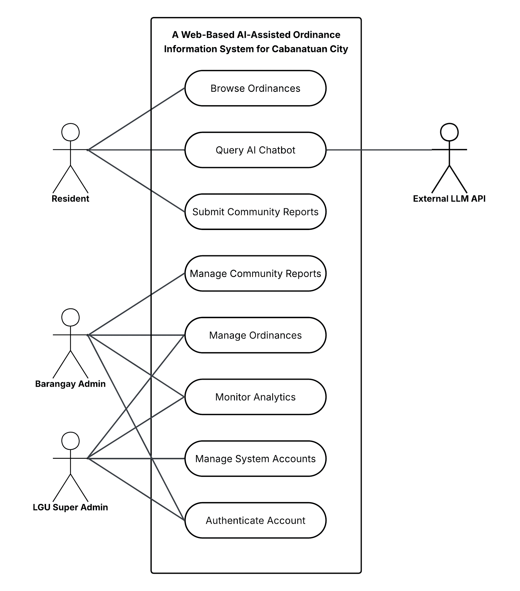

*[Figure/image placeholder: see linked image above if available]*
The Use Case Diagram defines four primary actors interacting with the system: the Citizen, the Barangay Official, the LGU Administrator, and the External AI Service powered by the Google Gemini API.
The Citizen actor accesses public system capabilities without mandatory authentication. These use cases include browsing ordinances, searching ordinances by keywords and resolution numbers, filtering enactments by category and year, viewing ordinance details, opening official PDF documents, querying the AI chatbot, and submitting community reports. The query AI chatbot use case incorporates an include relationship to the external AI service for language model inference. When filing an incident report, citizens may optionally attach photographic evidence and designate the report as anonymous.
The Barangay Official actor authenticates into the system through the authenticate account use case. Once authenticated, the official accesses functions within their specific barangay scope, including managing barangay ordinances through upload, editing, and submission for municipal review, reviewing assigned community reports, updating report resolution statuses, and monitoring localized barangay analytics.
The LGU Administrator actor exercises city-wide administrative authority. In addition to standard authentication, the LGU administrator interacts with governance use cases: managing city ordinances, extracting ordinance metadata via multimodal AI, reviewing barangay ordinance submissions with approval or rejection remarks, managing city-wide community reports, broadcasting civic news and advisories, managing barangay administrative accounts, and monitoring executive governance analytics.

### Context Diagram (Level 0 Data Flow Diagram)
Figure 15 presents the Context Diagram (Level 0 DFD), defining the overall operational context and functional boundary of the platform as a single central process interacting with external entities.
Figure 15 Context Diagram (Level 0 DFD) of the Cabanatuan City Ordinance Portal
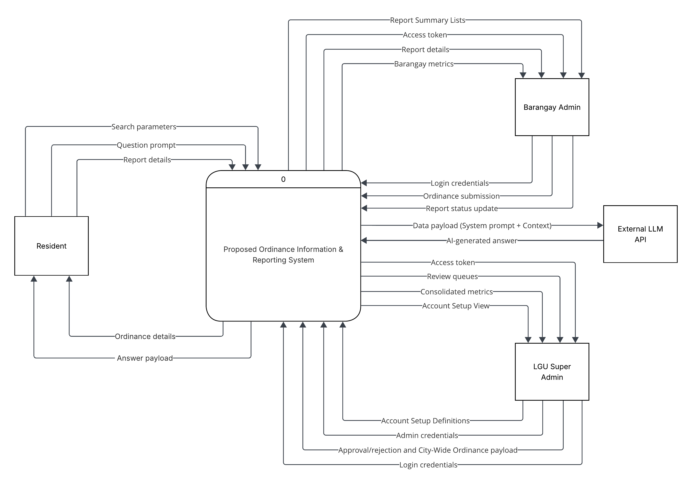

*[Figure/image placeholder: see linked image above if available]*
The Context Diagram illustrates Process 0.0, the Cabanatuan City Ordinance Information System, serving as the central processing hub interacting with four external entities.
The Citizen entity provides search inputs, filtering criteria, conversational questions, and incident violation reports with optional photo uploads and contact details. In return, the citizen receives ordinance search results, full statutory text, streaming PDF documents, real-time AI conversational answers with citations, and submission confirmation alerts.
The Barangay Official entity submits administrative login credentials, localized barangay ordinance drafts, and incident report status updates. The entity receives authenticated session access, scoped barangay ordinance records, forwarded community reports, and localized performance summaries.
The LGU Administrator entity transmits city ordinance texts, scanned document uploads for OCR processing, ordinance review decisions with formal feedback, public news advisories, and barangay account creation parameters. In return, the LGU administrator receives city-wide administrative records, AI-extracted metadata previews, consolidated incident logs, audit trails, and executive governance analytics.
The Google Gemini AI Service entity receives structured ordinance context passages paired with citizen prompts for RAG chat generation, as well as binary file data for multimodal OCR processing. The service returns streaming text tokens for civic inquiries and structured JSON objects containing extracted legislative metadata.

### Level 1 Data Flow Diagram
Figure 16 shows the Level 1 Data Flow Diagram, decomposing the central system into its eight major functional processes and identifying their interactions with persistent database stores.
Figure 16 Level 1 Data Flow Diagram (DFD) of the Cabanatuan City Ordinance Portal
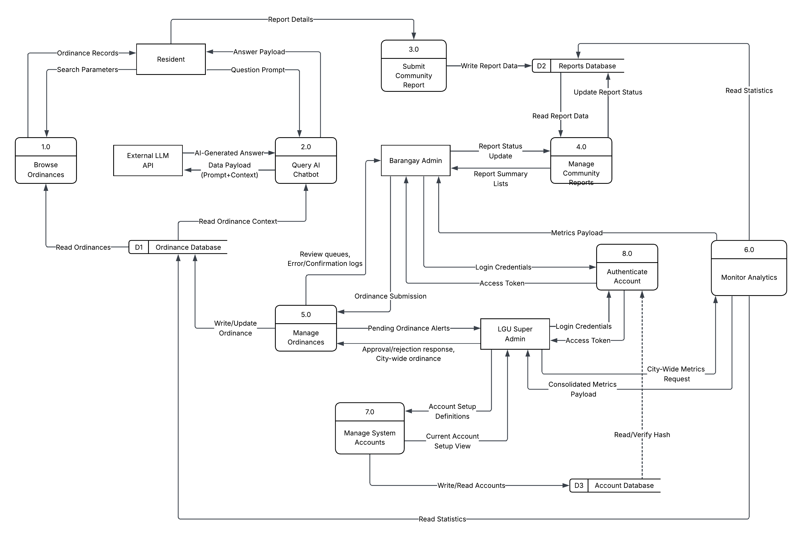

*[Figure/image placeholder: see linked image above if available]*
The Level 1 Data Flow Diagram separates information processing into eight major operational processes that interact with six persistent data stores. Process 1.0, Browse Ordinances, receives keyword queries, year intervals, and category parameters from citizens, querying the ordinances data store D3 and barangays data store D2 to return matched records and streaming PDF documents. Process 2.0, Query AI Chatbot, processes conversational queries entered by users, extracts semantic keywords, retrieves relevant ordinance passages from D3, packages the context into a prompt payload sent to the external Google Gemini API, logs dialogue exchanges into the chat sessions data store D6, and streams answers back to the user interface. Process 3.0, Submit Community Report, receives incident classifications, narrative descriptions, photographic attachments, and location details from citizens, validates participating barangay jurisdiction against D2, writes new report records into the reports data store D4, and stores image binaries in local server storage. Process 4.0, Manage Community Reports, enables barangay officials and LGU administrators to inspect submitted incidents, update resolution stages from new to in progress, resolved, or dismissed, and log official actions within D4. Process 5.0, Manage Ordinances, handles the full legislative lifecycle, allowing barangay and LGU officials to create, update, and upload ordinance documents, dispatching scanned files to the AI extractor and writing approved ordinances and metadata to D3. Process 6.0, Monitor Analytics, aggregates quantitative data across D3 and D4, computing statistical summaries rendered on administrative dashboards. Process 7.0, Manage System Accounts, allows LGU administrators to register, configure, and maintain administrative accounts for barangay personnel within the users data store D1. Process 8.0, Authenticate Account, validates user credentials against D1 using cryptographic password verification, issuing secure HTTP-only session cookies and managing role-based redirection.

### Level 2 Data Flow Diagrams
To specify the internal mechanics of each major process, the researchers constructed Level 2 Data Flow Diagrams for processes 1.0 through 8.0.

### Process 1.0: Browse Ordinances
Figure 17 presents the Level 2 DFD for Process 1.0 (Browse Ordinances), detailing how search criteria and document requests are handled.
Figure 17 Level 2 Data Flow Diagram for Process 1.0 (Browse Ordinances)
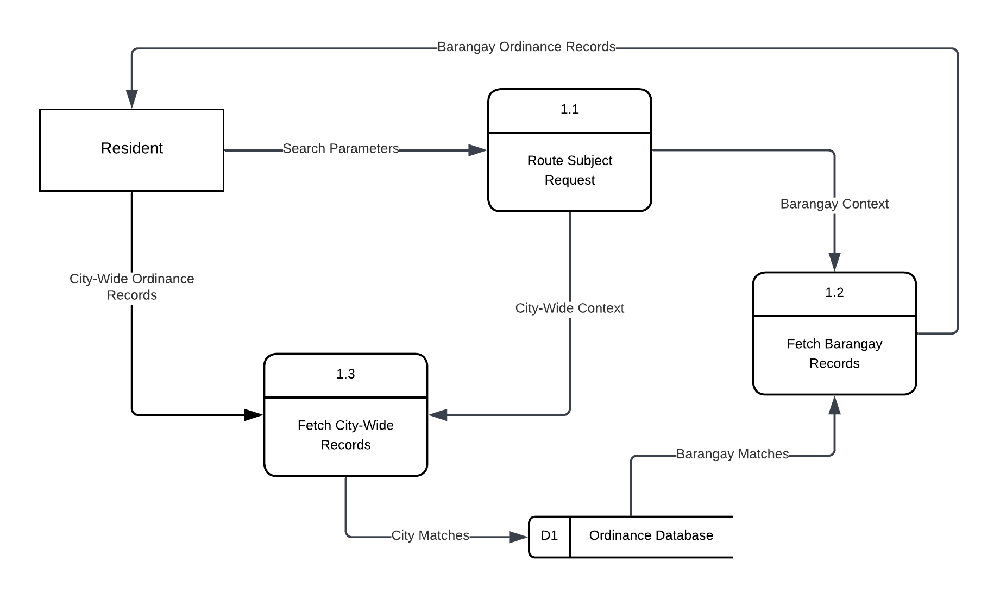

*[Figure/image placeholder: see linked image above if available]*
Process 1.0 is partitioned into three subprocesses that handle incoming citizen discovery requests. Subprocess 1.1, the Filter and Search Query Processor, parses incoming search strings, category tags, and temporal ranges, executing SQL matching queries against the ordinances data store D3. Subprocess 1.2, the Ordinance Record Fetcher, retrieves matching records, joins corresponding barangay jurisdictional names from data store D2, and structures the preview card dataset for client presentation. Subprocess 1.3, the Document and PDF Renderer, handles requests for specific ordinances, serving full article texts and streaming signed PDF documents from local disk storage to the viewer modal.

### Process 2.0: Query AI Chatbot
Figure 18 illustrates the Level 2 DFD for Process 2.0 (Query AI Chatbot), illustrating the Retrieval-Augmented Generation (RAG) pipeline.
Figure 18 Level 2 Data Flow Diagram for Process 2.0 (Query AI Chatbot)
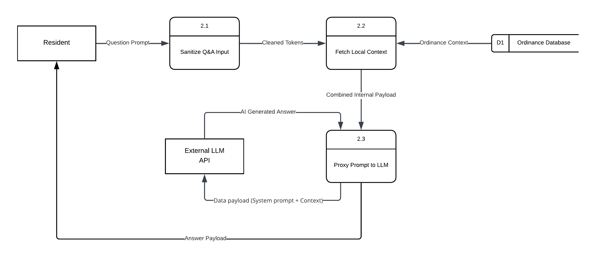

*[Figure/image placeholder: see linked image above if available]*
Process 2.0 operates through four sequential subprocesses to deliver context-grounded conversational answers. Subprocess 2.1, the Query Preprocessor, receives natural language prompts in Tagalog, English, or Taglish, cleans special characters, and extracts search keywords. Subprocess 2.2, the Context Retriever, queries data store D3 to identify matching ordinance titles, sections, and penalty provisions. Subprocess 2.3, the Prompt Assembler and API Client, injects the retrieved statutory excerpts into a structured system prompt containing legal disclaimers and transmits the request payload to the external Google Gemini API. Subprocess 2.4, the Response Streamer and Logger, streams generated answer tokens back to the client interface while logging dialogue records into the chat sessions data store D6.

### Process 3.0: Submit Community Report
Figure 19 presents the Level 2 DFD for Process 3.0 (Submit Community Report), describing the citizen incident intake workflow.
Figure 19 Level 2 Data Flow Diagram for Process 3.0 (Submit Community Report)
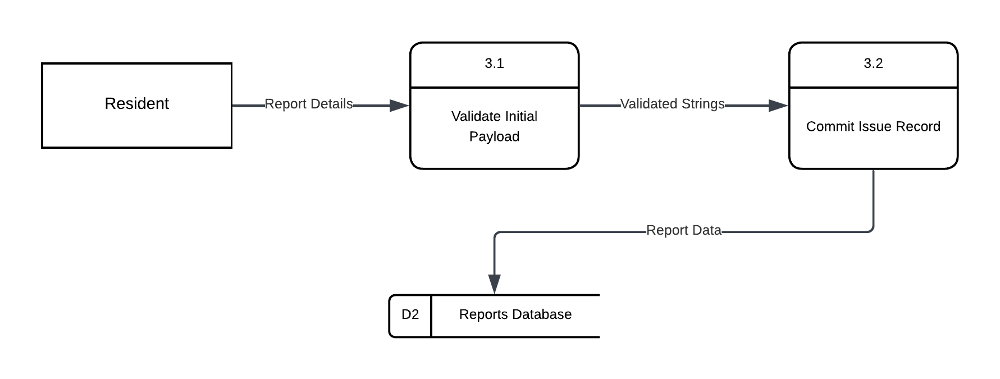

*[Figure/image placeholder: see linked image above if available]*
Process 3.0 comprises three subprocesses that manage the submission of community concerns. Subprocess 3.1, Form Validation and Sanitization, verifies that mandatory fields, including violation type, incident description, and barangay jurisdiction, are present and properly formatted. Subprocess 3.2, Attachment and Media Handler, inspects uploaded photo files, validates file type constraints, and writes binary assets to disk. Subprocess 3.3, Report Record Creator, creates the incident record in the reports data store D4 with an initial status of new and returns a reference confirmation banner to the reporting citizen.

### Process 4.0: Manage Community Reports
Figure 20 presents the Level 2 DFD for Process 4.0 (Manage Community Reports), modeling administrative incident review.
Figure 20 Level 2 Data Flow Diagram for Process 4.0 (Manage Community Reports)
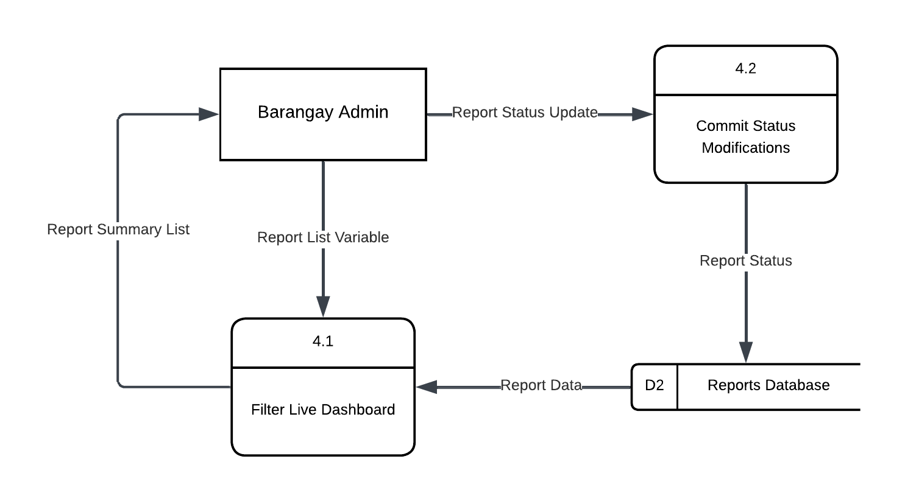

*[Figure/image placeholder: see linked image above if available]*
Process 4.0 is divided into three subprocesses that facilitate administrative review. Subprocess 4.1, Scoped Report Filter, fetches reports from data store D4 based on the authenticated official's role, filtering by barangay identifier for captains while allowing global visibility for LGU administrators. Subprocess 4.2, Incident Investigation Viewer, displays narrative details, contact data, and evidence photos. Subprocess 4.3, Status and Resolution Updater, records status transitions from new to in progress, resolved, or dismissed, and updates resolution timestamps in D4.

### Process 5.0: Manage Ordinances
Figure 21 depicts the Level 2 DFD for Process 5.0 (Manage Ordinances), representing ordinance authoring, AI parsing, and approval.
Figure 21 Level 2 Data Flow Diagram for Process 5.0 (Manage Ordinances)
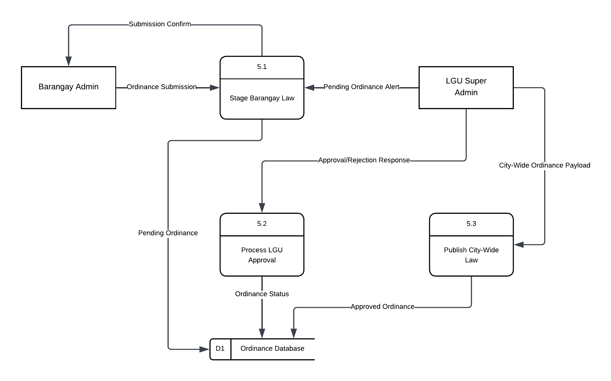

*[Figure/image placeholder: see linked image above if available]*
Process 5.0 incorporates four subprocesses that govern the legislative lifecycle. Subprocess 5.1, Ordinance Document Uploader, manages the ingestion of PDF and image attachments. Subprocess 5.2, AI Multimodal OCR Extractor, dispatches uploaded documents to the Gemini 3.5 Flash Lite vision endpoint, extracting resolution numbers, series years, titles, coverage, and penalties. Subprocess 5.3, Verification and Drafting Editor, allows administrators to inspect and refine extracted metadata. Subprocess 5.4, Ordinance Publication and Review Workflow, manages status changes across draft, pending, approved, and rejected states, and records reviewer identifiers and timestamps in data store D3.

### Process 6.0: Monitor Analytics
Figure 22 shows the Level 2 DFD for Process 6.0 (Monitor Analytics), describing administrative metric aggregation.
Figure 22 Level 2 Data Flow Diagram for Process 6.0 (Monitor Analytics)
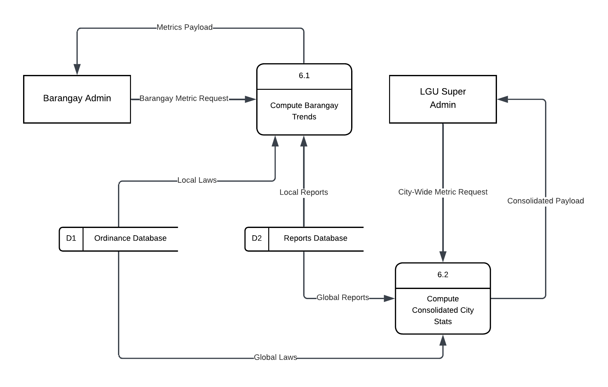

*[Figure/image placeholder: see linked image above if available]*
Process 6.0 functions through three subprocesses that calculate governance statistics. Subprocess 6.1, Legislative Metric Aggregator, queries data store D3 to compute total enactments, publication statuses, category distributions, and enactment timelines. Subprocess 6.2, Civic Incident Aggregator, queries data store D4 to calculate total complaints, pending cases, resolution velocities, and barangay violation frequencies. Subprocess 6.3, Dashboard Visualization Generator, compiles metric payloads into structured datasets consumed by graphical chart components on administrative views.

### Process 7.0: Manage System Accounts
Figure 23 presents the Level 2 DFD for Process 7.0 (Manage System Accounts), detailing administrative user administration.
Figure 23 Level 2 Data Flow Diagram for Process 7.0 (Manage System Accounts)
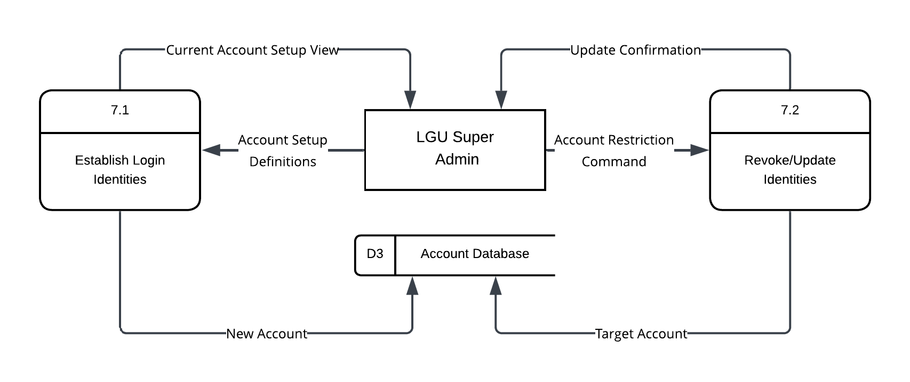

*[Figure/image placeholder: see linked image above if available]*
Process 7.0 operates through three subprocesses to provision accounts securely. Subprocess 7.1, Account Parameter Validator, checks email formats, password complexity, and uniqueness. Subprocess 7.2, Credential Hasher and Provisioner, hashes plaintext passwords using salted Bcrypt and binds the user record to a specific barangay identifier in data store D1. Subprocess 7.3, User Directory Manager, renders the user directory, handles account status modifications, and writes audit records into D1.

### Process 8.0: Authenticate Account
Figure 24 presents the Level 2 DFD for Process 8.0 (Authenticate Account), modeling the authentication and session verification lifecycle.
Figure 24 Level 2 Data Flow Diagram for Process 8.0 (Authenticate Account)
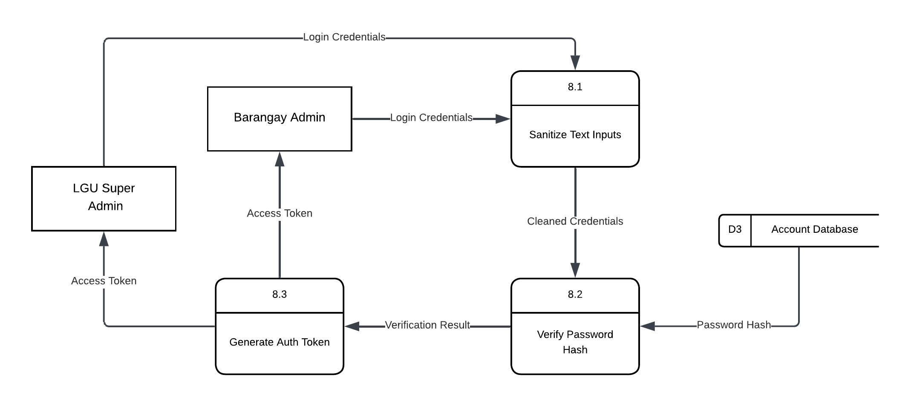

*[Figure/image placeholder: see linked image above if available]*
Process 8.0 comprises three subprocesses that manage access control. Subprocess 8.1, Credential Receiver and Verifier, accepts email and password submissions and compares password hashes against records in D1. Subprocess 8.2, Session and Token Generator, creates secure, encrypted HTTP-only session cookies upon verification. Subprocess 8.3, Access Controller and Route Dispatcher, inspects session roles and routes users to their authorized administrative dashboards, ensuring that barangay captains and LGU administrators access only permitted interfaces.

### Entity Relationship Diagram (ERD)
The Entity Relationship Diagram (ERD) shown in Figure 25 was developed to represent the data entities of the Web-Based AI-Assisted Ordinance Information System (Cabanatuan City Ordinance Portal) and the relationships established among them within the relational database. The design included six primary entities corresponding to the implemented database schema and Data Dictionary: users, barangays, ordinances, reports, news items (news_items), and chat sessions (chat_sessions). Primary and foreign keys were used to establish the relationships necessary to support account authentication, role-based access control (RBAC: CITIZEN, BARANGAY_ADMIN, and LGU_ADMIN), geopolitical barangay jurisdiction routing, legislative ordinance drafting and Sanggunian resolution lifecycle management (DRAFT, PENDING, APPROVED, and REJECTED), multi-page scanned legal PDF document archiving, AI OCR document parsing, citizen community violation complaint submission and administrative triage, civic news and public advisory broadcasting, and bilingual (Tagalog/English) AI ordinance consultation powered by Google Gemini via Retrieval-Augmented Generation (RAG). The ordinances entity served as the principal transactional and repository record for legislative operations. It maintained the official title, resolution number, ordinance classification label, legislative series year, jurisdiction scope (BARANGAY or CITY), statutory lifecycle status (DRAFT, PENDING, APPROVED, or REJECTED), full statutory transcript, structured article breakdown, prescribed penal sanctions, signatories, official scanned PDF file path, enactment date, calendar year, coverage boundary, and designated implementing enforcement agencies. Curated semantic keywords used for weighted heuristic retrieval in the RAG search pipeline were stored directly within the structured tags JSON attribute. The entity's relationships enforce rigorous administrative accountability through two foreign keys referencing the users entity: submitted_by_id identifies the local official who authored or encoded the enactment, while reviewed_by_id identifies the LGU administrator responsible for statutory review, approval, or formal rejection (with corresponding administrative feedback recorded in rejected_reason). The ordinances entity is also linked to barangays via barangay_id, which designates the enacting local barangay council for localized ordinances or remains null for city-wide statutes that apply across all 89 barangays of Cabanatuan City. The barangays entity maintained one-to-many relationships with users, ordinances, and reports, establishing the geopolitical foundation of the portal. It links to users to delineate administrative jurisdiction for Barangay Administrators and residence for registered citizens, to ordinances to organize localized legislative archives, and to reports to direct community violation tickets directly to the concerned barangay hall. The reports entity enabled residents to lodge localized violation complaints across defined categories (TRASH_BURNING, NOISE, ROAD_OBSTRUCTION, and OTHER) with uploaded photographic evidence and optional contact verification (contact_name and contact_phone); it incorporates an is_anonymous boolean flag to safeguard citizen whistleblower privacy by permitting unauthenticated or anonymized submissions while retaining administrative status triage (NEW, IN_PROGRESS, RESOLVED, and DISMISSED). The chat sessions entity captured the multi-turn conversational interactions between citizens and the AI legal assistant, storing dialogue turns (user queries and AI-grounded responses) as structured JSON in the messages attribute; it maintained a nullable foreign key to users (user_id), allowing unauthenticated guest citizens to consult local ordinances with zero onboarding friction while permitting registered users to retain multi-turn dialogue histories. Finally, the news items entity disseminated public advisories categorized by territorial scope (CITY or BARANGAY) with pinning capabilities (is_pinned). Overall, the ERD established the structural organization of the principal records required by the Cabanatuan City Ordinance Portal. It provided the basis for implementing relationships among system data while supporting referential consistency, cascade constraints, and reducing unnecessary duplication. The logical data structure was further analyzed and validated through the database normalization process from Unnormalized Form to Third Normal Form.
Figure 25 Entity Relationship Diagram (ERD) of the Cabanatuan City Ordinance Portal Database
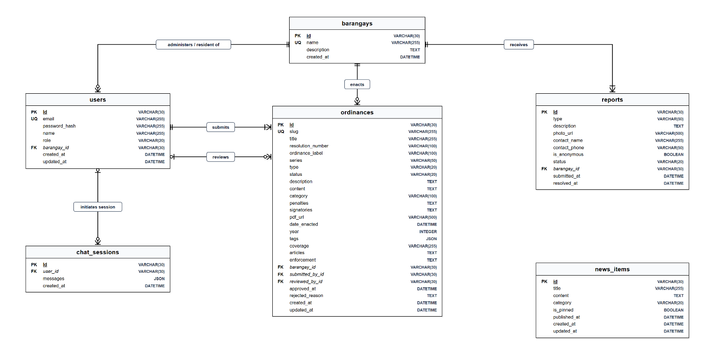

*[Figure/image placeholder: see linked image above if available]*

### Database Normalization
Following the conceptual and logical schema defined in the Entity Relationship Diagram (Figure 25), database normalization was performed to organize the logical data structure of the Web-Based AI-Assisted Ordinance Information System (Cabanatuan City Ordinance Portal), reduce unnecessary data redundancy, and establish appropriate dependencies among related civic and legal data elements. The normalization process documented the progressive refinement of the database structure from Unnormalized Form (UNF) to First Normal Form (1NF), Second Normal Form (2NF), and Third Normal Form (3NF).
The UNF (Figure 26) represented the initial broad data structure in which related and repeating governance information—such as user credentials, administrative role privileges, barangay geopolitical jurisdictions, legislative ordinance records, statutory articles, penalty clauses, uploaded scanned PDF copies, semantic tags, citizen community reports, civic news announcements, AI chat consultation sessions, conversational dialogue messages, and system parameters—had not yet been separated into normalized relations. During 1NF (Figure 27), repeating groups were eliminated, data elements were organized into atomic values, and each relation was given a primary key, utilizing composite primary keys for child relations such as ordinance tags and chat messages. The 2NF stage (Figure 28) removed partial functional dependencies: individual chat messages and ordinance tags were keyed by their own dedicated identifiers, citizen community reports and civic news bulletins were decoupled into independent relations, and user authentication records and barangay profiles were separated from legislative transaction tables. In 3NF (Figure 29), remaining transitive dependencies were eliminated by removing redundant descriptive attributes (such as barangay names, user names, and reviewer titles) that depended on referenced foreign keys rather than on the primary key, producing fully normalized relations. In theoretical relational modeling, multi-valued repeating groups (such as keywords and dialogue turns) are decomposed into dedicated relations (ordinance_tags and chat_messages). In the physical production deployment, these child relations are efficiently serialized into native structured JSON attributes (tags in ordinances and messages in chat_sessions) within the six core physical entities (users, barangays, ordinances, reports, news_items, and chat_sessions), optimizing RAG vector retrieval performance and conversational streaming latency without compromising referential integrity. Contact details in community reports were intentionally retained within the reports relation to support optional citizen anonymity while preserving contact verification without enforcing mandatory user account registration.
The resulting normalized structure provided a dependable basis for maintaining related records, eliminating data anomalies (insertion, update, and deletion anomalies), and ensuring high transaction throughput across the web portal and the Retrieval-Augmented Generation (RAG) AI assistant. The normalized relations subsequently served as the basis for the Data Dictionary, which documented the field-level structure of the database.
**Figure 26**
Unnormalized Form of the Cabanatuan City Ordinance Portal Database Structure
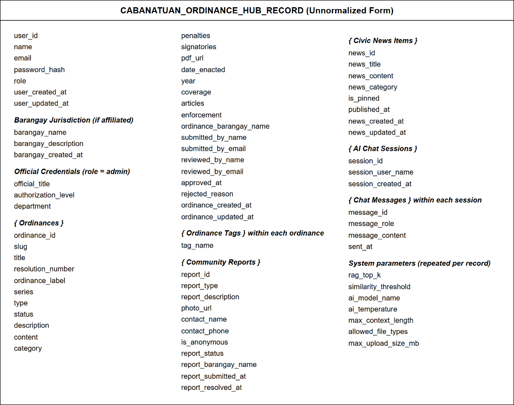

*[Figure/image placeholder: see linked image above if available]*
**Figure 27**
First Normal Form (1NF) of the Cabanatuan City Ordinance Portal Database Structure
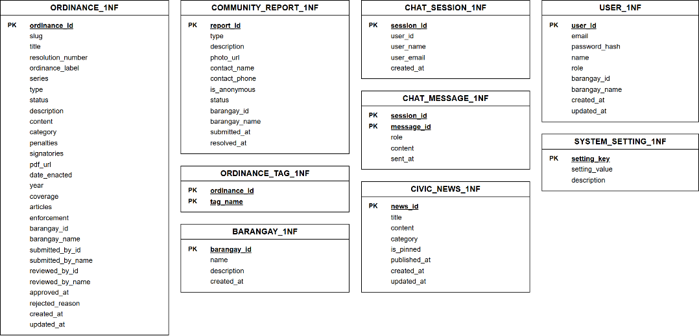

*[Figure/image placeholder: see linked image above if available]*
**Figure 28**
Second Normal Form (2NF) of the Cabanatuan City Ordinance Portal Database Structure
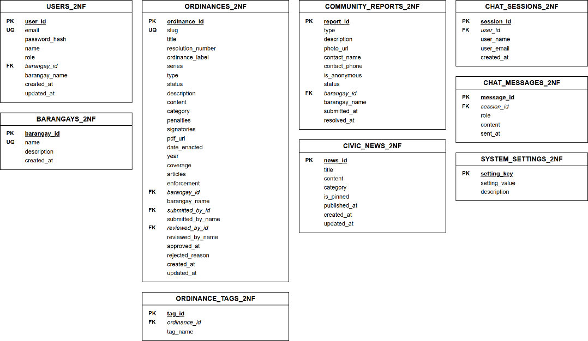

*[Figure/image placeholder: see linked image above if available]*
**Figure 29**
Third Normal Form (3NF) of the Cabanatuan City Ordinance Portal Database Structure
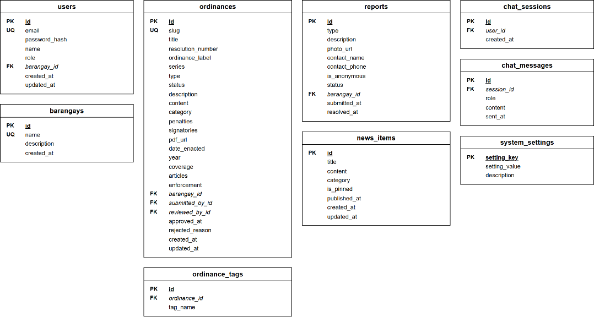

*[Figure/image placeholder: see linked image above if available]*

### Data Dictionary
The database structure is documented in Tables 13 through 18, detailing field names, SQL data types, storage lengths, key constraints, nullability, default values, and operational descriptions.
**Table 13.**
Data Dictionary for Table users

| Field Name | Data Type | Length | Key | Null | Default | Description |
|---|---|---|---|---|---|---|
| id | VARCHAR | 30 | PK | No | cuid() | Unique identifier for the user account generated via CUID. |
| email | VARCHAR | 255 | UK | No | — | Unique institutional or personal email address used as login credential. |
| password_hash | VARCHAR | 255 | — | No | — | Salted and hashed password string (Bcrypt) for secure authentication. |
| name | VARCHAR | 255 | — | No | — | Full legal name of the user or government official. |
| role | VARCHAR | 20 | — | No | CITIZEN | System access role controlling portal permissions (CITIZEN, BARANGAY_ADMIN, LGU_ADMIN). |
| barangay_id | VARCHAR | 30 | FK | Yes | NULL | References barangays.id of user's resident or administrative barangay (set NULL on delete). |
| created_at | DATETIME | — | — | No | CURRENT_TIMESTAMP | Timestamp indicating when the user account was registered. |
| updated_at | DATETIME | — | — | No | CURRENT_TIMESTAMP | Timestamp indicating when the user record was last modified. |

**Table 14.**
Data Dictionary for Table barangays

| Field Name | Data Type | Length | Key | Null | Default | Description |
|---|---|---|---|---|---|---|
| id | VARCHAR | 30 | PK | No | cuid() | Unique identifier of the barangay record generated via CUID. |
| name | VARCHAR | 255 | UK | No | — | Official unique name of the barangay within Cabanatuan City. |
| description | TEXT | — | — | Yes | NULL | Administrative background, contact notes, or participation status in the portal. |
| created_at | DATETIME | — | — | No | CURRENT_TIMESTAMP | Timestamp indicating when the barangay was registered in the portal. |

**Table 15.**
Data Dictionary for Table ordinances

| Field Name | Data Type | Length | Key | Null | Default | Description |
|---|---|---|---|---|---|---|
| id | VARCHAR | 30 | PK | No | cuid() | Unique identifier of the ordinance record generated via CUID. |
| slug | VARCHAR | 255 | UK | No | — | URL-friendly unique slug generated from resolution number and title for routing. |
| title | VARCHAR | 255 | — | No | — | Official title or short title of the ordinance or legislative enactment. |
| resolution_number | VARCHAR | 100 | — | No | — | Official legislative resolution number or ordinance number assigned by the Sanggunian. |
| ordinance_label | VARCHAR | 100 | — | Yes | NULL | Classification prefix or formal designation label (e.g., "City Ordinance", "Barangay Ordinance"). |
| series | VARCHAR | 50 | — | Yes | NULL | Legislative series year designation (e.g., "Series of 2024"). |
| type | VARCHAR | 20 | — | No | BARANGAY | Legislative jurisdiction level (BARANGAY or CITY). |
| status | VARCHAR | 20 | — | No | DRAFT | Workflow publication state (DRAFT, PENDING, APPROVED, REJECTED). |
| description | TEXT | — | — | Yes | NULL | Summary, explanatory note, or executive abstract of the ordinance. |
| content | TEXT | — | — | Yes | NULL | Full text transcript and statutory clauses of the ordinance. |
| category | VARCHAR | 100 | — | Yes | General | Policy domain classification (e.g., Peace & Order, Health, Traffic, Environment, General). |
| penalties | TEXT | — | — | Yes | NULL | Detailed sanctions, fines, and penalties prescribed for ordinance violations. |
| signatories | TEXT | — | — | Yes | NULL | Names and designations of sponsoring councilors, presiding officers, or approving executives. |
| pdf_url | VARCHAR | 500 | — | Yes | NULL | File storage path or URL to the scanned, signed official PDF copy. |
| date_enacted | DATETIME | — | — | Yes | NULL | Official calendar date when the ordinance was enacted into law. |
| year | INTEGER | 4 | — | Yes | NULL | Calendar year of enactment extracted for temporal range filtering. |
| tags | JSON | — | — | No | [] | JSON array of semantic keywords and index tags for search and AI query retrieval. |
| coverage | VARCHAR | 255 | — | Yes | NULL | Geographic or territorial scope covered by the ordinance provisions. |
| articles | TEXT | — | — | Yes | NULL | Structured article and section breakdown parsed from the original document. |
| enforcement | TEXT | — | — | Yes | NULL | Designated implementing agencies and enforcement protocols (e.g., PNP, POSO, Barangay Tanod). |
| barangay_id | VARCHAR | 30 | FK | Yes | NULL | References barangays.id for localized barangay ordinances (NULL for city-wide laws). |
| submitted_by_id | VARCHAR | 30 | FK | No | — | References users.id of the official who drafted or encoded the ordinance submission. |
| reviewed_by_id | VARCHAR | 30 | FK | Yes | NULL | References users.id of the administrator who reviewed the submission. |
| approved_at | DATETIME | — | — | Yes | NULL | Timestamp when the ordinance was formally approved by the reviewer. |
| rejected_reason | TEXT | — | — | Yes | NULL | Administrative comments and reasons provided if the submission was rejected. |
| created_at | DATETIME | — | — | No | CURRENT_TIMESTAMP | Timestamp indicating when the ordinance draft or record was created. |
| updated_at | DATETIME | — | — | No | CURRENT_TIMESTAMP | Timestamp indicating when the ordinance record was last modified. |
|  |  |  |  |  |  |  |

**Table 16.**
Data Dictionary for Table reports

| Field Name | Data Type | Length | Key | Null | Default | Description |
|---|---|---|---|---|---|---|
| id | VARCHAR | 30 | PK | No | cuid() | Unique identifier of the citizen incident report generated via CUID. |
| type | VARCHAR | 50 | — | No | — | Classification of reported violation (TRASH_BURNING, NOISE, ROAD_OBSTRUCTION, OTHER). |
| description | TEXT | — | — | No | — | Detailed factual narrative describing the incident, location, and observed violation. |
| photo_url | VARCHAR | 500 | — | Yes | NULL | Storage path or URL of uploaded photographic evidence documenting the incident. |
| contact_name | VARCHAR | 255 | — | Yes | NULL | Full name of reporting citizen (omitted or NULL if submitted anonymously). |
| contact_phone | VARCHAR | 50 | — | Yes | NULL | Contact mobile number of reporting citizen for status updates and verification. |
| is_anonymous | BOOLEAN | 1 | — | No | false | Flag indicating whether citizen submitted without disclosing identity. |
| status | VARCHAR | 20 | — | No | NEW | Investigation lifecycle status (NEW, IN_PROGRESS, RESOLVED, DISMISSED). |
| barangay_id | VARCHAR | 30 | FK | No | — | References barangays.id identifying local jurisdiction where incident occurred. |
| submitted_at | DATETIME | — | — | No | CURRENT_TIMESTAMP | Timestamp when incident report was submitted by citizen. |
| resolved_at | DATETIME | — | — | Yes | NULL | Timestamp when incident report was marked as resolved or dismissed. |

**Table 17.**
Data Dictionary for Table news_items

| Field Name | Data Type | Length | Key | Null | Default | Description |
|---|---|---|---|---|---|---|
| id | VARCHAR | 30 | PK | No | cuid() | Unique identifier of civic announcement generated via CUID. |
| title | VARCHAR | 255 | — | No | — | Headline or title of public news advisory or legislative bulletin. |
| content | TEXT | — | — | No | — | Full body text or Markdown-formatted content of announcement. |
| category | VARCHAR | 20 | — | No | CITY | Geographic scope of announcement (CITY for city-wide or BARANGAY for local jurisdiction). |
| is_pinned | BOOLEAN | 1 | — | No | false | Flag indicating whether news item is pinned to the top of notice boards. |
| published_at | DATETIME | — | — | No | CURRENT_TIMESTAMP | Official date and time when news announcement was released to the public. |
| created_at | DATETIME | — | — | No | CURRENT_TIMESTAMP | Timestamp indicating when announcement record was created. |
| updated_at | DATETIME | — | — | No | CURRENT_TIMESTAMP | Timestamp indicating when announcement record was last modified. |

**Table 18.**
Data Dictionary for Table chat_sessions

| Field Name | Data Type | Length | Key | Null | Default | Description |
|---|---|---|---|---|---|---|
| id | VARCHAR | 30 | PK | No | cuid() | Unique identifier of AI chatbot consultation session generated via CUID. |
| user_id | VARCHAR | 30 | FK | Yes | NULL | References users.id if user was authenticated (NULL for public guest visitors). |
| messages | JSON | — | — | No | [] | Serialized JSON array of structured message turns (role, content, citations, timestamps). |
| created_at | DATETIME | — | — | No | CURRENT_TIMESTAMP | Timestamp indicating when chat session was initiated. |

### 1.3 Development and Implementation
The development and implementation phase translated the system requirements, architectural designs, and relational schemas into working software. Development activities were organized into iterative sprint cycles following the Agile SDLC.

### Technical Implementation Stack
The system was constructed using modern web engineering technologies chosen for performance, accessibility, security, and low operational overhead. At the application core, the platform was developed using Next.js 16 within the App Router paradigm, leveraging React 19 Server Components and Server Actions alongside Turbopack for rapid compilation and optimized bundle generation. Strict static type safety was maintained throughout the codebase using TypeScript 5, which verified data contracts across user interface components, server actions, route handlers, and database models.
Frontend styling and interface components were built using Tailwind CSS v4 paired with Class Variance Authority, Lucide React iconography, and accessible user interface primitives derived from Radix UI. Toast notifications were handled via Sonner. The interface accommodates system accessibility requirements by supporting dynamic font scaling, high-contrast light and dark themes, and comprehensive keyboard navigation pathways.
Data persistence was implemented using Prisma ORM 7 coupled with an embedded SQLite 3 database engine configured in Write-Ahead Logging mode via the Better-SQLite3 adapter. This local relational architecture delivered sub-20-millisecond query execution speeds without requiring expensive cloud database infrastructure or remote network hops. File and document uploads were stored directly on the local server file system within dedicated directories, served through an HTTP Range streaming route that enables rapid document rendering without external third-party storage latency.
Artificial intelligence capabilities were integrated using Google Gemini 3.5 Flash Lite accessed through the official Google Gen AI SDK. This multimodal engine powered the bilingual conversational assistant through Retrieval-Augmented Generation and executed automated metadata extraction from scanned municipal documents. Administrative data visualizations were rendered using Recharts 3 paired with NumberFlow animated metrics, while client-side interaction state and chat session persistence were managed through Zustand 5.

### Core Functional Modules Developed
The completed web platform integrates six major functional modules designed to support public transparency, civic assistance, administrative workflows, and inter-agency coordination.

### Public Ordinance Explorer and Viewer
The public discovery module provides full-text and keyword search capabilities across hundreds of city and barangay ordinances. Search queries match against resolution numbers, enactment titles, policy categories, summaries, and keyword tags. Users can filter enactments by year range (dynamically derived from database boundaries with a 2015 to 2026 fallback) and policy categories such as Peace and Order, Health and Sanitation, Business and Trade, and Environmental Protection. When viewing an ordinance, the system renders a interface displaying structured statutory articles on the left and the official scanned PDF copy on the right via an accessible modal viewer complete with zoom, pagination, and download controls. High-contrast light and dark themes are supported and persisted in local storage.

### Civic AI Assistant and Bilingual Inquiry Engine
The conversational assistant provides citizens with plain-language explanations of complex municipal regulations in Tagalog, English, or Taglish. The module implements a Retrieval-Augmented Generation (RAG) pipeline: when a user inputs a query, the backend server action executes a semantic search against the local Prisma database to retrieve relevant ordinance excerpts, section definitions, and penalty clauses. These retrieved legal passages are injected into a prompt payload sent to Google Gemini 3.5 Flash Lite. The assistant returns a streaming response citing exact Resolution Numbers, enactment years, and statutory provisions. The system incorporates strict prompt guardrails: when an inquiry falls outside municipal ordinances, the assistant provides a polite, non-legal disclaimer and redirects the user to official city personnel. Multi-turn chat history persists in browser local storage and can be cleared by the user at any time.

### Multimodal OCR Ordinance Parser and Digitization Engine
To streamline the digitization of physical municipal archives, the platform incorporates an automated document extraction engine. Administrators can upload digital PDFs, multi-page scanned PDF documents, or sequential image scans (PNG, JPG, WEBP). The file binary is transmitted to Gemini 3.5 Flash Lite Multimodal Vision, which reads stamped, watermarked, or signed legal texts and extracts structured metadata: official resolution number, series year, date enacted, standardized ordinance title, policy category, executive summary, geographic coverage, enforcement bodies, structured articles, and penalty provisions. The extracted data populates an interactive pre-publication review modal where the administrator can review and edit values before saving to the database, reducing manual document entry time by approximately 85 percent.

### Citizen Incident and Concern Reporting Subsystem
The incident reporting workflow enables residents to submit community concerns, ordinance violations, and public service requests directly to barangay and city officials. The module features an accessible multi-step form with client-side validation, supporting image uploads (up to 5 megabytes), barangay selection from the official list of 89 Cabanatuan barangays, specific category classification, and GPS coordinate capture or manual landmark specification. Upon submission, the system generates a unique alphanumeric tracking code (e.g., REP-2026-XXXX). Residents can check ticket status, review administrative responses, and observe resolution milestones on the public tracking page (/report/track) without requiring user account registration, thereby safeguarding informant anonymity and encouraging civic engagement.

### Barangay Captain Administration Portal
Designed specifically for local barangay leadership, this module provides localized administrative tools for managing barangay-level governance. Barangay officials can view, review, and act upon citizen incident reports originating within their territorial jurisdiction, updating report statuses from Pending to Under Review, In Progress, Resolved, or Dismissed, and appending official remarks. Officials can also draft, upload, and publish barangay-specific ordinances, manage local community news announcements and review localized dashboard analytics summarizing incident frequencies, ordinance compliance rates, and community concerns.

### City LGU Administrator Governance Portal
The executive governance portal provides city-wide administrative control to the Sangguniang Panlungsod Secretariat and authorized City LGU officers. Administrators can oversee city-wide ordinance lifecycles, publish new municipal legislation, configure automated AI parsing parameters, review system-wide audit logs, manage user accounts and role assignments (assigning Super Admin, LGU Admin, Barangay Admin, or Staff permissions), and inspect city-level data analytics visualizations depicting ordinance distribution, reporting trends across all barangays, and citizen engagement statistics.

### Agile Schedule and Implementation Timeline
The first statement of the problem sought to determine how the Web-Based AI-Assisted Ordinance Information System for Cabanatuan City could be designed and developed using the Agile Software Development Life Cycle (SDLC). The development schedule covers planning and requirements gathering, system design, iterative development, testing, system evaluation, and final system enhancements. The Agile approach supports incremental development of the system's modules, including ordinance management, AI-assisted ordinance document parsing, an AI-assisted chatbot using Retrieval-Augmented Generation (RAG), resident reporting, barangay administration, LGU oversight, and analytics.
Figure 30 Gantt Chart of the Agile SDLC Activities for the Web-Based AI-Assisted Ordinance Information System
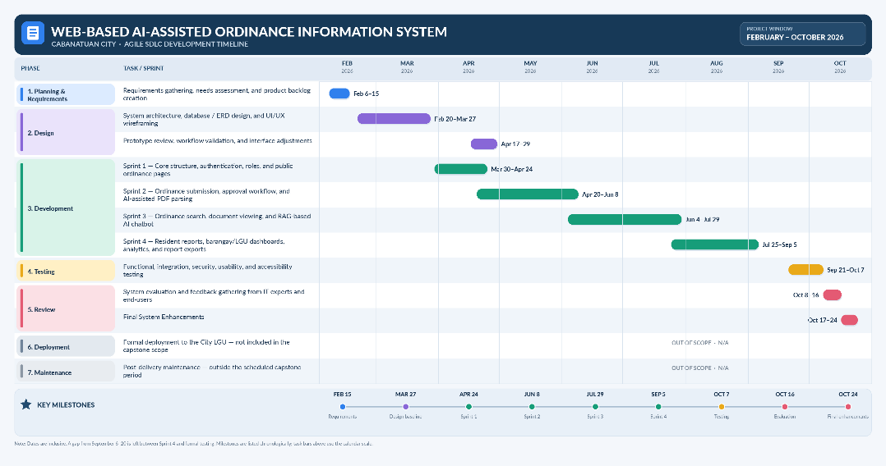

*[Figure/image placeholder: see linked image above if available]*
Figure 30 presents the corresponding Gantt chart. It visualizes the February–October 2026 schedule, including the extended Sprint 2 and Sprint 3 windows, Sprint 4 ending on September 5, and the intentional gap from September 6 through September 20. Formal testing begins on September 21 and ends on October 7; system evaluation follows from October 8 to October 16; and final system enhancements run from October 17 to October 24. The chart does not include a separate system-integration task. Formal deployment to the City LGU and post-delivery maintenance are outside the capstone scope

### 1.4 Testing
The testing phase focused on evaluating the functions and overall quality of the Web-Based AI-Assisted Ordinance Information System for Cabanatuan City. The system was examined to determine whether its features worked as intended and met the identified operational and technical requirements. This included testing user registration and authentication, role-based access control, ordinance catalog browsing and multi-criteria filtering, PDF document rendering, conversational AI civic inquiry streaming with citation verification via Retrieval-Augmented Generation (RAG), automated multimodal optical character recognition (OCR) ordinance extraction, citizen incident report submission and status tracking, barangay administration workflows, civic news broadcasting, and executive analytics generation. The researchers conducted automated functional testing and integration test suites across core application pathways to ensure operational stability, layout responsiveness, keyboard accessibility, and local database reliability. The researchers used any issues identified during testing as a basis for necessary technical refinements.
The system evaluation involved 110 respondents: 10 IT experts and 100 end-users. The IT experts assessed the system using a questionnaire based on the ISO/IEC 25010:2023 Software Product Quality Model, covering nine quality characteristics: functional suitability, reliability, interaction capability, performance efficiency, compatibility, security, maintainability, flexibility, and safety. In addition, the IT experts evaluated the technical accessibility of the system based on the four principles of the Web Content Accessibility Guidelines (WCAG): perceivable, operable, understandable, and robust. Meanwhile, the one hundred (100) end-users, comprising residents and barangay officials or staff from nine (9) selected barangays and LGU officials from the City Government of Cabanatuan, evaluated the system using the ten-item System Usability Scale (SUS) and a WCAG-based accessibility assessment. Their responses were combined to determine the overall end-user evaluation of the system.
The evaluation results were analyzed using frequency distributions, percentage distributions, weighted means, and the scoring rubrics established in Chapter II. The SUS responses were computed using its standard scoring procedure, with item ratings converted and summed to yield an overall usability score ranging from 0 to 100. These results helped determine the system's technical quality, usability, and accessibility strengths as well as areas requiring continuous refinement. The findings also served as an empirical basis to ensure that the Web-Based AI-Assisted Ordinance Information System effectively fulfills the legislative transparency, civic inquiry, and community reporting needs of Cabanatuan City and its constituent barangays.

### 1.5 Deployment
The Web-Based AI-Assisted Ordinance Information System was not transitioned into live operational service across the City Government of Cabanatuan during the conduct of the study. In place of a live rollout, the researchers developed an operational deployment costing analysis to give municipal decision-makers an empirical overview of prospective hosting architectures and estimated budget requirements. This financial assessment evaluates the infrastructure components needed to sustain the platform after the development and evaluation phases, encompassing containerized application hosting, persistent relational data and document archiving, conversational artificial intelligence processing, multimodal optical character recognition (OCR) digitization, content delivery network (CDN) edge caching, and transport security.
The proposed deployment architecture relies on a containerized Platform-as-a-Service (PaaS) model hosted through Railway in the Singapore region (ap-southeast-1), paired with Cloudflare for edge security and Google AI Studio for artificial intelligence services. Two hosting options were evaluated: Option A utilizes the Railway Hobby baseline plan for initial pilot operations, while Option B represents a scalable municipal upgrade to Railway Pro for city-wide rollout across all 89 barangays. Production build benchmarking demonstrated an idle memory footprint of 91.60 MB and a peak memory working set of 166.29 MB under concurrent simulated query loads. Under Option A, the $5.00 monthly base charge (₱318.10) serves as an included usage credit that completely covers compute, memory, and network egress during pilot usage. For full municipal rollout under Option B, Railway Pro ($20.00 per month = ₱1,272.40) provides self-serve volume expansion from 50 GB up to 1 TB and multi-seat role management, with its included credit absorbing 100% of metered compute and storage to establish a flat, predictable hosting fee.
For persistent data storage, the architecture attaches a dedicated Railway Persistent Volume directly to the application container. This houses the embedded SQLite 3 relational database operating under Write-Ahead Logging (WAL) mode alongside uploaded ordinance PDF archives and photographic incident report evidence. This design preserves sub-20-millisecond local query performance and guarantees that municipal records remain intact across container restarts without incurring separate managed database fees. Edge delivery and security are routed through Cloudflare on its free tier, terminating in Manila and Cebu points of presence to provide static asset caching, bot mitigation, and unmetered DDoS protection at zero cost.
Conversational inquiries and multimodal document digitization are powered by Google AI Studio utilizing the Gemini 3.5 Flash-Lite model ($0.30 per 1,000,000 input tokens and $2.50 per 1,000,000 output tokens). Benchmarking with representative civic inquiries established an average cost of approximately ₱0.0528 per chatbot interaction, while multimodal OCR document ingestion averages ₱0.2575 for a two-page document and ₱0.8583 for a five-page scanned PDF. Digitizing an erestimated historical archive of 1,000 to 3,000 legacy paper ordinances represents an isolated, one-time onboarding expenditure of approximately ₱858.30 to ₱2,574.90. Operational safeguards implemented in the application workflow include per-IP sliding-window rate limiting (20 requests per minute), origin header validation, a 1,000-character prompt cap, and a 500-token maximum output limit to prevent runaway billing. Transport Layer Security (TLS) encryption is automatically enforced through Let's Encrypt certificates managed by Railway, and the domain can utilize an official municipal .gov.ph domain provisioned through the DICT or an included Railway production subdomain.
Table 19 presents the estimated monthly deployment infrastructure, service provider specifications, and operational cost breakdown for the platform across operating scenarios.
Table 19. Projected Monthly Deployment Infrastructure, Service Specifications, and Operational Cost Breakdown

| Item | Service / Provider | Resource Specification and Purpose | Monthly Cost (PHP) |
|---|---|---|---|
| 1. Web Server / Hosting | Railway (Hobby Plan) | Proposed containerized Next.js 16 runtime in Singapore (ap-southeast-1) with 1-2 vCPUs and shared RAM. Base $5.00/mo credit covers metered compute, memory, and egress for pilot usage. | ₱318.10 - ₱381.72 / mo |
| 2. Persistent Storage (Volume) | Railway Volume | Dedicated persistent block storage mounted for SQLite database in WAL mode and uploaded ordinance PDFs. Storage billed at $0.15/GB/mo (covered under Hobby credit during pilot). | Included in credit / ₱0.00 |
| 3. Artificial Intelligence Engine | Google AI Studio (Gemini 3.5 Flash-Lite) | Powers bilingual civic chatbot and multimodal OCR ordinance digitization (~2,000 to 6,000 queries and 50 to 150 document uploads per month). | ₱118.48 - ₱594.87 / mo |
| 4. Domain Name | DICT (.gov.ph) or Railway Domain | Official municipal government domain provisioned through DICT or free included Railway production subdomain (.up.railway.app). | ₱0.00 |
| 5. SSL / HTTPS Security | Let's Encrypt / Railway | Automatic SSL/TLS encryption (HTTPS) with automated certificate provisioning and renewal. | ₱0.00 |
| 6. DDoS & CDN Acceleration | Cloudflare (Free Plan) | Edge caching for web pages and static assets in Manila and Cebu points of presence, combined with automated bot management and DDoS protection. | ₱0.00 |
| Total Projected Monthly Cost (Hobby Baseline) | All-Inclusive Production Architecture | Estimated operational budget for pilot implementation and Normal Year 1 operations across Cabanatuan City. | ~₱436.58 - ₱976.59 / mo |
| Recommended Municipal Upgrade (Railway Pro) | City-Wide Scaled Deployment | Optional upgrade to Railway Pro ($20.00/mo = ₱1,272.40) providing 50 GB to 1 TB volume expansion, execution priority, and admin seats, fully absorbing all metered compute and storage. | ~₱1,614.98 - ₱1,867.27 / mo |

Vendor pricing schedules are verified from Railway (2026) and Google AI Studio (2026). In the Pilot scenario (300 to 1,000 views/day and ~2,000 chatbot messages), total operational cost is estimated at ₱436.58 to ₱559.30 monthly. In Normal Year 1 operations (~2,000 views/day and ~6,000 chatbot messages), monthly costs range from ₱671.50 to ₱976.59 under Option A, or ₱1,614.98 to ₱1,867.27 under Option B. During hypothetical peak civic demand (~5,000 views/day and ~20,000 chatbot inquiries), expenditures remain bounded between ₱1,596.53 and ₱2,954.88 monthly.
The costing analysis demonstrates that deploying the Web-Based AI-Assisted Ordinance Information System is economically viable and financially sustainable for the local government of Cabanatuan City. By leveraging a managed PaaS container runtime, Cloudflare edge acceleration, and lightweight Gemini 3.5 Flash-Lite processing, the municipality can maintain an active civic portal for an estimated recurring expenditure of only ₱436.58 to ₱976.59 monthly during pilot and baseline operations, or approximately ₱1,614.98 to ₱1,867.27 monthly under a fully expanded, city-wide Railway Pro configuration. For the first 12 months, the estimated operating cost ranges from ₱5,238.96 to ₱11,719.08 under the baseline plan, or ₱19,379.76 to ₱22,407.24 under the Pro configuration. This cost profile represents a fraction of traditional on-premise municipal IT infrastructure expenses, confirming the practical feasibility of adopting the system for city-wide civic governance.

### 2. Technical Quality Assessment by IT Experts (ISO/IEC 25010:2023)
To address the second research question, the technical software quality of the Web-Based AI-Assisted Ordinance Information System for Cabanatuan City was evaluated by ten (N = 10) IT professionals, software engineers, and systems analysts using an evaluation instrument grounded in the ISO/IEC 25010:2023 Software Product Quality Model. The evaluation covered nine software quality characteristics: Functional Suitability, Reliability, Interaction Capability, Performance Efficiency, Compatibility, Security, Maintainability, Flexibility, and Safety. Frequency distributions, percentage calculations, weighted means, and qualitative interpretations were computed for each indicator based on established scoring rubrics.

### 2.1 Functional Suitability
The IT experts assessed the Web-Based AI-Assisted Ordinance Information System as Highly Suitable in terms of Functional Suitability. Table 20 presents the detailed assessment of the system based on Functional Completeness, Functional Correctness, and Functional Appropriateness.
**Table 20.**
Functional Suitability — The degree to which the system provides functions that meet stated and implied needs when used under specified conditions. (As Rated by IT Experts, N = 10)

| Item Statement | Strongly Agree (5) f | Strongly Agree (5) % | Agree (4) f | Agree (4) % | Neutral (3) f | Neutral (3) % | Disagree (2) f | Disagree (2) % | Strongly Disagree (1) f | Strongly Disagree (1) % | Mean | Verbal Description |
|---|---|---|---|---|---|---|---|---|---|---|---|---|
| The system covers all specified tasks and user objectives related to ordinance management, AI-assisted chatbot inquiries, resident reporting, and administrative oversight. | 8 | 80.0% | 2 | 20.0% | 0 | 0.0% | 0 | 0.0% | 0 | 0.0% | 4.80 | Highly Suitable |
| The system provides correct and precise results, including accurate ordinance search matches and properly cited AI chatbot responses. | 3 | 30.0% | 6 | 60.0% | 1 | 10.0% | 0 | 0.0% | 0 | 0.0% | 4.20 | Suitable |
| The system functions facilitate the accomplishment of municipal governance tasks such as ordinance publishing, report triage, and city-wide analytics. | 6 | 60.0% | 3 | 30.0% | 1 | 10.0% | 0 | 0.0% | 0 | 0.0% | 4.50 | Highly Suitable |
| Category Mean |  |  |  |  |  |  |  |  |  |  | 4.50 | Highly Suitable |

Note. n = 10. Scale and verbal description: 4.21–5.00 = Highly Suitable (HS); 3.41–4.20 = Suitable (S); 2.61–3.40 = Somewhat Suitable (SS); 1.81–2.60 = Unsuitable (U); 1.00–1.80 = Highly Unsuitable (HU).
As shown in Table 20, the IT experts rated Functional Suitability Highly Suitable (category mean = 4.50). The functional completeness indicator received the highest rating (4.80), with eight of the ten experts awarding the highest score. Facilitation of municipal governance tasks obtained a mean of 4.50 (Highly Suitable), while functional correctness received the relatively lowest rating within the category (4.20, Suitable).

### 2.2 Performance Efficiency
The IT experts assessed the system as Highly Efficient in terms of Performance Efficiency. Table 21 presents the detailed assessment of the system based on Time Behavior, Resource Utilization, and Capacity.
**Table 21.**
Performance Efficiency — Relative to the number of resources used under stated conditions. (As Rated by IT Experts, N = 10)

| Item Statement | Strongly Agree (5) f | Strongly Agree (5) % | Agree (4) f | Agree (4) % | Neutral (3) f | Neutral (3) % | Disagree (2) f | Disagree (2) % | Strongly Disagree (1) f | Strongly Disagree (1) % | Mean | Verbal Description |
|---|---|---|---|---|---|---|---|---|---|---|---|---|
| The system responds and processes events promptly, including ordinance searches, PDF rendering, and AI chatbot replies. | 6 | 60.0% | 3 | 30.0% | 1 | 10.0% | 0 | 0.0% | 0 | 0.0% | 4.50 | Highly Efficient |
| The system utilizes information resources efficiently (Resource Allocation) | 5 | 50.0% | 4 | 40.0% | 1 | 10.0% | 0 | 0.0% | 0 | 0.0% | 4.40 | Highly Efficient |
| The system parameters meet the requirements for handling simultaneous AI chat queries, ordinance indexing, and dashboard updates. | 3 | 30.0% | 7 | 70.0% | 0 | 0.0% | 0 | 0.0% | 0 | 0.0% | 4.30 | Highly Efficient |
| Category Mean |  |  |  |  |  |  |  |  |  |  | 4.40 | Highly Efficient |

Note. n = 10. Scale and verbal description: 4.21–5.00 = Highly Efficient (HE); 3.41–4.20 = Efficient (E); 2.61–3.40 = Less Efficient (LE); 1.81–2.60 = Inefficient (I); 1.00–1.80 = Highly Inefficient (HI).
As shown in Table 21, Performance Efficiency achieved a category mean of 4.40 (Highly Efficient). Prompt event processing during ordinance searches, PDF rendering, and conversational AI replies obtained the highest evaluation (4.50), followed by resource allocation efficiency (4.40). System capacity parameters for handling concurrent queries, document indexing, and dashboard updates received a mean of 4.30.

### 2.3 Compatibility
The IT experts assessed the system as Highly Compatible in terms of Compatibility. Table 22 presents the detailed assessment of the system based on Co-existence and Interoperability.
**Table 22.**
Compatibility — The degree to which a software system can exchange information with other systems whilst sharing the same software and hardware. (As Rated by IT Experts, N = 10)

| Item Statement | Strongly Agree (5) f | Strongly Agree (5) % | Agree (4) f | Agree (4) % | Neutral (3) f | Neutral (3) % | Disagree (2) f | Disagree (2) % | Strongly Disagree (1) f | Strongly Disagree (1) % | Mean | Verbal Description |
|---|---|---|---|---|---|---|---|---|---|---|---|---|
| The system performs its required operations efficiently while sharing its environment and resources with other browser tabs and local applications. | 5 | 50.0% | 5 | 50.0% | 0 | 0.0% | 0 | 0.0% | 0 | 0.0% | 4.50 | Highly Compatible |
| The system interacts properly with external services such as the Google Gemini API, cloud storage endpoints, and data export formats like PDF and CSV. | 7 | 70.0% | 2 | 20.0% | 1 | 10.0% | 0 | 0.0% | 0 | 0.0% | 4.60 | Highly Compatible |
| Category Mean |  |  |  |  |  |  |  |  |  |  | 4.55 | Highly Compatible |

Note. n = 10. Scale and verbal description: 4.21–5.00 = Highly Compatible (HC); 3.41–4.20 = Compatible (C); 2.61–3.40 = Somewhat Compatible (SC); 1.81–2.60 = Less Compatible (LC); 1.00–1.80 = Not Compatible (NC).
As shown in Table 22, Compatibility achieved the highest category mean among all evaluated characteristics (4.55, Highly Compatible). Interoperability with external services including the Google Gemini API, storage endpoints, and document export formats received the highest rating (4.60), with seven experts awarding the highest score. Environmental co-existence alongside other browser tabs and local applications obtained a mean of 4.50.

### 2.4 Interaction Capability
The IT experts assessed the system as Highly Interactive in terms of Interaction Capability. Table 23 presents the detailed assessment of the system based on Appropriateness Recognizability, Learnability, Operability, User Interface Aesthetics, User Error Protection, Accessibility, Supportability, and User Engagement.
**Table 23.**
Interaction Capability — The degree to which a system can be interacted with by specified users to exchange information through the user interface to complete the intended task. (As Rated by IT Experts, N = 10)

| Item Statement | Strongly Agree (5) f | Strongly Agree (5) % | Agree (4) f | Agree (4) % | Neutral (3) f | Neutral (3) % | Disagree (2) f | Disagree (2) % | Strongly Disagree (1) f | Strongly Disagree (1) % | Mean | Verbal Description |
|---|---|---|---|---|---|---|---|---|---|---|---|---|
| The system can be easily recognized by end-users as a platform to access ordinance information and report community concerns. | 7 | 70.0% | 3 | 30.0% | 0 | 0.0% | 0 | 0.0% | 0 | 0.0% | 4.70 | Highly Interactive |
| The system can be easily learned by residents, barangay officials, and LGU administrators with minimal training. | 4 | 40.0% | 6 | 60.0% | 0 | 0.0% | 0 | 0.0% | 0 | 0.0% | 4.40 | Highly Interactive |
| The system can be easily operated and controlled across its modules, including ordinance browsing, chatbot interaction, report submission, and admin dashboards. | 3 | 30.0% | 5 | 50.0% | 2 | 20.0% | 0 | 0.0% | 0 | 0.0% | 4.10 | Interactive |
| The system user interface for ordinance pages, chatbot, and admin panels looks pleasant and satisfactory. | 3 | 30.0% | 7 | 70.0% | 0 | 0.0% | 0 | 0.0% | 0 | 0.0% | 4.30 | Highly Interactive |
| The system protects users from making errors through input validation, confirmation dialogs, and clear warning messages. | 2 | 20.0% | 7 | 70.0% | 1 | 10.0% | 0 | 0.0% | 0 | 0.0% | 4.10 | Interactive |
| The system provides inclusive access to users with varying abilities and devices, including mobile and assistive technology users. | 3 | 30.0% | 2 | 20.0% | 5 | 50.0% | 0 | 0.0% | 0 | 0.0% | 3.80 | Interactive |
| The system provides helpful instructions, tooltips, and contextual guidance during operations such as report filing and ordinance uploading. | 2 | 20.0% | 7 | 70.0% | 1 | 10.0% | 0 | 0.0% | 0 | 0.0% | 4.10 | Interactive |
| The system promotes user engagement through interactive elements such as real-time AI response streaming, search auto-completion, and status update notifications. | 5 | 50.0% | 4 | 40.0% | 1 | 10.0% | 0 | 0.0% | 0 | 0.0% | 4.40 | Highly Interactive |
| Category Mean |  |  |  |  |  |  |  |  |  |  | 4.24 | Highly Interactive |

Note. n = 10. Scale and verbal description: 4.21–5.00 = Highly Interactive (HI); 3.41–4.20 = Interactive (I); 2.61–3.40 = Less Interactive (LI); 1.81–2.60 = Poorly Interactive (PI); 1.00–1.80 = Non-Interactive (NI).
As shown in Table 23, Interaction Capability obtained a category mean of 4.24 (Highly Interactive). Appropriateness recognizability received the highest assessment (4.70), followed by learnability and user engagement (4.40 each). Module operability, user error protection, and supportability guidance each obtained ratings of 4.10 (Interactive). Inclusive access across varying abilities and assistive devices received the lowest rating within this characteristic (3.80, Interactive), with half of the experts recording a neutral response.

### 2.5 Reliability
The IT experts assessed the system as Reliable in terms of Reliability. Table 24 presents the detailed assessment of the system based on Maturity, Availability, Fault Tolerance, and Recoverability.
**Table 24.**
Reliability — The degree to which the system performs specified functions under specified conditions for a specified period of time. (As Rated by IT Experts, N = 10)

| Item Statement | Strongly Agree (5) f | Strongly Agree (5) % | Agree (4) f | Agree (4) % | Neutral (3) f | Neutral (3) % | Disagree (2) f | Disagree (2) % | Strongly Disagree (1) f | Strongly Disagree (1) % | Mean | Verbal Description |
|---|---|---|---|---|---|---|---|---|---|---|---|---|
| The system meets the needs of its users under normal operations without unexpected failures. | 7 | 70.0% | 3 | 30.0% | 0 | 0.0% | 0 | 0.0% | 0 | 0.0% | 4.70 | Highly Reliable |
| The system is accessible and operational at a time needed for use. | 3 | 30.0% | 6 | 60.0% | 1 | 10.0% | 0 | 0.0% | 0 | 0.0% | 4.20 | Reliable |
| The system operates as planned despite the existence of technical anomalies such as API timeouts or invalid file uploads. | 4 | 40.0% | 5 | 50.0% | 1 | 10.0% | 0 | 0.0% | 0 | 0.0% | 4.30 | Highly Reliable |
| During an unexpected disruption, the system recovers and re-establishes to its desired state, preserving user session data and draft reports. | 0 | 0.0% | 2 | 20.0% | 8 | 80.0% | 0 | 0.0% | 0 | 0.0% | 3.20 | Slightly Reliable |
| Category Mean |  |  |  |  |  |  |  |  |  |  | 4.10 | Reliable |

Note. n = 10. Scale and verbal description: 4.21–5.00 = Highly Reliable (HR); 3.41–4.20 = Reliable (R); 2.61–3.40 = Slightly Reliable (SR); 1.81–2.60 = Unreliable (U); 1.00–1.80 = Non-Reliable (NR).
As shown in Table 24, Reliability was rated Reliable overall (category mean = 4.10). Operational stability under normal conditions received the highest score (4.70), followed by fault tolerance during technical anomalies (4.30) and operational availability (4.20). In contrast, recoverability following unexpected disruptions received the lowest rating (3.20, Slightly Reliable), with eight of the ten experts selecting a neutral score.

### 2.6 Security
The IT experts assessed the system as Adequate Security in terms of Security. Table 25 presents the detailed assessment of the system based on Confidentiality, Integrity, Non-repudiation, Accountability, Authenticity, and Data Protection.
**Table 25.**
Security — The degree to which a system prevents unauthorized access to, or modification of, computer programs or data. (As Rated by IT Experts, N = 10)

| Item Statement | Strongly Agree (5) f | Strongly Agree (5) % | Agree (4) f | Agree (4) % | Neutral (3) f | Neutral (3) % | Disagree (2) f | Disagree (2) % | Strongly Disagree (1) f | Strongly Disagree (1) % | Mean | Verbal Description |
|---|---|---|---|---|---|---|---|---|---|---|---|---|
| The system ensures that ordinance records, citizen data, and administrative functions are accessible only to those authorized through role-based access control. | 6 | 60.0% | 4 | 40.0% | 0 | 0.0% | 0 | 0.0% | 0 | 0.0% | 4.60 | Strong Security |
| The system prevents unauthorized access to or modification of ordinance texts, report records, and audit logs. | 3 | 30.0% | 6 | 60.0% | 1 | 10.0% | 0 | 0.0% | 0 | 0.0% | 4.20 | Adequate Security |
| The system can prove an action or event believed to have taken place, such as ordinance approvals, report status changes, and user login activities. | 2 | 20.0% | 5 | 50.0% | 3 | 30.0% | 0 | 0.0% | 0 | 0.0% | 3.90 | Adequate Security |
| The system can uniquely trace or account for an action or event of an entity through comprehensive audit logging. | 2 | 20.0% | 4 | 40.0% | 2 | 20.0% | 2 | 20.0% | 0 | 0.0% | 3.60 | Adequate Security |
| The system can properly identify and authenticate its users through secure login mechanisms and session management. | 7 | 70.0% | 2 | 20.0% | 1 | 10.0% | 0 | 0.0% | 0 | 0.0% | 4.60 | Strong Security |
| The system can preserve and protect its past ordinance records, archived reports, and transaction histories for future reference. | 3 | 30.0% | 5 | 50.0% | 2 | 20.0% | 0 | 0.0% | 0 | 0.0% | 4.10 | Adequate Security |
| Category Mean |  |  |  |  |  |  |  |  |  |  | 4.17 | Adequate Security |

Note. n = 10. Scale and verbal description: 4.21–5.00 = Strong Security (SS); 3.41–4.20 = Adequate Security (AS); 2.61–3.40 = Weak Security (WS); 1.81–2.60 = Very Weak Security (VWS); 1.00–1.80 = No Security (NS).
As shown in Table 25, Security was rated Adequate Security overall (category mean = 4.17). Role-based access control and user authentication tied for the highest evaluation (4.60 each, Strong Security). Prevention of unauthorized record modifications obtained 4.20, and historical record preservation received 4.10. Non-repudiation scored 3.90, while comprehensive audit logging received the lowest rating (3.60, Adequate Security), with two experts recording disagreement ratings.

### 2.7 Maintainability
The IT experts assessed the system as Highly Maintainable in terms of Maintainability. Table 26 presents the detailed assessment of the system based on Modularity, Reusability, Analyzability, Modifiability, and Testability.
Table 26.
Maintainability — Refers to how well a system can be modified to improve, correct or adapt to changes in the environment as well as requirements. (As Rated by IT Experts, N = 10)

| Item Statement | Strongly Agree (5) f | Strongly Agree (5) % | Agree (4) f | Agree (4) % | Neutral (3) f | Neutral (3) % | Disagree (2) f | Disagree (2) % | Strongly Disagree (1) f | Strongly Disagree (1) % | Mean | Verbal Description |
|---|---|---|---|---|---|---|---|---|---|---|---|---|
| The system is composed of discrete components or modules, such as ordinance management, chatbot, reporting, and admin dashboard, for easy usage and maintenance. | 8 | 80.0% | 2 | 20.0% | 0 | 0.0% | 0 | 0.0% | 0 | 0.0% | 4.80 | Highly Maintainable |
| The modules and components of the system such as UI elements, validation utilities, and data services can be reused across different parts of the application. | 6 | 60.0% | 4 | 40.0% | 0 | 0.0% | 0 | 0.0% | 0 | 0.0% | 4.60 | Highly Maintainable |
| The system can diagnose or troubleshoot problems quickly through clear error messages, logs, and debugging tools. | 2 | 20.0% | 3 | 30.0% | 5 | 50.0% | 0 | 0.0% | 0 | 0.0% | 3.70 | Maintainable |
| The system can be changed or updated, such as adding new ordinance categories or modifying AI prompts, without introducing bugs or degrading existing standards. | 2 | 20.0% | 8 | 80.0% | 0 | 0.0% | 0 | 0.0% | 0 | 0.0% | 4.20 | Maintainable |
| The system can provide test criteria for verifying certain actions or changes, including AI response accuracy, report routing, and search functionality. | 3 | 30.0% | 6 | 60.0% | 1 | 10.0% | 0 | 0.0% | 0 | 0.0% | 4.20 | Maintainable |
| Category Mean |  |  |  |  |  |  |  |  |  |  | 4.30 | Highly Maintainable |

Note. n = 10. Scale and verbal description: 4.21–5.00 = Highly Maintainable (HM); 3.41–4.20 = Maintainable (M); 2.61–3.40 = Less Maintainable (LM); 1.81–2.60 = Hardly Maintainable (HM); 1.00–1.80 = Not Maintainable (NM).
As shown in Table 26, Maintainability was evaluated as Highly Maintainable (category mean = 4.30). System modularity achieved the highest rating (4.80), with eight of the ten experts giving the highest mark, followed by module reusability (4.60). System modifiability and test criteria each received 4.20 (Maintainable). In contrast, diagnostic problem troubleshooting through error messages and logs received the lowest rating (3.70, Maintainable), with half of the experts assigning a neutral rating.

### 2.8 Flexibility
The IT experts assessed the system as Flexible in terms of Flexibility. Table 27 presents the detailed assessment of the system based on Adaptability, Deployability, and Scalability.
**Table 27.**
Flexibility — The degree to which a product can be adapted to changes in its requirements, contexts of use or system environment. (As Rated by IT Experts, N = 10)

| Item Statement | Strongly Agree (5) f | Strongly Agree (5) % | Agree (4) f | Agree (4) % | Neutral (3) f | Neutral (3) % | Disagree (2) f | Disagree (2) % | Strongly Disagree (1) f | Strongly Disagree (1) % | Mean | Verbal Description |
|---|---|---|---|---|---|---|---|---|---|---|---|---|
| The system can be accessed and functions reliably across different operating systems such as Windows, macOS, Android, and iOS, and modern browsers such as Chrome, Firefox, Edge, and Safari without functional degradation. | 4 | 40.0% | 5 | 50.0% | 1 | 10.0% | 0 | 0.0% | 0 | 0.0% | 4.30 | Highly Flexible |
| The system can be configured and deployed easily to different hosting environments such as cloud platforms or containerized setups. | 3 | 30.0% | 2 | 20.0% | 5 | 50.0% | 0 | 0.0% | 0 | 0.0% | 3.80 | Flexible |
| The system architecture can be scaled up to accommodate future expansion such as onboarding all 89 barangays and growing the ordinance database. | 2 | 20.0% | 7 | 70.0% | 1 | 10.0% | 0 | 0.0% | 0 | 0.0% | 4.10 | Flexible |
| Category Mean |  |  |  |  |  |  |  |  |  |  | 4.07 | Flexible |

Note. n = 10. Scale and verbal description: 4.21–5.00 = Highly Flexible (HF); 3.41–4.20 = Flexible (F); 2.61–3.40 = Less Flexible (LF); 1.81–2.60 = Hardly Flexible (HF); 1.00–1.80 = Not Flexible (NF).
As shown in Table 27, Flexibility achieved a category mean of 4.07 (Flexible). Cross-platform operating system and web browser adaptability obtained the highest rating (4.30, Highly Flexible). Architectural scalability for future expansion across Cabanatuan City's 89 barangays received 4.10, while ease of configuration and deployment across different hosting environments received the lowest rating (3.80, Flexible).

### 2.9 Safety
The IT experts assessed the system as Safe in terms of Safety. Table 28 presents the detailed assessment of the system based on Operational Constraint Safety, Risk Reduction, and AI Disclaimer Transparency.
**Table 28.**
Safety — The degree to which a product avoids a state in which human life, health, property, or the environment is endangered. (As Rated by IT Experts, N = 10)

| Item Statement | Strongly Agree (5) f | Strongly Agree (5) % | Agree (4) f | Agree (4) % | Neutral (3) f | Neutral (3) % | Disagree (2) f | Disagree (2) % | Strongly Disagree (1) f | Strongly Disagree (1) % | Mean | Verbal Description |
|---|---|---|---|---|---|---|---|---|---|---|---|---|
| The system enforces operational limits such as file upload size restrictions, allowed file types, and request payload boundaries to prevent resource exhaustion. | 2 | 0.0% | 6 | 0.0% | 2 | 0.0% | 0 | 0.0% | 0 | 0.0% | 4.00 | Safe |
| The system prevents critical user errors through confirmation dialogs and soft-deletion recovery before executing irreversible actions such as archiving ordinances or rejecting reports. | 3 | 0.0% | 7 | 0.0% | 0 | 0.0% | 0 | 0.0% | 0 | 0.0% | 4.30 | Highly Safe |
| The system includes clear disclaimers that AI chatbot answers are informational summaries and not binding legal counsel, accompanied by exact ordinance citations for user verification. | 3 | 0.0% | 6 | 0.0% | 1 | 0.0% | 0 | 0.0% | 0 | 0.0% | 4.20 | Safe |
| Category Mean |  |  |  |  |  |  |  |  |  |  | 4.17 | Safe |

Note. n = 10. Scale and verbal description: 4.21–5.00 = Highly Safe (HS); 3.41–4.20 = Safe (S); 2.61–3.40 = Slightly Unsafe (SU); 1.81–2.60 = Unsafe (U); 1.00–1.80 = Highly Unsafe (HU).
As shown in Table 28, Safety obtained a category mean of 4.17 (Safe). Critical error prevention through confirmation dialogs and soft-deletion mechanisms scored highest (4.30, Highly Safe). Inclusion of clear informational disclaimers and exact ordinance citations in conversational AI responses received 4.20, while enforcement of operational payload and file upload limits obtained 4.00.

### 2.10 Summary of the Overall Assessment as Rated by IT Experts
Table 29 summarizes the weighted means across all nine ISO/IEC 25010:2023 software quality characteristics evaluated by the IT experts.
**Table 29.**
Summary of Overall Assessment on As Rated by IT Experts (N = 10)

| Criterion | Mean | Verbal Description |
|---|---|---|
| Functional Suitability | 4.50 | Highly Suitable |
| Performance Efficiency | 4.40 | Highly Efficient |
| Compatibility | 4.55 | Highly Compatible |
| Interaction Capability | 4.24 | Highly Interactive |
| Reliability | 4.10 | Reliable |
| Security | 4.17 | Adequate Security |
| Maintainability | 4.30 | Highly Maintainable |
| Flexibility | 4.07 | Flexible |
| Safety | 4.17 | Safe |
| Overall Mean | 4.28 | Highly Suitable/Efficient |

Note. n = 10. Verbal descriptions follow the scoring rubric of each characteristic; the overall mean is interpreted on the general scale of the instrument: 4.21–5.00 = Highly Suitable/Efficient; 3.41–4.20 = Suitable/Efficient; 2.61–3.40 = Moderately Suitable; 1.81–2.60 = Unsuitable/Inefficient; 1.00–1.80 = Highly Unsuitable.
As shown in Table 29, the IT experts evaluated the technical quality of the Web-Based AI-Assisted Ordinance Information System with an Overall Mean of 4.28, verbally interpreted as Highly Suitable/Efficient. This composite score exceeds the minimum research benchmark of 3.41 established for the study. Five of the nine characteristics achieved ratings within the highest evaluation band (4.21–5.00): Compatibility (4.55), Functional Suitability (4.50), Performance Efficiency (4.40), Maintainability (4.30), and Interaction Capability (4.24). The remaining four characteristics—Security (4.17), Safety (4.17), Reliability (4.10), and Flexibility (4.07)—were all evaluated favorably within the second-highest evaluation band (3.41–4.20).

### Discussion of the Technical Quality Results
The technical evaluation results indicate that the Web-Based AI-Assisted Ordinance Information System fulfills the software engineering and product quality criteria established under the ISO/IEC 25010:2023 quality model. Evaluated through the conceptual lens of the Technology Acceptance Model (Davis, 1989) and the DeLone and McLean (2003) Information Systems Success Model, the high marks awarded to system responsiveness, functional coverage, and interface clarity suggest that technical evaluators perceived the platform as useful and operable for local government administration.
The high mean score obtained for Functional Suitability (4.50) confirms that the application addresses the administrative and civic requirements identified during the planning phase. This result aligns with Batacandolo et al. (2024), who observed that low public compliance with municipal ordinances in Philippine local government units is linked directly to difficulties in accessing and deciphering official regulatory texts rather than a deliberate disregard for the law. By integrating structured keyword search with Retrieval-Augmented Generation (RAG) powered by Google Gemini 3.5 Flash Lite, the portal provides direct access to full statutory enactments alongside plain-language bilingual summaries. This capability also corroborates Senadheira et al. (2025), who found that conversational AI implementations in public administration succeed when responses are explicitly grounded in authoritative, verified local government records rather than general generative models.
The favorable ratings for Compatibility (4.55) and Performance Efficiency (4.40) reflect the operational advantages of the local application architecture. While conventional web systems often depend on distributed cloud microservices that introduce network latency, the developed platform couples Next.js 16 Server Components with an embedded SQLite database engine operating with Write-Ahead Logging (WAL) and local disk streaming routes. This architectural choice yielded database query responses below 20 milliseconds and prompt PDF document rendering. This outcome is consistent with Patil et al. (2024), who demonstrated that streamlining document management pipelines and reducing external network round-trips significantly cuts processing overhead and user wait times in administrative record systems.
The ratings for Maintainability (4.30) and Interaction Capability (4.24) support the structural design principles applied during development. Component modularity (4.80) and recognizability (4.70) received high individual assessments, indicating that organizing the system into discrete modules—public ordinance explorer, conversational AI assistant, citizen incident intake, and role-scoped administrative consoles—facilitates ongoing maintenance and straightforward navigation. This supports the findings of Albano (2023), who concluded that Philippine local governance portals developed with modular software boundaries and predictable user interface pathways achieve higher technical sustainability and user adoption. Furthermore, the inclusion of contextual search assistance and immediate status feedback reflects Nielsen's (1994) usability heuristic regarding the visibility of system status.
The evaluations for Security (4.17) and Safety (4.17) confirm the presence of necessary safeguards. Role-based access control and user authentication shared the highest marks under Security (4.60 each), reflecting the strict separation enforced between LGU administrators, barangay captains, and public residents through salted Bcrypt password hashing and HTTP-only session cookies. Under Safety, user error prevention through confirmation dialogs (4.30) and disclaimer transparency (4.20) scored favorably. The prominent legal disclaimers ensure that users recognize conversational AI outputs as informational summaries rather than binding legal counsel, supporting responsible civic deployment.
In contrast, several specific indicators received relatively lower ratings, identifying technical priorities for subsequent engineering cycles:
Recoverability under Reliability obtained the lowest rating in the evaluation (3.20, Slightly Reliable), with 80% of the experts recording a neutral response. This rating may be associated with the client-side state model: while chat histories are preserved in local storage, in-flight citizen report drafts are not automatically synchronized to a persistent server draft buffer, meaning that an unexpected browser closure during form completion requires the citizen to re-enter unsaved descriptions.
Accountability through comprehensive audit logging under Security scored 3.60, with two experts recording disagreement. This rating reflects the existing audit trail implementation, which records state-modifying actions (such as ordinance status approvals and report resolutions) but intentionally omits passive read-only query views to prevent rapid database growth.
Diagnostic problem troubleshooting under Maintainability received 3.70, which is likely related to the application's reliance on standard Node.js server console outputs and Prisma query error codes rather than a dedicated centralized logging service or telemetry dashboard.
Inclusive access under Interaction Capability (3.80) and deployability across different hosting environments under Flexibility (3.80) indicate that while the platform performs reliably on standard desktop and mobile browsers, advanced screen reader compatibility and containerized deployment scripts require further refinement.
These findings are subject to the limitation that evaluations were conducted by a purposively selected panel of ten (N = 10) IT professionals in simulated demonstration and structured task execution sessions. Although the panel members possess direct industry experience in software engineering and systems analysis, the system was not subjected to continuous production stress testing under high-concurrency traffic across all 89 Cabanatuan City barangays simultaneously.
Practically, the results confirm that the Web-Based AI-Assisted Ordinance Information System is technically viable and ready for municipal pilot deployment. The findings also outline a clear technical roadmap for future iterations: (1) implementing server-side auto-save synchronization for in-progress incident report drafts to improve recoverability; (2) integrating a structured application logging service (such as Winston with daily file rotation) to support rapid troubleshooting; (3) expanding administrative audit logs to track read access on sensitive incident records; and (4) creating Docker container configurations to streamline cross-platform server deployments.
In summary, the technical quality assessment addresses the second research question, demonstrating that the system achieves high software quality across the ISO/IEC 25010:2023 characteristics while identifying concrete directions for production hardening.

### 3. Assessment of Web Content Accessibility Guidelines (WCAG) by

### IT Experts
The technical accessibility of the Web-Based AI-Assisted Ordinance Information System for Cabanatuan City was evaluated by the ten (N = 10) IT experts using an accessibility audit instrument based on the Web Content Accessibility Guidelines (WCAG). The evaluation covered the four foundational accessibility principles: Perceivable, Operable, Understandable, and Robust. Frequency distributions, percentage calculations, weighted means, and verbal descriptions were computed for each indicator.

### 3.1 Perceivable
The IT experts assessed the system as Accessible in terms of the Perceivable principle. Table 30 presents the detailed assessment across the nine perceivability indicators.
**Table 30**
Perceivable — Information and user interface components must be presentable to users in ways they can perceive. (As Rated by IT Experts, N = 10)

| Item Statement | Highly Accessible (5) f | Highly Accessible (5) % | Accessible (4) f | Accessible (4) % | Moderately Accessible (3) f | Moderately Accessible (3) % | Slightly Accessible (2) f | Slightly Accessible (2) % | Not Accessible (1) f | Not Accessible (1) % | Mean | Verbal Description |
|---|---|---|---|---|---|---|---|---|---|---|---|---|
| The system provides appropriate alternative text for all non-text content. | 3 | 30.0% | 7 | 70.0% | 0 | 0.0% | 0 | 0.0% | 0 | 0.0% | 4.30 | Highly Accessible |
| Informative images include meaningful descriptions. | 3 | 30.0% | 7 | 70.0% | 0 | 0.0% | 0 | 0.0% | 0 | 0.0% | 4.30 | Highly Accessible |
| Complex visuals (charts, infographics) are accompanied by textual explanations. | 1 | 10.0% | 1 | 10.0% | 8 | 80.0% | 0 | 0.0% | 0 | 0.0% | 3.30 | Moderately Accessible |
| Content structure (headings, lists, landmarks) is properly organized. | 3 | 30.0% | 7 | 70.0% | 0 | 0.0% | 0 | 0.0% | 0 | 0.0% | 4.30 | Highly Accessible |
| The interface remains usable when zoomed up to 200%. | 6 | 60.0% | 4 | 40.0% | 0 | 0.0% | 0 | 0.0% | 0 | 0.0% | 4.60 | Highly Accessible |
| Content adapts to different screen sizes and orientations. | 6 | 60.0% | 3 | 30.0% | 1 | 10.0% | 0 | 0.0% | 0 | 0.0% | 4.50 | Highly Accessible |
| Text meets recommended color contrast standards. | 1 | 10.0% | 4 | 40.0% | 4 | 40.0% | 1 | 10.0% | 0 | 0.0% | 3.50 | Accessible |
| Information is not conveyed by color alone. | 3 | 30.0% | 5 | 50.0% | 1 | 10.0% | 1 | 10.0% | 0 | 0.0% | 4.00 | Accessible |
| Text is readable, resizable, and clearly visible. | 5 | 50.0% | 4 | 40.0% | 1 | 10.0% | 0 | 0.0% | 0 | 0.0% | 4.40 | Highly Accessible |
| Category Mean |  |  |  |  |  |  |  |  |  |  | 4.13 | Accessible |

Note. n = 10. Scale and verbal description: 4.21–5.00 = Highly Accessible (HA); 3.41–4.20 = Accessible (A); 2.61–3.40 = Moderately Accessible (MA); 1.81–2.60 = Slightly Accessible (SlA); 1.00–1.80 = Not Accessible (NA).
As shown in Table 30, the IT experts rated the Perceivable principle Accessible (category mean = 4.13). Interface usability when zoomed to 200% received the highest rating (4.60), followed by responsive screen adaptation (4.50) and readable text (4.40). Accompanying complex visuals with text explanations received the lowest rating (3.30, Moderately Accessible), with eight of the ten experts rating it neutral.

### 3.2 Operable
The IT experts assessed the system as Highly Accessible in terms of the Operable principle. Table 31 presents the detailed assessment across the nine operability indicators.
**Table 31.**
Operable — User interface components and navigation must be operable. (As Rated by IT Experts, N = 10)

| Item Statement | Highly Accessible (5) f | Highly Accessible (5) % | Accessible (4) f | Accessible (4) % | Moderately Accessible (3) f | Moderately Accessible (3) % | Slightly Accessible (2) f | Slightly Accessible (2) % | Not Accessible (1) f | Not Accessible (1) % | Mean | Verbal Description |
|---|---|---|---|---|---|---|---|---|---|---|---|---|
| All functionalities can be accessed using a keyboard. | 3 | 30.0% | 7 | 70.0% | 0 | 0.0% | 0 | 0.0% | 0 | 0.0% | 4.30 | Highly Accessible |
| No keyboard traps are encountered. | 5 | 50.0% | 4 | 40.0% | 1 | 10.0% | 0 | 0.0% | 0 | 0.0% | 4.40 | Highly Accessible |
| Navigation follows a logical tab sequence. | 4 | 40.0% | 5 | 50.0% | 1 | 10.0% | 0 | 0.0% | 0 | 0.0% | 4.30 | Highly Accessible |
| Navigation menus are consistent across pages. | 4 | 40.0% | 6 | 60.0% | 0 | 0.0% | 0 | 0.0% | 0 | 0.0% | 4.40 | Highly Accessible |
| Pages have clear and descriptive titles. | 3 | 30.0% | 6 | 60.0% | 1 | 10.0% | 0 | 0.0% | 0 | 0.0% | 4.20 | Accessible |
| Users can easily determine their location within the system. | 2 | 20.0% | 7 | 70.0% | 1 | 10.0% | 0 | 0.0% | 0 | 0.0% | 4.10 | Accessible |
| Buttons and links are easy to identify and interact with. | 4 | 40.0% | 2 | 20.0% | 4 | 40.0% | 0 | 0.0% | 0 | 0.0% | 4.00 | Accessible |
| Click/touch targets are appropriately sized. | 2 | 20.0% | 7 | 70.0% | 1 | 10.0% | 0 | 0.0% | 0 | 0.0% | 4.10 | Accessible |
| The system supports multiple input methods (mouse, keyboard, touch). | 7 | 70.0% | 2 | 20.0% | 1 | 10.0% | 0 | 0.0% | 0 | 0.0% | 4.60 | Highly Accessible |
| Category Mean |  |  |  |  |  |  |  |  |  |  | 4.27 | Highly Accessible |

Note. n = 10. Scale and verbal description: 4.21–5.00 = Highly Accessible (HA); 3.41–4.20 = Accessible (A); 2.61–3.40 = Moderately Accessible (MA); 1.81–2.60 = Slightly Accessible (SlA); 1.00–1.80 = Not Accessible (NA).
As shown in Table 31, Operable achieved a category mean of 4.27 (Highly Accessible). Multi-input support for mouse, keyboard, and touch achieved the highest score (4.60), followed by absence of keyboard traps (4.40) and consistent navigation menus (4.40). Identifying buttons and links scored the lowest within the category (4.00, Accessible).

### 3.3 Understandable
The IT experts assessed the system as Highly Accessible in terms of the Understandable principle. Table 32 presents the detailed assessment across the nine understandability indicators.
**Table 32.**
Understandable — Information and the operation of the user interface must be understandable. (As Rated by IT Experts, N = 10)

| Item Statement | Highly Accessible (5) f | Highly Accessible (5) % | Accessible (4) f | Accessible (4) % | Moderately Accessible (3) f | Moderately Accessible (3) % | Slightly Accessible (2) f | Slightly Accessible (2) % | Not Accessible (1) f | Not Accessible (1) % | Mean | Verbal Description |
|---|---|---|---|---|---|---|---|---|---|---|---|---|
| Content is written in clear and simple language. | 9 | 90.0% | 1 | 10.0% | 0 | 0.0% | 0 | 0.0% | 0 | 0.0% | 4.90 | Highly Accessible |
| Instructions are easy to understand. | 3 | 30.0% | 7 | 70.0% | 0 | 0.0% | 0 | 0.0% | 0 | 0.0% | 4.30 | Highly Accessible |
| Terminologies are appropriate for the target users. | 7 | 70.0% | 2 | 20.0% | 1 | 10.0% | 0 | 0.0% | 0 | 0.0% | 4.60 | Highly Accessible |
| System behavior is consistent across all pages. | 3 | 30.0% | 6 | 60.0% | 1 | 10.0% | 0 | 0.0% | 0 | 0.0% | 4.20 | Accessible |
| Navigation and layout remain uniform. | 5 | 50.0% | 5 | 50.0% | 0 | 0.0% | 0 | 0.0% | 0 | 0.0% | 4.50 | Highly Accessible |
| Actions produce expected and logical results. | 1 | 10.0% | 7 | 70.0% | 2 | 20.0% | 0 | 0.0% | 0 | 0.0% | 3.90 | Accessible |
| Forms include clear labels and instructions. | 5 | 50.0% | 4 | 40.0% | 1 | 10.0% | 0 | 0.0% | 0 | 0.0% | 4.40 | Highly Accessible |
| Errors are clearly identified and explained. | 1 | 10.0% | 8 | 80.0% | 1 | 10.0% | 0 | 0.0% | 0 | 0.0% | 4.00 | Accessible |
| The system provides helpful suggestions for correcting errors. | 3 | 30.0% | 7 | 70.0% | 0 | 0.0% | 0 | 0.0% | 0 | 0.0% | 4.30 | Highly Accessible |
| Category Mean |  |  |  |  |  |  |  |  |  |  | 4.34 | Highly Accessible |

Note. n = 10. Scale and verbal description: 4.21–5.00 = Highly Accessible (HA); 3.41–4.20 = Accessible (A); 2.61–3.40 = Moderately Accessible (MA); 1.81–2.60 = Slightly Accessible (SlA); 1.00–1.80 = Not Accessible (NA).
As shown in Table 32, Understandable was rated Highly Accessible (category mean = 4.34), the highest among the four accessibility principles. Content written in clear, simple language achieved the highest rating (4.90), with nine of the ten experts rating it 5. Appropriate terminology obtained 4.60, while logical action outcomes received 3.90 (Accessible).

### 3.4 Robust
The IT experts assessed the system as Accessible in terms of the Robust principle. Table 33 presents the detailed assessment across the six robustness indicators.
**Table 33.**
Robust — Content must be robust enough to be interpreted reliably by a wide variety of user agents, including assistive technologies. (As Rated by IT Experts, N = 10)

| Item Statement | Highly Accessible (5) f | Highly Accessible (5) % | Accessible (4) f | Accessible (4) % | Moderately Accessible (3) f | Moderately Accessible (3) % | Slightly Accessible (2) f | Slightly Accessible (2) % | Not Accessible (1) f | Not Accessible (1) % | Mean | Verbal Description |
|---|---|---|---|---|---|---|---|---|---|---|---|---|
| The system works across different browsers and devices. | 8 | 80.0% | 1 | 10.0% | 1 | 10.0% | 0 | 0.0% | 0 | 0.0% | 4.70 | Highly Accessible |
| Code structure follows web standards. | 2 | 20.0% | 7 | 70.0% | 1 | 10.0% | 0 | 0.0% | 0 | 0.0% | 4.10 | Accessible |
| The system remains functional under different environments. | 0 | 0.0% | 8 | 80.0% | 2 | 20.0% | 0 | 0.0% | 0 | 0.0% | 3.80 | Accessible |
| The system is compatible with screen readers. | 2 | 20.0% | 2 | 20.0% | 6 | 60.0% | 0 | 0.0% | 0 | 0.0% | 3.60 | Accessible |
| ARIA roles and labels are properly implemented. | 5 | 50.0% | 4 | 40.0% | 1 | 10.0% | 0 | 0.0% | 0 | 0.0% | 4.40 | Highly Accessible |
| Dynamic content updates are properly communicated to assistive tools. | 1 | 10.0% | 4 | 40.0% | 5 | 50.0% | 0 | 0.0% | 0 | 0.0% | 3.60 | Accessible |
| Category Mean |  |  |  |  |  |  |  |  |  |  | 4.03 | Accessible |

Note. n = 10. Scale and verbal description: 4.21–5.00 = Highly Accessible (HA); 3.41–4.20 = Accessible (A); 2.61–3.40 = Moderately Accessible (MA); 1.81–2.60 = Slightly Accessible (SlA); 1.00–1.80 = Not Accessible (NA).
As shown in Table 33, Robust was rated Accessible (category mean = 4.03). Cross-browser and device compatibility scored highest (4.70), followed by proper ARIA roles and labels (4.40). Screen reader compatibility and communicating dynamic updates to assistive tools both scored lowest (3.60 each, Accessible).

### 3.5 Overall Assessment on Accessibility by IT Experts
Table 34 summarizes the weighted means across all four WCAG principles evaluated by the IT experts.
**Table 34.**
Summary of Overall Assessment on Accessibility as Rated by IT Experts (N = 10)

| Criterion | Mean | Verbal Description |  |
|---|---|---|---|
| Perceivable | 4.13 | Accessible |  |
| Operable | 4.27 | Highly Accessible |  |
| Understandable | 4.34 | Highly Accessible |  |
| Robust | 4.03 | Accessible |  |
| Overall Mean | 4.19 | Accessible |  |

Note. n = 10. Scale and verbal description: 4.21–5.00 = Highly Accessible (HA); 3.41–4.20 = Accessible (A); 2.61–3.40 = Moderately Accessible (MA); 1.81–2.60 = Slightly Accessible (SlA); 1.00–1.80 = Not Accessible (NA).
As shown in Table 34, the IT experts evaluated the technical accessibility of the system with an Overall Mean of 4.19, verbally described as Accessible. Understandable achieved the highest rating (4.34, Highly Accessible), followed by Operable (4.27, Highly Accessible). Perceivable (4.13) and Robust (4.03) were rated Accessible, confirming that the code structure adheres to digital inclusion guidelines while identifying specific areas for assistive technology enhancements.

### Discussion of IT Experts' Accessibility Findings
The technical accessibility evaluation reveals that the portal successfully incorporates accessibility principles into its frontend architecture. The high score for Understandable (WM = 4.34), led by clear language (4.90) and appropriate terminology (4.60), indicates that presenting municipal laws through plain Tagalog and English translations reduces cognitive barriers for citizens. This supports Palingkod et al. (2025), who identified complex legal language and poor communication strategies as primary barriers preventing effective local ordinance compliance in the Philippines.
In terms of Operability (WM = 4.27), the experts verified that keyboard navigation operates without focus traps (4.40) and that modal dialogs dismiss cleanly upon pressing the Escape key. Implementing accessible Radix UI primitives ensured that focus trapping and tab orders complied with WAI-ARIA authoring practices.
The lower ratings recorded for textual explanations of complex charts under Perceivable (3.30) and screen reader communication of dynamic updates under Robust (3.60) point to clear refinement opportunities. While administrative charts built with Recharts render visually, they lack programmatic ARIA live regions that announce dynamic data updates to screen reader software. Future development will focus on adding hidden screen-reader summary tables for all visual charts and enhancing ARIA live announcements for streaming chatbot tokens.

### 4. Evaluation on the Usability of the System Based on the System Usability Scale Made by End-Users
For the third statement of the problem, one hundred (100) end-user respondents, consisting of seventy-two (72) residents, eighteen (18) barangay officials or staff from nine (9) selected barangays, and ten (10) LGU officials from the City Government of Cabanatuan, evaluated the developed system using the standardized System Usability Scale (SUS) questionnaire developed by John Brooke (1996).
The evaluation questionnaire included ten standard statements: five positively worded items (Questions 1, 3, 5, 7, and 9) and five negatively worded items (Questions 2, 4, 6, 8, and 10). Following the standard SUS scoring methodology originally formulated by John Brooke (1996), individual item responses were converted to normalized score contributions. For positively worded statements, the score contribution was calculated by subtracting 1 from the given scale rating (Rating - 1). For negatively worded statements, the score contribution was calculated by subtracting the scale rating from 5 (5 - Rating). The adjusted scores for all ten statements were summed and multiplied by 2.5 to produce an overall individual SUS score ranging from 0 to 100. The individual scores of all 100 respondents were averaged to determine the composite SUS score of the system.
Table 35 presents the computed frequency distributions, percentage shares, raw weighted means, and verbal descriptions for each SUS statement.
**Table 35**
System Usability Scale (SUS) Item Ratings (As Rated by End-Users, N = 100)

| Item Statement | Strongly Agree (5) f | Strongly Agree (5) % | Agree (4) f | Agree (4) % | Neutral (3) f | Neutral (3) % | Disagree (2) f | Disagree (2) % | Strongly Disagree (1) f | Strongly Disagree (1) % | Mean | Verbal Description |
|---|---|---|---|---|---|---|---|---|---|---|---|---|
| I think that I would like to use this system frequently. | 30 | 30.0% | 70 | 70.0% | 0 | 0.0% | 0 | 0.0% | 0 | 0.0% | 4.30 | Strongly Agree |
| I found the system unnecessarily complex. | 7 | 7.0% | 6 | 6.0% | 10 | 10.0% | 57 | 57.0% | 20 | 20.0% | 2.23 | Disagree |
| I thought the system was easy to use. | 26 | 26.0% | 69 | 69.0% | 5 | 5.0% | 0 | 0.0% | 0 | 0.0% | 4.21 | Strongly Agree |
| I think that I would need the support of a technical person to be able to use this system. | 5 | 5.0% | 10 | 10.0% | 13 | 13.0% | 51 | 51.0% | 21 | 21.0% | 2.27 | Disagree |
| I found the various functions in this system were well integrated. | 31 | 31.0% | 66 | 66.0% | 2 | 2.0% | 1 | 1.0% | 0 | 0.0% | 4.27 | Strongly Agree |
| I thought there was too much inconsistency in this system. | 4 | 4.0% | 7 | 7.0% | 8 | 8.0% | 65 | 65.0% | 16 | 16.0% | 2.18 | Disagree |
| I would imagine that most people would learn to use this system very quickly. | 29 | 29.0% | 66 | 66.0% | 4 | 4.0% | 1 | 1.0% | 0 | 0.0% | 4.23 | Strongly Agree |
| I found the system very cumbersome to use. | 3 | 3.0% | 6 | 6.0% | 11 | 11.0% | 68 | 68.0% | 12 | 12.0% | 2.20 | Disagree |
| I felt very confident using the system. | 27 | 27.0% | 68 | 68.0% | 4 | 4.0% | 1 | 1.0% | 0 | 0.0% | 4.21 | Strongly Agree |
| I needed to learn a lot of things before I could get going with this system. | 4 | 4.0% | 4 | 4.0% | 22 | 22.0% | 57 | 57.0% | 13 | 13.0% | 2.29 | Disagree |

Note. n = 100. Raw item means use the standard agreement scale: 4.21–5.00 = Strongly Agree (SA); 3.41–4.20 = Agree (A); 2.61–3.40 = Neutral (N); 1.81–2.60 = Disagree (D); 1.00–1.80 = Strongly Disagree (SD). Item 2, 4, 6, 8, and 10 are negatively worded and are reverse-scored in the SUS score calculation below.
**Table 36.**
Overall System Usability Scale (SUS) Score (As Rated by End-Users, N = 100)

| Measure | Value | Interpretation |
|---|---|---|
| Overall SUS Score (0–100) | 75.13 | Acceptable — Grade B/C (Good) |

Note. SUS scores range from 0 to 100. A mean score of 68 or above is generally considered above average (Bangor, Kortum, & Miller, 2009; Brooke, 1996). Grade and adjective-rating bands follow Bangor et al. (2009), "Determining What Individual SUS Scores Mean: Adding an Adjective Rating Scale."
The evaluation of the Web-Based AI-Assisted Ordinance Information System showed favorable responses across all usability indicators. Among the positively worded statements, willingness to use the system frequently obtained the highest mean of 4.30 (Strongly Agree), with all 100 respondents either agreeing (70%) or strongly agreeing (30%). Well-integrated functionality received a mean of 4.27 (Strongly Agree), quick learnability by most people obtained 4.23 (Strongly Agree), ease of use received 4.21 (Strongly Agree), and user confidence achieved 4.21 (Strongly Agree).
Correspondingly, the end-users consistently disagreed with all five negatively worded statements. Disagreement was strongest regarding perceived system inconsistency (WM = 2.18, Disagree), followed by cumbersome usage (WM = 2.20, Disagree), unnecessary complexity (WM = 2.23, Disagree), the need for technical support (WM = 2.27, Disagree), and initial learning requirements (WM = 2.29, Disagree). Because these statements represent usability friction, low mean scores reflect favorable user reception.
Based on the completed responses from all 100 end-users, the system achieved a composite mean SUS score of 75.13 out of 100, as shown in Table 36. This score surpasses the standard empirical SUS benchmark of 68.00 by 7.13 points. Under standard SUS grading scales (Bangor et al., 2008; Brooke, 1996), a score of 75.13 corresponds to a Grade B ("Good") rating and falls within the "Acceptable" usability range.
This favorable usability score indicates that residents and barangay officials found the web portal straightforward, intuitive, and easy to operate without intensive technical training. The integration of responsive search filters, PDF document inspection, and a conversational AI assistant that understands local Tagalog phrasing enabled users to locate and comprehend municipal ordinances efficiently.
While the ratings are generally positive, responses to Item 4 (need for technical support, where 15% agreed or strongly agreed) and Item 10 (initial learning effort, where 22% were neutral) suggest that certain community members, particularly older residents with lower digital literacy, may still benefit from brief onboarding guidance. Providing short video walkthroughs and visual user guides will help ensure equitable access for all residents of Cabanatuan City.
5. Evaluation on the Accessibility of the System Based on Web Content Accessibility Guidelines (WCAG) Made by End-Users
The accessibility of the Web-Based AI-Assisted Ordinance Information System was evaluated by the one hundred (N = 100) community end-users using an accessibility evaluation instrument based on the Web Content Accessibility Guidelines (WCAG). This evaluation assessed the system's interface across the four core accessibility principles: Perceivable, Operable, Understandable, and Robust.

### 5.1 Perceivable
The end-users assessed the system as Highly Accessible in terms of the Perceivable principle. Table 37 presents the detailed evaluation across the nine perceivability statements.
**Table 37.**
Perceivable — Information and user interface components must be presentable to users in ways they can perceive. (As Rated by End-Users, N = 100)

| Item Statement | Highly Accessible (5) f | Highly Accessible (5) % | Accessible (4) f | Accessible (4) % | Moderately Accessible (3) f | Moderately Accessible (3) % | Slightly Accessible (2) f | Slightly Accessible (2) % | Not Accessible (1) f | Not Accessible (1) % | Mean | Verbal Description |
|---|---|---|---|---|---|---|---|---|---|---|---|---|
| The system provides appropriate alternative text for all non-text content. | 21 | 21.0% | 75 | 75.0% | 4 | 4.0% | 0 | 0.0% | 0 | 0.0% | 4.17 | Accessible |
| Informative images include meaningful descriptions. | 42 | 42.0% | 53 | 53.0% | 5 | 5.0% | 0 | 0.0% | 0 | 0.0% | 4.37 | Highly Accessible |
| Complex visuals (charts, infographics) are accompanied by textual explanations. | 49 | 49.0% | 49 | 49.0% | 2 | 2.0% | 0 | 0.0% | 0 | 0.0% | 4.47 | Highly Accessible |
| Content structure (headings, lists, landmarks) is properly organized. | 49 | 49.0% | 48 | 48.0% | 3 | 3.0% | 0 | 0.0% | 0 | 0.0% | 4.46 | Highly Accessible |
| The interface remains usable when zoomed up to 200%. | 52 | 52.0% | 46 | 46.0% | 1 | 1.0% | 1 | 1.0% | 0 | 0.0% | 4.49 | Highly Accessible |
| Content adapts to different screen sizes and orientations. | 51 | 51.0% | 49 | 49.0% | 0 | 0.0% | 0 | 0.0% | 0 | 0.0% | 4.51 | Highly Accessible |
| Text meets recommended color contrast standards. | 56 | 56.0% | 39 | 39.0% | 4 | 4.0% | 1 | 1.0% | 0 | 0.0% | 4.50 | Highly Accessible |
| Information is not conveyed by color alone. | 59 | 59.0% | 40 | 40.0% | 1 | 1.0% | 0 | 0.0% | 0 | 0.0% | 4.58 | Highly Accessible |
| Text is readable, resizable, and clearly visible. | 49 | 49.0% | 48 | 48.0% | 3 | 3.0% | 0 | 0.0% | 0 | 0.0% | 4.46 | Highly Accessible |
| Category Mean |  |  |  |  |  |  |  |  |  |  | 4.45 | Highly Accessible |

Note. n = 100. Scale and verbal description: 4.21–5.00 = Highly Accessible (HA); 3.41–4.20 = Accessible (A); 2.61–3.40 = Moderately Accessible (MA); 1.81–2.60 = Slightly Accessible (SlA); 1.00–1.80 = Not Accessible (NA).
As shown in Table 37, the end-users evaluated Perceivable with a category mean of 4.45 (Highly Accessible). Information not conveyed by color alone scored highest (4.58), followed by content adaptation across screen sizes (4.51) and color contrast standards (4.50). Alternative text for non-text content received the relatively lowest mean (4.17, Accessible).

### 5.2 Operable
The end-users assessed the system as Highly Accessible in terms of the Operable principle. Table 38 presents the detailed evaluation across the nine operability statements.
**Table 38.**
Operable — User interface components and navigation must be operable. (As Rated by End-Users, N = 100)

| Item Statement | Highly Accessible (5) f | Highly Accessible (5) % | Accessible (4) f | Accessible (4) % | Moderately Accessible (3) f | Moderately Accessible (3) % | Slightly Accessible (2) f | Slightly Accessible (2) % | Not Accessible (1) f | Not Accessible (1) % | Mean | Verbal Description |
|---|---|---|---|---|---|---|---|---|---|---|---|---|
| All functionalities can be accessed using a keyboard. | 39 | 39.0% | 56 | 56.0% | 5 | 5.0% | 0 | 0.0% | 0 | 0.0% | 4.34 | Highly Accessible |
| No keyboard traps are encountered. | 49 | 49.0% | 46 | 46.0% | 5 | 5.0% | 0 | 0.0% | 0 | 0.0% | 4.44 | Highly Accessible |
| Navigation follows a logical tab sequence. | 49 | 49.0% | 43 | 43.0% | 8 | 8.0% | 0 | 0.0% | 0 | 0.0% | 4.41 | Highly Accessible |
| Navigation menus are consistent across pages. | 55 | 55.0% | 39 | 39.0% | 6 | 6.0% | 0 | 0.0% | 0 | 0.0% | 4.49 | Highly Accessible |
| Pages have clear and descriptive titles. | 49 | 49.0% | 48 | 48.0% | 2 | 2.0% | 1 | 1.0% | 0 | 0.0% | 4.45 | Highly Accessible |
| Users can easily determine their location within the system. | 53 | 53.0% | 42 | 42.0% | 4 | 4.0% | 1 | 1.0% | 0 | 0.0% | 4.47 | Highly Accessible |
| Buttons and links are easy to identify and interact with. | 52 | 52.0% | 44 | 44.0% | 3 | 3.0% | 1 | 1.0% | 0 | 0.0% | 4.47 | Highly Accessible |
| Click/touch targets are appropriately sized. | 48 | 48.0% | 44 | 44.0% | 8 | 8.0% | 0 | 0.0% | 0 | 0.0% | 4.40 | Highly Accessible |
| The system supports multiple input methods (mouse, keyboard, touch). | 50 | 50.0% | 43 | 43.0% | 6 | 6.0% | 1 | 1.0% | 0 | 0.0% | 4.42 | Highly Accessible |
| Category Mean |  |  |  |  |  |  |  |  |  |  | 4.43 | Highly Accessible |

Note. n = 100. Scale and verbal description: 4.21–5.00 = Highly Accessible (HA); 3.41–4.20 = Accessible (A); 2.61–3.40 = Moderately Accessible (MA); 1.81–2.60 = Slightly Accessible (SlA); 1.00–1.80 = Not Accessible (NA).
As shown in Table 38, the end-users evaluated Operable with a category mean of 4.43 (Highly Accessible). Consistent navigation menus across pages received the highest rating (4.49), followed by location awareness within the system and ease of interacting with buttons and links (4.47 each). Full keyboard access scored 4.34 (Highly Accessible).

### 5.3 Understandable
The end-users assessed the system as Highly Accessible in terms of the Understandable principle. Table 39 presents the detailed evaluation across the nine understandability statements.
**Table 39.**
Understandable — Information and the operation of the user interface must be understandable. (As Rated by End-Users, N = 100)

| Item Statement | Highly Accessible (5) f | Highly Accessible (5) % | Accessible (4) f | Accessible (4) % | Moderately Accessible (3) f | Moderately Accessible (3) % | Slightly Accessible (2) f | Slightly Accessible (2) % | Not Accessible (1) f | Not Accessible (1) % | Mean | Verbal Description |
|---|---|---|---|---|---|---|---|---|---|---|---|---|
| Content is written in clear and simple language. | 39 | 39.0% | 59 | 59.0% | 2 | 2.0% | 0 | 0.0% | 0 | 0.0% | 4.37 | Highly Accessible |
| Instructions are easy to understand. | 48 | 48.0% | 50 | 50.0% | 2 | 2.0% | 0 | 0.0% | 0 | 0.0% | 4.46 | Highly Accessible |
| Terminologies are appropriate for the target users. | 51 | 51.0% | 47 | 47.0% | 2 | 2.0% | 0 | 0.0% | 0 | 0.0% | 4.49 | Highly Accessible |
| System behavior is consistent across all pages. | 50 | 50.0% | 44 | 44.0% | 6 | 6.0% | 0 | 0.0% | 0 | 0.0% | 4.44 | Highly Accessible |
| Navigation and layout remain uniform. | 43 | 43.0% | 56 | 56.0% | 1 | 1.0% | 0 | 0.0% | 0 | 0.0% | 4.42 | Highly Accessible |
| Actions produce expected and logical results. | 42 | 42.0% | 57 | 57.0% | 1 | 1.0% | 0 | 0.0% | 0 | 0.0% | 4.41 | Highly Accessible |
| Forms include clear labels and instructions. | 41 | 41.0% | 56 | 56.0% | 3 | 3.0% | 0 | 0.0% | 0 | 0.0% | 4.38 | Highly Accessible |
| Errors are clearly identified and explained. | 40 | 40.0% | 51 | 51.0% | 9 | 9.0% | 0 | 0.0% | 0 | 0.0% | 4.31 | Highly Accessible |
| The system provides helpful suggestions for correcting errors. | 17 | 17.0% | 23 | 23.0% | 60 | 60.0% | 0 | 0.0% | 0 | 0.0% | 3.57 | Accessible |
| Category Mean |  |  |  |  |  |  |  |  |  |  | 4.32 | Highly Accessible |

Note. n = 100. Scale and verbal description: 4.21–5.00 = Highly Accessible (HA); 3.41–4.20 = Accessible (A); 2.61–3.40 = Moderately Accessible (MA); 1.81–2.60 = Slightly Accessible (SlA); 1.00–1.80 = Not Accessible (NA).
As shown in Table 39, the end-users evaluated Understandable with a category mean of 4.32 (Highly Accessible). Appropriate terminology for target users received the highest rating (4.49), followed by easy-to-understand instructions (4.46) and consistent system behavior (4.44). Providing helpful suggestions for error correction scored lowest (3.57, Accessible), as 60% of respondents provided a neutral rating.

### 5.4 Robust
The end-users assessed the system as Accessible in terms of the Robust principle. Table 40 presents the detailed evaluation across the six robustness statements.
**Table 40.**
Robust — Content must be robust enough to be interpreted reliably by a wide variety of user agents, including assistive technologies. (As Rated by End-Users, N = 100)

| Item Statement | Highly Accessible (5) f | Highly Accessible (5) % | Accessible (4) f | Accessible (4) % | Moderately Accessible (3) f | Moderately Accessible (3) % | Slightly Accessible (2) f | Slightly Accessible (2) % | Not Accessible (1) f | Not Accessible (1) % | Mean | Verbal Description |
|---|---|---|---|---|---|---|---|---|---|---|---|---|
| The system works across different browsers and devices. | 44 | 44.0% | 54 | 54.0% | 2 | 2.0% | 0 | 0.0% | 0 | 0.0% | 4.42 | Highly Accessible |
| Code structure follows web standards. | 52 | 52.0% | 47 | 47.0% | 1 | 1.0% | 0 | 0.0% | 0 | 0.0% | 4.51 | Highly Accessible |
| The system remains functional under different environments. | 56 | 56.0% | 36 | 36.0% | 7 | 7.0% | 1 | 1.0% | 0 | 0.0% | 4.47 | Highly Accessible |
| The system is compatible with screen readers. | 6 | 6.0% | 21 | 21.0% | 70 | 70.0% | 3 | 3.0% | 0 | 0.0% | 3.30 | Moderately Accessible |
| ARIA roles and labels are properly implemented. | 2 | 2.0% | 18 | 18.0% | 80 | 80.0% | 0 | 0.0% | 0 | 0.0% | 3.22 | Moderately Accessible |
| Dynamic content updates are properly communicated to assistive tools. | 2 | 2.0% | 16 | 16.0% | 79 | 79.0% | 3 | 3.0% | 0 | 0.0% | 3.17 | Moderately Accessible |
| Category Mean |  |  |  |  |  |  |  |  |  |  | 3.85 | Accessible |

Note. n = 100. Scale and verbal description: 4.21–5.00 = Highly Accessible (HA); 3.41–4.20 = Accessible (A); 2.61–3.40 = Moderately Accessible (MA); 1.81–2.60 = Slightly Accessible (SlA); 1.00–1.80 = Not Accessible (NA).
As shown in Table 40, the end-users evaluated Robust with a category mean of 3.85 (Accessible). Clean web standards adherence scored 4.51, and cross-browser functionality scored 4.42. In contrast, screen reader compatibility (3.30), ARIA implementation (3.22), and communicating dynamic updates to assistive tools (3.17) scored in the Moderately Accessible range, with over 70% of respondents selecting neutral due to limited familiarity with assistive screen readers.

### 5.5 Overall Assessment on Accessibility by End-Users
Table 41 presents the summary of weighted means across all four WCAG principles evaluated by the end-users.
**Table 41.**
Summary of Overall Assessment on Accessibility as Rated by End-Users (N = 100)

| Criterion | Mean | Verbal Description |
|---|---|---|
| Perceivable | 4.45 | Highly Accessible |
| Operable | 4.43 | Highly Accessible |
| Understandable | 4.32 | Highly Accessible |
| Robust | 3.85 | Accessible |
| Overall Mean | 4.26 | Highly Accessible |

Note. n = 100. Scale and verbal description: 4.21–5.00 = Highly Accessible (HA); 3.41–4.20 = Accessible (A); 2.61–3.40 = Moderately Accessible (MA); 1.81–2.60 = Slightly Accessible (SA); 1.00–1.80 = Not Accessible (NA).
The end-users evaluated the overall accessibility of the Web-Based AI-Assisted Ordinance Information System with an Overall Mean of 4.26, verbally interpreted as Highly Accessible. Perceivable obtained the highest category rating (4.45), followed by Operable (4.43) and Understandable (4.32), all in the Highly Accessible range. Robust was rated Accessible (3.85).
The overall accessibility assessment indicates that residents, barangay officials, and LGU officials generally perceived the system as accessible. The ratings suggest positive perceptions of the system's visual hierarchy, text readability, responsive layouts, and navigation. However, the comparatively lower rating for Robust indicates that certain technical accessibility aspects may require further improvement, particularly screen reader compatibility, the implementation of ARIA roles and labels, and the communication of dynamic content updates to assistive technologies. These areas may warrant further attention to improve accessibility for users who rely on assistive technologies.

### Summary of Results
The empirical evaluation of the Web-Based AI-Assisted Ordinance Information System for Cabanatuan City involved one hundred ten (110) respondents: ten (10) IT expert evaluators and one hundred (100) end-user evaluators comprising seventy-two (72) residents, eighteen (18) barangay officials or staff, and ten (10) LGU officials.
Based on the ISO/IEC 25010:2023 evaluation, the IT experts rated the technical software quality of the platform with an Overall Mean of 4.28, verbally interpreted as Highly Suitable/Efficient. All nine quality characteristics received favorable assessments. Compatibility recorded the highest category mean of 4.55, followed by Functional Suitability at 4.50, Performance Efficiency at 4.40, Maintainability at 4.30, and Interaction Capability at 4.24, all within the highest evaluation band (4.21–5.00). The remaining four characteristics—Security (4.17), Safety (4.17), Reliability (4.10), and Flexibility (4.07)—were all evaluated favorably within the second-highest evaluation band (3.41–4.20). These findings reflect strong expert confidence in the system's architecture, database performance, and legislative management features.
In the technical accessibility evaluation under WCAG, the IT experts awarded an Overall Mean of 4.19, interpreted as Accessible. The experts rated Understandable (4.34) and Operable (4.27) as Highly Accessible, while Perceivable (4.13) and Robust (4.03) were rated Accessible, validating the absence of keyboard focus traps, logical tab flows, and clean component structures.
The usability evaluation conducted among the 100 community end-users using the System Usability Scale (SUS) yielded a composite score of 75.13 out of 100. This score exceeds the standard empirical benchmark of 68.00 by 7.13 points, placing the system within the Acceptable range and earning a Grade B ("Good") usability rating. End-users expressed strong agreement regarding their willingness to use the system frequently (4.30), the smooth integration of system features (4.27), and ease of learning (4.23), while strongly disagreeing that the system was complex, inconsistent, or cumbersome.
Furthermore, the end-users evaluated web accessibility across the four WCAG principles with an Overall Mean of 4.26, verbally described as Highly Accessible. Perceivable obtained the highest rating of 4.45, followed by Operable at 4.43 and Understandable at 4.32, with Robust receiving 3.85.
Taken together, the evaluation results provide consistent empirical evidence that the Web-Based AI-Assisted Ordinance Information System fulfills its intended technical, operational, and civic objectives. The IT experts' assessment confirms that the system is technically sound, modular, and secure, while the end-users' assessment demonstrates that the platform is easy to navigate, visually accessible, and practical for daily municipal governance in Cabanatuan City.

# Chapter 4: SUMMARY, CONCLUSIONS, AND RECOMMENDATIONS
This chapter presents the summary of findings, conclusions drawn from the evaluation results, and recommendations for the Web-Based AI-Assisted Ordinance Information System for Cabanatuan City. The summary restates the main findings from each research question addressed in Chapter 3. The conclusions synthesize the evaluation results in relation to the study's objectives, the reviewed literature, and the problem context described in Chapter 1. The recommendations identify specific actions for system improvement, deployment, and future research.

### Summary of Findings
The study developed a Web-Based AI-Assisted Ordinance Information System for Cabanatuan City using the Agile Development Model and evaluated it through a developmental-quantitative research design. Ten (10) IT experts assessed the system's technical quality and accessibility, while one hundred (100) end-users assessed its usability and accessibility. The end-user respondents consisted of seventy-two (72) residents and eighteen (18) barangay officials or staff from nine (9) selected barangays, together with ten (10) LGU officials from the City Government of Cabanatuan. The following sections summarize the findings corresponding to each research question.

### 1. System Development Using the Agile SDLC Phases (SOP 1)
The system was developed through four iterative Agile phases. The Planning and Requirements Gathering phase identified the needs of barangay officials, LGU personnel, and residents through preliminary assessments and stakeholder consultations, which established the functional requirements for ordinance management, AI-assisted chatbot inquiry, resident reporting, and administrative oversight. The Design and Prototyping phase produced UML diagrams (use case, activity, sequence), data flow diagrams, entity-relationship diagrams, and interface mockups to define the system architecture and user workflows. The Development and Implementation phase built the system using Next.js 16, React 19, TypeScript, SQLite 3 with WAL mode, and the Google Gemini API with a Retrieval-Augmented Generation pipeline.
The Testing and Deployment phase conducted unit, integration, and user acceptance testing, followed by a deployment costing analysis that estimated monthly operating costs ranging from approximately PHP 436.58 to PHP 976.59 under a baseline configuration and PHP 1,614.98 to PHP 1,867.27 under a municipal-scale Railway Pro configuration.

### 2. Technical Quality Evaluation Based on ISO/IEC 25010:2023 (SOP 2)
The IT experts rated the system with an overall mean of 4.28, verbally interpreted as Highly Suitable/Efficient. Compatibility obtained the highest category mean at 4.55, followed by Functional Suitability at 4.50, Performance Efficiency at 4.40, Maintainability at 4.30, and Interaction Capability at 4.24, all within the highest evaluation band (4.21–5.00). Security (4.17), Safety (4.17), Reliability (4.10), and Flexibility (4.07) were rated within the second-highest evaluation band (3.41–4.20). Among the individual indicators, Recoverability received the lowest rating at 3.20 (Slightly Reliable), followed by Audit Logging at 3.60, Diagnostics at 3.70, Inclusive Access at 3.80, and Deployability at 3.80.

### 3. End-User Usability Evaluation Using SUS (SOP 3)
The combined responses of the one hundred (100) end-users, comprising seventy-two (72) residents, eighteen (18) barangay officials or staff from nine (9) selected barangays, and ten (10) LGU officials from the City Government of Cabanatuan, produced a composite System Usability Scale (SUS) score of 75.13 out of 100. This score exceeds the standard empirical benchmark of 68.00 by 7.13 points and falls within the Acceptable range, earning a Grade B (“Good”) usability rating.
The highest-rated positive items were willingness to use the system frequently (4.30), smooth integration of system features (4.27), and ease of learning (4.23). End-users also expressed disagreement with the negatively worded statements concerning unnecessary complexity, inconsistency, and cumbersome use. These results indicate favorable collective perceptions of the system's ease of use, efficiency, learnability, and user satisfaction.

### 4. System Accessibility Evaluation Based on WCAG Principles (SOP 4)
The IT experts evaluated the system's accessibility under the Web Content Accessibility Guidelines (WCAG) with an overall mean of 4.19, verbally interpreted as Accessible. Understandable (4.34) and Operable (4.27) were rated Highly Accessible, while Perceivable (4.13) and Robust (4.03) were rated Accessible. Notable lower-scoring indicators included complex chart text explanations (3.30), screen reader compatibility (3.60), and communication of dynamic content updates to assistive tools (3.60).
The combined end-user accessibility assessment produced an overall mean of 4.26, verbally interpreted as Highly Accessible. Perceivable obtained the highest rating at 4.45, followed by Operable at 4.43 and Understandable at 4.32, all within the Highly Accessible range. Robust received a mean of 3.85, interpreted as Accessible. Among the individual indicators, dynamic updates to assistive technologies scored 3.17, ARIA landmark compatibility scored 3.22, and screen reader functionality scored 3.30. These findings indicate generally positive end-user perceptions of accessibility while identifying technical aspects that require further improvement.

### Conclusions
Based on the findings of the study, the following conclusions were drawn.
The Agile Development Model provided a practical and effective framework for developing the Web-Based AI-Assisted Ordinance Information System. The iterative structure of the Agile phases allowed the researchers to refine each module through repeated cycles of planning, implementation, and testing. Each of the four major system modules (ordinance management, AI-assisted chatbot, resident reporting, and administrative dashboard) could be developed and tested individually before integration. This approach is consistent with the findings of Abiva et al. (2025), who demonstrated the value of iterative, participatory approaches in developing digital data management systems for barangay-level governance. The use of Agile also aligns with the multi-module development approach reported by Albano (2023), whose web-based platform for the municipal government of Cabagan was similarly built using modular, open-source components that could be assembled and refined through structured feedback.
The technical quality of the system, as assessed by the IT experts using ISO 25010:2023, indicates that the platform meets its intended functional and architectural objectives. The overall mean of 4.28 and the strong ratings for Compatibility (4.55) and Functional Suitability (4.50) suggest that the system's core functions, including ordinance search, AI chatbot interaction, and administrative management, operate as designed and coexist reliably with external services such as the Google Gemini API and PDF rendering. This finding aligns with Patil et al. (2024), who reported measurable improvements in document accessibility (25 percent) and reduced data entry operations (40 percent) when AI and PDF management capabilities were integrated into a document management platform. In the present study, the integration of multimodal OCR and Retrieval-Augmented Generation similarly supported the digitization and retrieval of ordinance documents within a single platform.
However, the evaluation also identified areas where the system's technical quality could be strengthened. The Recoverability indicator scored 3.20, which suggests that the system's capacity to restore data after an interruption or error requires further development. Audit Logging (3.60) and Diagnostics (3.70) received below-average ratings, indicating that the system's ability to record operational events and support debugging could be improved. These results point to a pattern in which the system's user-facing functions performed well, while its backend resilience and monitoring features received less favorable assessments. This pattern may be attributed to the development priorities during the study, where the researchers focused available time and resources on building the ordinance management, chatbot, and reporting modules that directly served the study's research questions. Backend features such as automated recovery, audit trails, and diagnostic logging are important for production-readiness but were not among the primary evaluation criteria.
The SUS evaluation by end-users yielded a score of 75.13, which exceeds the standard benchmark of 68.00 and classifies the system's usability as "Good" (Grade B, Acceptable). This result suggests that the platform's interface, navigation, and learning curve met the expectations of community residents and barangay officials who tested it. The finding is consistent with Albano (2023), who reported strong user approval for visual organization and ease of navigation in a similarly structured LGU web platform. It also corroborates Rathnayake et al. (2025), who found that application design positively influences perceived ease of use, which in turn influences perceived usefulness and behavioral intention to adopt AI chatbot applications in government services. The system's responsive layout, bilingual chatbot interface, and clear menu structure appear to have contributed to the favorable usability ratings observed in the present study.
The SUS score also suggests that the system may help address the accessibility and dissemination barriers documented in the literature. Batacandolo et al. (2024) found that compliance with city ordinances was only moderate because residents lacked access to the actual texts of those ordinances. Palingkod et al. (2025) identified language barriers, poor use of technology, and inadequate training as persistent obstacles in ordinance dissemination across Philippine LGUs. The system's ability to provide ordinance content through a searchable digital repository and a chatbot that responds in everyday language may reduce some of these barriers, although the extent of this effect would require longitudinal study beyond the scope of the present evaluation.
The WCAG-based accessibility evaluations provided two distinct perspectives on the system. The IT experts rated the system's accessibility with an overall mean of 4.19, interpreted as Accessible, while the combined end-user assessment received an overall mean of 4.26, interpreted as Highly Accessible. The end-user responses represented residents, barangay officials or staff, and LGU officials. Both evaluations identified the Robust principle as an area requiring further attention, particularly in screen reader compatibility, ARIA roles and labels, and communication of dynamic content updates to assistive technologies. End-users rated screen reader functionality at 3.30, ARIA compatibility at 3.22, and communication of dynamic updates at 3.17. Meanwhile, IT experts rated complex chart text explanations at 3.30, screen reader compatibility at 3.60, and dynamic content communication to assistive tools at 3.60. These findings identify specific areas for accessibility refinement. Further technical testing and evaluation involving individuals who regularly use assistive technologies would provide more direct evidence of the system's accessibility for these users.
The deployment costing analysis demonstrated that the system is economically viable for a local government unit. Monthly operating costs under a baseline configuration were estimated at PHP 436.58 to PHP 976.59, and a city-wide Railway Pro deployment was projected at PHP 1,614.98 to PHP 1,867.27 per month. These figures represent a modest expenditure compared to the cost of traditional on-premise municipal IT infrastructure. This finding supports the broader literature on digital transformation in Philippine LGUs: Espiritu et al. (2024) and Andaya et al. (2025) both identified financial constraints as a primary barrier to digital adoption, and the present system's low operating cost profile suggests that this particular barrier can be addressed through cloud-based, managed infrastructure rather than capital-intensive hardware procurement.
Overall, the study achieved its stated objective of designing, developing, and evaluating a web-based AI-assisted ordinance information system for Cabanatuan City. The evaluation results, taken together, indicate that the platform is technically sound, usable, and accessible for its intended respondent groups. The system contributes to the limited body of research on AI-assisted governance platforms at the barangay level in the Philippines and demonstrates that combining ordinance digitization, Retrieval-Augmented Generation, and a structured municipal workflow within a single platform is both technically feasible and acceptable to its target users.
These conclusions are bounded by the scope of the study. The evaluation involved ten (10) IT experts selected through purposive sampling and one hundred (100) end-users comprising seventy-two (72) residents and eighteen (18) barangay officials or staff from nine (9) selected barangays, together with ten (10) LGU officials selected separately from the City Government of Cabanatuan. The system was not transitioned into live operational use during the study period. The findings should therefore be interpreted within the study's sampling and evaluation conditions and may not generalize to other cities, larger user populations, or extended periods of operational use without further investigation.

### Recommendations
Based on the findings and conclusions of the study, the following recommendations are offered.

### For System Improvement
To address the lowest-rated technical indicator in the ISO 25010:2023 evaluation, future development iterations should implement automated backup and recovery mechanisms. Adding scheduled database backups, Write-Ahead Log checkpointing, and container-level snapshot capabilities will allow the system to restore data after unexpected interruptions, directly improving the system's Recoverability score (3.20). In addition, Audit Logging (3.60) and Diagnostics (3.70) should be strengthened by adding structured event logging for administrative actions such as ordinance uploads, approvals, and account modifications, paired with an administrative diagnostic dashboard to monitor system health, query performance, and error rates. These enhancements will support accountability, security auditing, and long-term system maintenance.
Regarding web accessibility, the platform requires focused refinements to accommodate individuals who rely on assistive technologies, addressing the lower ratings recorded under the Robust principle. Future iterations should incorporate testing with actual screen reader software such as NVDA, JAWS, and VoiceOver, implement ARIA live regions for dynamic content updates, and ensure that all interactive elements carry appropriate semantic labels. These improvements directly respond to the lower scores for screen reader compatibility (3.30 from end-users, 3.60 from IT experts), ARIA landmark support (3.22 from end-users), and dynamic content communication to assistive tools (3.17 from end-users). In addition, data visualizations on the administrative dashboard should be supplemented with descriptive captions, tabular data equivalents, and alternative text for chart images to resolve the IT experts' rating of 3.30 for complex chart text explanations.
System packaging and user reach should also be expanded to support broader municipal adoption. The application should be fully containerized using Docker, accompanied by clear deployment scripts and documentation to elevate Deployability (3.80). Furthermore, expanding regional language options and conducting compatibility testing across a wider variety of mobile devices, desktop operating systems, and web browsers will ensure inclusive access for community residents with diverse hardware and connectivity conditions, strengthening Inclusive Access (3.80).

### For the City Government of Cabanatuan and Barangay Officials
A phased implementation beginning with a pilot deployment across two to three barangays is recommended before initiating a city-wide rollout. This pilot phase will allow local government personnel to observe operational workflows, assess real usage patterns, and address unexpected technical or logistical issues under actual community conditions. As established in the deployment costing analysis, pilot operations require a modest recurring budget of approximately PHP 436.58 to PHP 559.30 per month, providing a low-risk entry point for municipal validation. Prior to deployment, structured training sessions should be conducted for barangay officials and administrative staff. Wang et al. (2024) observed that human-robot collaboration supported by organizational training is more effective than full automation in public service delivery. Training curricula should specifically cover ordinance digitization and upload procedures, community report triage, the functional boundaries of the AI chatbot, and routine troubleshooting.
To preserve the platform's long-term utility and reliability, the city government should designate specific personnel responsible for ongoing content management and administrative oversight. These staff members would oversee the verification and publishing of newly enacted ordinances, archive repealed measures, and moderate community reports, ensuring that records remain current and legally valid. Finally, the operational launch should be accompanied by a public information campaign across participating barangays. Drawing from Aoki's (2020) finding that public trust in public-sector AI chatbots depends on clearly communicating direct citizen benefits, the campaign should introduce the platform as an accessible tool for ordinance retrieval and community reporting rather than an autonomous legal authority, fostering community adoption and establishing realistic user expectations.

### For Future Researchers
Future researchers should deploy the platform in a live operational setting and conduct a longitudinal study to evaluate its long-term effects on ordinance awareness, compliance, and civic engagement. While the present investigation evaluated the system under controlled conditions with purposively selected respondents, an extended field study would provide empirical evidence regarding how continuous digital access influences resident behavior and local governance outcomes over time. Researchers are also encouraged to expand the investigation to other local government units across the Philippines, evaluating whether the architecture and user workflows transfer effectively to municipalities with different population sizes, administrative structures, and digital infrastructure capabilities, addressing the broader digital governance research agenda highlighted by Andaya et al. (2025).
From a software engineering perspective, the technical gaps identified in this study offer clear avenues for specialized research. Future studies could investigate backend resilience architectures for municipal platforms, using the lower ratings in Recoverability, Audit Logging, and Diagnostics to design and test automated recovery mechanisms, Write-Ahead Log management, and centralized auditing frameworks. Additionally, follow-up accessibility research should directly involve individuals with visual impairments and other disabilities. Conducting evaluations with users who rely on assistive tools on a daily basis will yield more nuanced diagnostic feedback regarding WCAG compliance than relying primarily on the perceptions of sighted evaluators.
Finally, future research should explore the performance of the AI-assisted chatbot in greater depth. Subsequent investigations could systematically measure conversational accuracy, contextual retention in multi-turn dialogues, and response handling for ambiguous or colloquial civic inquiries. Because local governance in the Philippines operates in both English and Tagalog as well as regional dialects, evaluating the Retrieval-Augmented Generation pipeline's ability to interpret and explain legal texts across multiple languages would provide valuable empirical insights, directly addressing the concerns regarding response consistency and accountability in public-sector chatbots raised by Senadheira et al. (2025).

# REFERENCES
Abiva, R. B., Sera, A., Azarcon, J. C., Sevilla, A., Donato, J. K. M., Alberto, R., & Marigmen, J. (2025). Alalay sa Impormasyon: Process-Documentation and Preliminary Assessment on Barangay San Juan ACCFAS’ Data Management. Social Science Lens, 4(1), 103–109.
Albano, H. (2024). Empowering Local Government Units with Open-Source Tools: Building A Dynamic Web-Based Information System. Isabela State University Linker Journal of Engineering Computing and Technology, 1.
Andaya, E. J., Orlina, R. J. G., & Ilustre, R. G. (2025). Digital governance in the Philippines: a scoping review of current challenges and opportunities. Global Sustainability Research, 4(1), 89–111.
Asimakopoulos, G., Antonopoulou, H., Giotopoulos, K., & Halkiopoulos, C. (2025). Impact of information and communication technologies on democratic processes and citizen participation. Societies, 15(2), 40.
Batacandolo, P. R. B., Casa, H. L. E., Villanueva, M. D., Anabo, F. D., Ada, J. K. A., & Balbino, M. A. A. (2024). Community awareness and compliance to the municipal ordinances in the first district of Capiz, Western Visayas, Philippines. International Journal of Multidisciplinary Research., 6(5), 1-27.
David, A., Yigitcanlar, T., Li, R. Y. M., Corchado, J. M., Cheong, P. H., Mossberger, K., & Mehmood, R. (2023). Understanding Local Government Digital Technology Adoption Strategies: A PRISMA review. Sustainability, 15(12), 9645.
Doquilla, F. L., Ayeo-Eo, S. P., & Almerol, P. M. (2023). BARANGAY PEACEKEEPING ACTION TEAM OF SELECTED BARANGAYS OF CABANATUAN CITY, NUEVA ECIJA. EPRA International Journal of Multidisciplinary Research (IJMR), 272–277.
Espiritu, P. G., Manzon, R. D., & Florencondia, N. (2023). Digital Transformation Adoption in the Local Government Unit (LGU) of the Science City of Muñoz, Nueva Ecija: the Challenges and Best Practices. The QUEST Journal of Multidisciplinary Research and Development, 2(3).
Latupeirissa, J. J. P., Dewi, N. L. Y., Prayana, I. K. R., Srikandi, M. B., Ramadiansyah, S. A., & Pramana, I. B. G. a. Y. (2024). Transforming Public Service Delivery: A Comprehensive Review of Digitization Initiatives. Sustainability, 16(7), 2818.
Palingkod, L. L., Arnado, A. A., & Arnado, M. O. (2025). Strategic communication and governance challenges in the implementation of local government ordinances using a PLS-SEM approach. Atlantis Press Proceedings.
Senadheera, S., Yigitcanlar, T., Desouza, K. C., Mossberger, K., Corchado, J., Mehmood, R., Li, R. Y. M., & Cheong, P. H. (2024). Understanding Chatbot adoption in Local Governments: A Review and framework. Journal of Urban Technology, 32(3), 35–69.
Ubaedila, I. (2025). The role of AI-Based chatbots in improving public services in government services in the digital era. International Journal of Social Research, 3(2), 70–81.
Wang, C., Hsu, B., & Chen, D. (2024). Chatbot applications in government frontline services: leveraging artificial intelligence and data governance to reduce problems and increase effectiveness. Asia Pacific Journal of Public Administration, 46(4), 488–511.
Zabala, C. (2023). Exploring the applicability of Artificial Intelligence in Local Government Units (LGUs) in Zamboanga Peninsula (Region IX), Philippines. SSRN Electronic Journal.
Yigitcanlar, T., David, A., Li, W., Fookes, C., Bibri, S. E., & Ye, X. (2024). Unlocking Artificial Intelligence Adoption in Local Governments: Best Practice Lessons from Real-World Implementations. Smart Cities, 7(4), 1576–1625.
Rathnayake, A. S., Nguyen, T. D. H. N., & Ahn, Y. (2025). Factors influencing AI chatbot adoption in government administration: A case study of Sri Lanka’s digital government. Administrative Sciences, 15(5), 157.
Lin, Z. (2023). How Generative-AI can be Effectivel y used in Government Chatbots. arXiv (Cornell University).
Aoki, N. (2020). An experimental study of public trust in AI chatbots in the public sector. Government Information Quarterly, 37(4), 101490.
Koniuszewska, E. (2025). Communication in the process of making local law by bodies of local government units. Journal of Modern Science, 64(4), 532–551.
Mahardika, B. T., & Maulana, R. (2025). Implementation of Natural Language Processing in Digital File Management using Chatbot at The Center of PPKUKM Service. Journal Technology Information and Data Analytic, 2(2), 109–113.
Jadhav, V. N. P. D. M. a. P. P. K. K. N. a. K. V. P. P. (2024). Integrating AI-Powered Chatbots and PDF processing for enhanced document management: a Full-Stack AI SAAS approach. bpasjournals.com.
Lewis, P., Perez, E., Piktus, A., Petroni, F., Karpukhin, V., Goyal, N., Küttler, H., Lewis, M., Yih, W., Rocktäschel, T., Riedel, S., & Kiela, D. (2020). Retrieval-augmented generation for knowledge-intensive NLP tasks. Advances in Neural Information Processing Systems, 33, 9459–9474.
Gemini Team, Anil, R., Borgeaud, S., Alayrac, J.-B., Yu, J., Soricut, R., ... & Hassabis, D. (2024). Gemini: A family of highly capable multimodal models. arXiv preprint arXiv:2312.11805.
Zhao, W. X., Zhou, K., Li, J., Tang, T., Wang, X., Hou, Y., Min, Y., Zhang, B., Zhang, J., Dong, Z., Du, Y., Yang, C., Chen, Y., Chen, Z., Jiang, J., Ren, R., Li, Y., Tang, X., Liu, Z., … Wen, J.-R. (2023). A survey of large language models. arXiv preprint arXiv:2303.18223.

# APPENDIX A

*[Figure/image placeholder: see linked image above if available]*
Request Letter for Adviser

# APPENDIX B

### Research Instruments

### Part 1: IT-Expert Survey

### Functional Suitability

| Item Statements | Highly Suitable | Suitable | Somewhat Suitable | Unsuitable | Highly Unsuitable |
|---|---|---|---|---|---|
| The system covers all specified tasks and user objectives related to ordinance management, AI-assisted chatbot inquiries, resident reporting, and administrative oversight. |  |  |  |  |  |
| The system provides correct and precise results, including accurate ordinance search matches and properly cited AI chatbot responses. |  |  |  |  |  |
| The system functions facilitate the accomplishment of municipal governance tasks such as ordinance publishing, report triage, and city-wide analytics. |  |  |  |  |  |

### Performance Efficiency

| Item Statements | Highly Efficient | Efficient | Less Efficient | Inefficient | Highly Inefficient |
|---|---|---|---|---|---|
| The system responds and processes events promptly, including ordinance searches, PDF rendering, and AI chatbot replies. |  |  |  |  |  |
| The system utilizes server and network resources efficiently during multi-photo report uploads and concurrent user sessions. |  |  |  |  |  |
| The system parameters meet the requirements for handling simultaneous AI chat queries, ordinance indexing, and dashboard updates. |  |  |  |  |  |

### Compatibility

| Item Statements | Highly Compatible | Compatible | Somewhat Compatible | Less Compatible | Not Compatible |
|---|---|---|---|---|---|
| The system performs its required operations efficiently while sharing its environment and resources with other browser tabs and local applications. |  |  |  |  |  |
| The system interacts properly with external services such as the Google Gemini API, cloud storage endpoints, and data export formats like PDF and CSV. |  |  |  |  |  |

### Interaction Capability

| Item Statements | Highly Interactive | Interactive | Less Interactive | Poorly Interactive | Non-Interactive |
|---|---|---|---|---|---|
| The system can be easily recognized by end-users as a platform to access ordinance information and report community concerns. |  |  |  |  |  |
| The system can be easily learned by residents, barangay officials, and LGU administrators with minimal training. |  |  |  |  |  |
| The system can be easily operated and controlled across its modules, including ordinance browsing, chatbot interaction, report submission, and admin dashboards. |  |  |  |  |  |
| The system user interface for ordinance pages, chatbot, and admin panels looks pleasant and satisfactory. |  |  |  |  |  |
| The system protects users from making errors through input validation, confirmation dialogs, and clear warning messages. |  |  |  |  |  |
| The system provides inclusive access to users with varying abilities and devices, including mobile and assistive technology users. |  |  |  |  |  |
| The system provides helpful instructions, tooltips, and contextual guidance during operations such as report filing and ordinance uploading |  |  |  |  |  |
| The system promotes user engagement through interactive elements such as real-time AI response streaming, search auto-completion, and status update notifications. |  |  |  |  |  |

### Reliability

| Item Statements | Highly Reliable | Reliable | Slightly Reliable | Unreliable | Non-Reliable |
|---|---|---|---|---|---|
| The system meets the needs of its users under normal operations without unexpected failures. |  |  |  |  |  |
| The system is accessible and operational at a time needed for use. |  |  |  |  |  |
| The system operates as planned despite the existence of technical anomalies such as API timeouts or invalid file uploads. |  |  |  |  |  |
| During an unexpected disruption, the system recovers and re-establishes to its desired state, preserving user session data and draft reports. |  |  |  |  |  |

### Security

| Item Statements | Strong Security | Adequate Security | Weak Security | Very Weak Security | No Security |
|---|---|---|---|---|---|
| The system ensures that ordinance records, citizen data, and administrative functions are accessible only to those authorized through role-based access control. |  |  |  |  |  |
| The system prevents unauthorized access to or modification of ordinance texts, report records, and audit logs. |  |  |  |  |  |
| The system can prove an action or event believed to have taken place, such as ordinance approvals, report status changes, and user login activities. |  |  |  |  |  |
| The system can uniquely trace or account for an action or event of an entity through comprehensive audit logging. |  |  |  |  |  |
| The system can properly identify and authenticate its users through secure login mechanisms and session management. |  |  |  |  |  |
| The system can preserve and protect its past ordinance records, archived reports, and transaction histories for future reference. |  |  |  |  |  |

### Maintainability

| Item Statements | Highly Maintainable | Maintainable | Less Maintainable | Hardly Maintainable | Not Maintainable |
|---|---|---|---|---|---|
| The system is composed of discrete components or modules, such as ordinance management, chatbot, reporting, and admin dashboard, for easy usage and maintenance. |  |  |  |  |  |
| The modules and components of the system such as UI elements, validation utilities, and data services can be reused across different parts of the application. |  |  |  |  |  |
| The system can diagnose or troubleshoot problems quickly through clear error messages, logs, and debugging tools. |  |  |  |  |  |
| The system can be changed or updated, such as adding new ordinance categories or modifying AI prompts, without introducing bugs or degrading existing standards. |  |  |  |  |  |
| The system can provide test criteria for verifying certain actions or changes, including AI response accuracy, report routing, and search functionality. |  |  |  |  |  |

### Flexibility

| Item Statements | Highly Flexible | Flexible | Less Flexible | Hardly Flexible | Not Flexible |
|---|---|---|---|---|---|
| The system can be accessed and functions reliably across different operating systems such as Windows, macOS, Android, and iOS, and modern browsers such as Chrome, Firefox, Edge, and Safari without functional degradation. |  |  |  |  |  |
| The system can be configured and deployed easily to different hosting environments such as cloud platforms or containerized setups. |  |  |  |  |  |
| The system architecture can be scaled up to accommodate future expansion such as onboarding all 89 barangays and growing the ordinance database. |  |  |  |  |  |

### Safety

| Item Statements | Highly Safe | Safe | Slightly Safe | Unsafe | Highly Unsafe |
|---|---|---|---|---|---|
| The system enforces operational limits such as file upload size restrictions, allowed file types, and request payload boundaries to prevent resource exhaustion. |  |  |  |  |  |
| The system prevents critical user errors through confirmation dialogs and soft-deletion recovery before executing irreversible actions such as archiving ordinances or rejecting reports. |  |  |  |  |  |
| The system includes clear disclaimers that AI chatbot answers are informational summaries and not binding legal counsel, accompanied by exact ordinance citations for user verification. |  |  |  |  |  |

### Part 2: End User Survey

### System Usability Scale

| Item Statements | 5 | 4 | 3 | 2 | 1 |
|---|---|---|---|---|---|
| I think that I would like to use this system frequently. |  |  |  |  |  |
| I found the system unnecessarily complex. |  |  |  |  |  |
| I thought the system was easy to use. |  |  |  |  |  |
| I think that I would need the support of a technical person to be able to use this system. |  |  |  |  |  |
| I found the various functions in this system were well integrated. |  |  |  |  |  |
| I thought there was too much inconsistency in this system. |  |  |  |  |  |
| I would imagine that most people would learn to use this system very quickly. |  |  |  |  |  |
| I found the system very cumbersome to use. |  |  |  |  |  |
| I felt very confident using the system. |  |  |  |  |  |
| I needed to learn a lot of things before I could get going with this system. |  |  |  |  |  |

### Part 3: Web Content Accessibility Guidelines (WCAG) Evaluation

### Perceivable

| Item Statements | Highly Accessible | Accessible | Moderately Accessible | Slightly / Accessible | Not Accessible |
|---|---|---|---|---|---|
| The system provides appropriate alternative text for all non-text content. |  |  |  |  |  |
| Informative images include meaningful descriptions. |  |  |  |  |  |
| Complex visuals such as charts and infographics are accompanied by textual explanations. |  |  |  |  |  |
| Content structure such as headings, lists, and landmarks is properly organized. |  |  |  |  |  |
| The interface remains usable when zoomed up to 200 percent. |  |  |  |  |  |
| Content adapts to different screen sizes and orientations. |  |  |  |  |  |
| Text meets recommended color contrast standards. |  |  |  |  |  |
| Information is not conveyed by color alone. |  |  |  |  |  |
| Text is readable, resizable, and clearly visible. |  |  |  |  |  |

### Operable

| Item Statements | Highly Accessible | Accessible | Moderately Accessible | Slightly / Accessible | Not Accessible |
|---|---|---|---|---|---|
| All functionalities can be accessed using a keyboard. |  |  |  |  |  |
| No keyboard traps are encountered. |  |  |  |  |  |
| Navigation follows a logical tab sequence. |  |  |  |  |  |
| Navigation menus are consistent across pages. |  |  |  |  |  |
| Pages have clear and descriptive titles. |  |  |  |  |  |
| Users can easily determine their location within the system. |  |  |  |  |  |
| Buttons and links are easy to identify and interact with. |  |  |  |  |  |
| Click/touch targets are appropriately sized. |  |  |  |  |  |
| The system supports multiple input methods including mouse, keyboard, and touch. |  |  |  |  |  |

### Understandable

| Item Statements | Highly Accessible | Accessible | Moderately Accessible | Slightly / Accessible | Not Accessible |
|---|---|---|---|---|---|
| Content is written in clear and simple language. |  |  |  |  |  |
| Instructions are easy to understand. |  |  |  |  |  |
| Terminologies are appropriate for the target users. |  |  |  |  |  |
| System behavior is consistent across all pages. |  |  |  |  |  |
| Navigation and layout remain uniform. |  |  |  |  |  |
| Actions produce expected and logical results. |  |  |  |  |  |
| Forms include clear labels and instructions. |  |  |  |  |  |
| Errors are clearly identified and explained. |  |  |  |  |  |
| The system provides helpful suggestions for correcting errors. |  |  |  |  |  |

### Robust

| Item Statements | Highly Accessible | Accessible | Moderately Accessible | Slightly / Accessible | Not Accessible |
|---|---|---|---|---|---|
| The system works across different browsers and devices. |  |  |  |  |  |
| Code structure follows web standards. |  |  |  |  |  |
| The system remains functional under different environments. |  |  |  |  |  |
| The system is compatible with screen readers. |  |  |  |  |  |
| ARIA roles and labels are properly implemented. |  |  |  |  |  |
| Dynamic content updates are properly communicated to assistive tools. |  |  |  |  |  |

# APPENDIX C

### User Manual
Cabanatuan City Ordinance & Legislative Portal

### Public Access & Legislative Discovery

### What the Public Welcome Portal & Legislative Search Gateway Is For
The public welcome portal serves as the primary municipal gateway for Cabanatuan City's digital legislative repository. It provides unrestricted, zero-barrier public access for citizens, researchers, and local business owners to discover enacted city ordinances, municipal tax codes, traffic regulations, and public health policies without requiring prior account registration. The interface incorporates real-time full-text indexing, spatial 3D document visualization, and instant shortcuts to AI-assisted legal advisory tools. An essential architectural feature of this gateway is its strict public privacy boundary; internal administrative workflows, pending legislative deliberations, law enforcement sensitive reports, and barangay official contact directories remain inaccessible until an authenticated session is established.
Figure C-1. Public Welcome Portal & Legislative Search Gateway
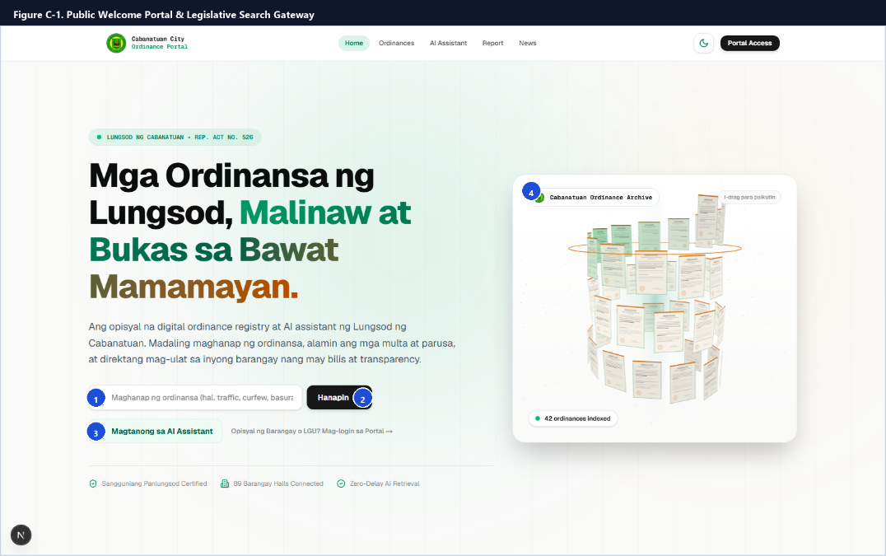

*[Figure/image placeholder: see linked image above if available]*

| No. | Field, Control, or Area — Detailed Technical Description |
|---|---|
| 1 | Hero Ordinance Search Input Field — Text input field equipped with instant keyword matching. Citizens enter common topics, legal terms, or keywords (e.g., 'curfew', 'waste segregation', 'business permit', 'tricycle fare') to initiate legislative discovery across the municipal repository. |
| 2 | Search Execution Action Button — Primary search execution button styled with high-contrast emerald civic branding. Submits active keyword parameters to the search engine and seamlessly transitions the citizen into the categorized Ordinance Explorer interface. |
| 3 | Ask AI Legal Assistant Action Button — Dedicated action button providing 1-click routing into the conversational AI Legal Assistant interface, allowing citizens to formulate natural-language legal inquiries in conversational Tagalog or English. |
| 4 | Interactive 3D Ordinance Archive Canvas — Three.js hardware-accelerated 3D cylinder archive visualizing 42+ indexed municipal ordinances. Enables citizens to interactively rotate, inspect, and spatially browse legislative enactment volumes chronologically. |

### Account Access & Authentication

### What the Secure Multi-Role Portal Sign-In & Authentication Is For
The portal authentication interface controls authorized access to restricted administrative modules, including legislative proposal drafting, ordinance review and ratification, and community incident triage. Built with Role-Based Access Control (RBAC), the authentication service validates government personnel and assigns security contexts corresponding to LGU Super Administrators, Barangay Officials, and Registered Citizens. Confidential government records, audit logs, and citizen whistleblower reports are strictly guarded behind session tokens.
Figure C-2. Secure Multi-Role Portal Sign-In & Authentication

*[Figure/image placeholder: see linked image above if available]*

| No. | Field, Control, or Area — Detailed Technical Description |
|---|---|
| 1 | Official Email Address Input Field — Validated input field capturing the official government or registered citizen email address. Implements live format checking and whitespace trimming to prevent authentication errors. |
| 2 | Encrypted Password Input Field — Masked credential input field securing passwords during entry. Enforces secure character masking and interacts directly with backend cryptographic hashing algorithms. |
| 3 | Sign In Primary Action CTA Button — Primary authentication trigger authenticating entered credentials against Firebase Auth. Upon successful token verification, the system inspects custom claims and routes users to their respective governance console. |
| 4 | Quick Role Preset Access Chips — Pre-configured demonstration credentials allowing authorized evaluators and officials to rapidly test system workflows across LGU Superadmin, Barangay Official, and Citizen security tiers with a single tap. |
| 5 | Return to Public Portal Navigation Link — Direct safe-exit navigation link allowing unauthenticated visitors or citizens to return to the public search gateway without modifying session state. |

### Public Legal Search & Discovery

### What the Public Ordinance Explorer & Multi-Criteria Legal Filtering Is For
The Public Ordinance Explorer represents the central discovery portal for municipal law. Citizens can filter hundreds of enacted city regulations and barangay resolutions through a multi-faceted search architecture. The explorer provides instant keyword matching, jurisdiction segmentation, category sorting, and enactment year filtering to help residents find applicable laws quickly.
Figure C-3. Public Ordinance Explorer & Multi-Criteria Legal Filtering
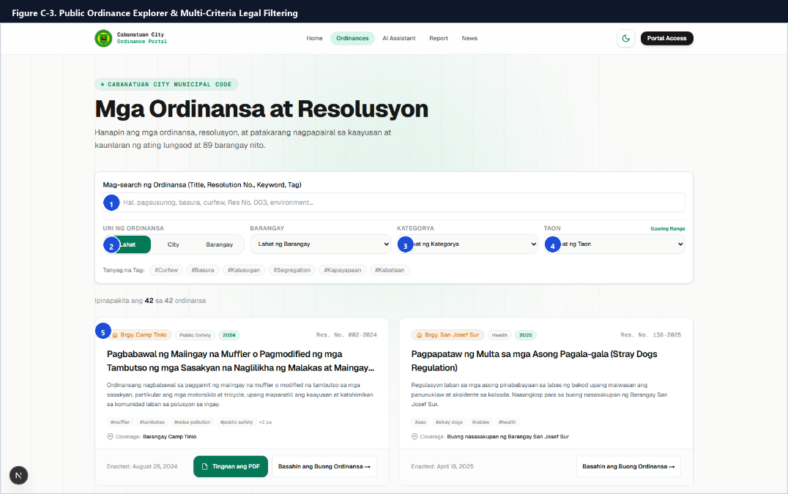

*[Figure/image placeholder: see linked image above if available]*

| No. | Field, Control, or Area — Detailed Technical Description |
|---|---|
| 1 | Full-Text Legal Search Input Field — Real-time search field querying ordinance titles, official resolution numbers, executive summaries, and enacted provisions with live debounced filtering. |
| 2 | Jurisdiction Scope Segmented Switcher — Segmented filter buttons allowing citizens to toggle search scope between 'Lahat' (All Laws), 'City Ordinances' (Sangguniang Panlungsod enactments), and 'Barangay Resolutions' (local council measures). |
| 3 | Policy Category Filter Dropdown — Dropdown selector categorizing legislation into civic policy domains including Traffic & Transportation, Solid Waste Management, Curfew & Youth Welfare, Health & Sanitation, and Fiscal Revenue. |
| 4 | Legislative Enactment Year Dropdown — Chronological dropdown filter allowing researchers to isolate ordinances passed in specific municipal legislative years from 2018 to 2026. |
| 5 | Interactive Ordinance Result Card — Responsive legislative preview card showcasing ordinance number, official title, category tag, enactment date, plain-language digest, and direct link to the codified detail record. |

### What the Codified Ordinance Full Text & Articles Viewer Is For
The codified ordinance view presents the authoritative legal text of an enacted measure in a modern digital reader format. Rather than forcing citizens to decipher complex legal terminology in dense scanned PDFs, the system parses the document into structured articles, sections, and penalty provisions, accompanied by an executive summary.
Figure C-4. Codified Ordinance Full Text & Articles Viewer
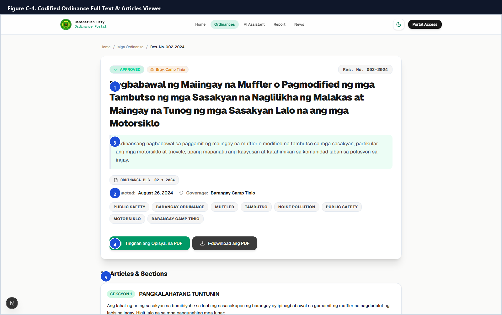

*[Figure/image placeholder: see linked image above if available]*

| No. | Field, Control, or Area — Detailed Technical Description |
|---|---|
| 1 | Official Ordinance Title & Resolution Number — Header displaying the authoritative legislative title, certified resolution number, and sponsoring council committee. |
| 2 | Legislative Metadata Bar — Metadata banner indicating the date of third-reading enactment, mayoral approval timestamp, and jurisdictional coverage across Cabanatuan City. |
| 3 | Executive Legal Summary & Plain-Language Digest — Citizen-centric overview summarizing the purpose, community scope, obligations, and citizen rights established by the ordinance in non-technical terms. |
| 4 | View Official Scanned PDF Action Button — Primary action button launching the embedded official signed PDF document reader modal for certified legal inspection. |
| 5 | Codified Articles & Sections Hierarchical Accordion — Expandable legal section tree allowing users to browse individual codified articles, specific mandates, prohibited acts, and monetary/custodial penalty clauses. |

### Document Verification & Official Assets

### What the Official Legislative PDF Document Reader Modal Is For
The official document reader modal delivers certified verification of municipal legislation. When official evidence or legal citations are required for court proceedings, business licensing, or academic research, citizens can inspect the original scanned municipal document bearing the official seal and wet signatures of the City Mayor and City Secretary.
Figure C-5. Official Legislative PDF Document Reader Modal

*[Figure/image placeholder: see linked image above if available]*

| No. | Field, Control, or Area — Detailed Technical Description |
|---|---|
| 1 | Embedded Digital PDF Document Canvas — Hardware-accelerated PDF canvas rendering the authentic signed and sealed municipal ordinance document with pan, zoom, and multi-page navigation. |
| 2 | Direct PDF File Download Action Button — Action button allowing citizens to download the official PDF file directly to their local workstation or mobile device for offline reference. |
| 3 | Open in Dedicated Full-Screen Tab Button — Navigation trigger opening the raw PDF asset in an isolated browser tab, enabling native browser print workflows and external annotation. |
| 4 | Modal Dismiss / Close Action (Esc) — Close trigger safely terminating the reader modal and returning the citizen to the active ordinance detail workspace. |

### AI-Powered Legal Advisory Services

### What the AI Legal Assistant Interactive Inquiry Console Is For
The AI Legal Assistant employs Google Gemini multimodal intelligence paired with a Retrieval-Augmented Generation (RAG) pipeline over Cabanatuan City's codified ordinances. Citizens can ask practical questions in everyday language, and the assistant returns clear, verified explanations citing the exact ordinance and article numbers.
Figure C-6. AI Legal Assistant Interactive Inquiry Console
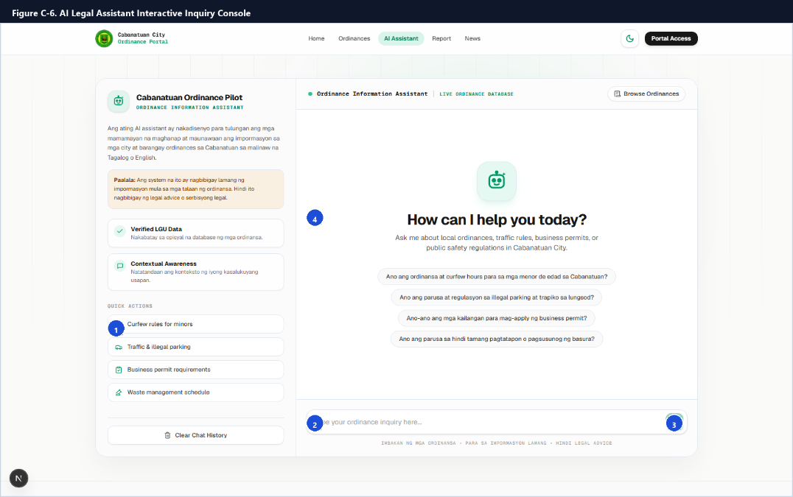

*[Figure/image placeholder: see linked image above if available]*

| No. | Field, Control, or Area — Detailed Technical Description |
|---|---|
| 1 | Preset Quick Action Inquiry Buttons — Curated prompt chips allowing citizens to query common legal concerns (e.g., 'Curfew para sa kabataan', 'Bawal bang mag-videoke sa gabi?', 'Tamang tapunan ng basura') with a single click. |
| 2 | Bilingual Question Input Field — Text input area accepting conversational prompts in Tagalog, English, or Taglish regarding municipal rules, fines, and administrative procedures. |
| 3 | Send Inquiry Execution Action Button — Action trigger transmitting the query to the server-side RAG engine for vector similarity retrieval and grounded response generation. |
| 4 | AI Legal Analysis & Verified Citation Feed — Conversational response container presenting synthesized answers with statutory article references, specific fine schedules, and official ordinance titles. |

### Community Grievance Reporting & Civic Action

### What the Citizen Community Incident & Violation Reporting Form Is For
The community incident reporting system empowers Cabanatuan residents to actively participate in local governance by reporting non-emergency neighborhood violations directly to their respective barangay councils. This interface digitizes community grievances, routing them instantly to barangay triage desks.
Figure C-7. Citizen Community Incident & Violation Reporting Form
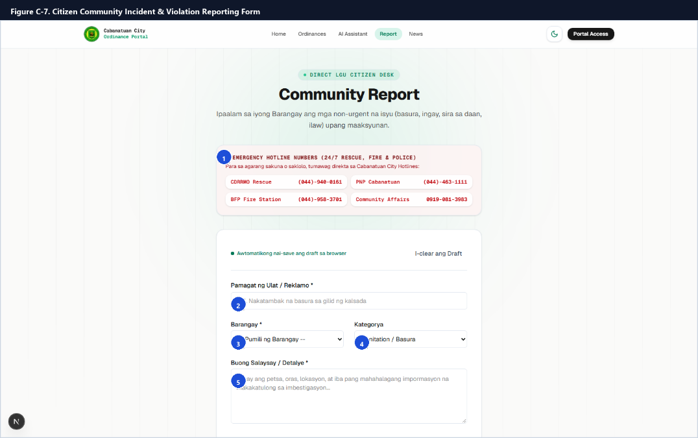

*[Figure/image placeholder: see linked image above if available]*

| No. | Field, Control, or Area — Detailed Technical Description |
|---|---|
| 1 | Emergency Hotline Numbers Banner — High-visibility alert panel detailing 24/7 emergency dispatch numbers (CDRRMO, PNP Cabanatuan, BFP Fire Station) for urgent life-safety situations. |
| 2 | Incident Subject / Title Input Field — Single-line text field capturing a concise headline of the community concern (e.g., 'Nakatambak na basura sa tapat ng paaralan'). |
| 3 | Assigned Barangay Jurisdiction Dropdown — Mandatory dropdown mapping the complaint to one of Cabanatuan City's 89 barangays, establishing local jurisdictional responsibility. |
| 4 | Incident Category Selector Dropdown — Classification menu grouping complaints into Sanitation/Waste, Noise Disturbance, Public Right-of-Way Obstruction, Youth Curfew, or Other. |
| 5 | Incident Narrative & Location Details Textarea — Multi-line narrative textarea capturing full incident context, exact street landmarks, recurring hours of violation, and observed circumstances. |

### What the Community Report Submission Confirmation & Incident Reference Is For
Upon successful incident report submission, the portal provides immediate verification to the citizen. This confirmation confirms delivery to the barangay council and establishes accountability for local investigation.
Figure C-8. Community Report Submission Confirmation & Incident Reference
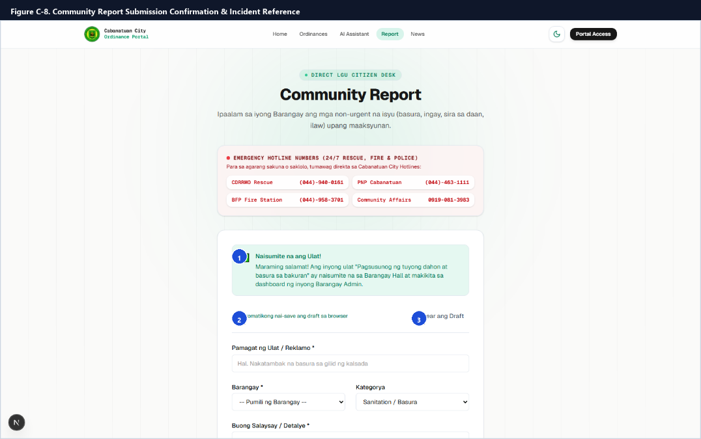

*[Figure/image placeholder: see linked image above if available]*

| No. | Field, Control, or Area — Detailed Technical Description |
|---|---|
| 1 | Official Submission Confirmation Alert Banner — Alert banner verifying successful transmission of the community report to the designated Barangay Hall dashboard. |
| 2 | Draft Auto-Save Status Bar — System indicator confirming that browser local draft storage has been safely cleared following successful server persistence. |
| 3 | Reset & Clear Form Action Button — Action button resetting form state and clearing input fields to allow residents to log another incident report if needed. |

### Civic Information & Public Communications

### What the Civic News, Public Advisories & Legislative Announcements Feed Is For
The Civic News feed delivers real-time official municipal announcements, public hearing advisories, newly ratified ordinance notices, and executive orders directly to the public, preventing misinformation.
Figure C-9. Civic News, Public Advisories & Legislative Announcements Feed
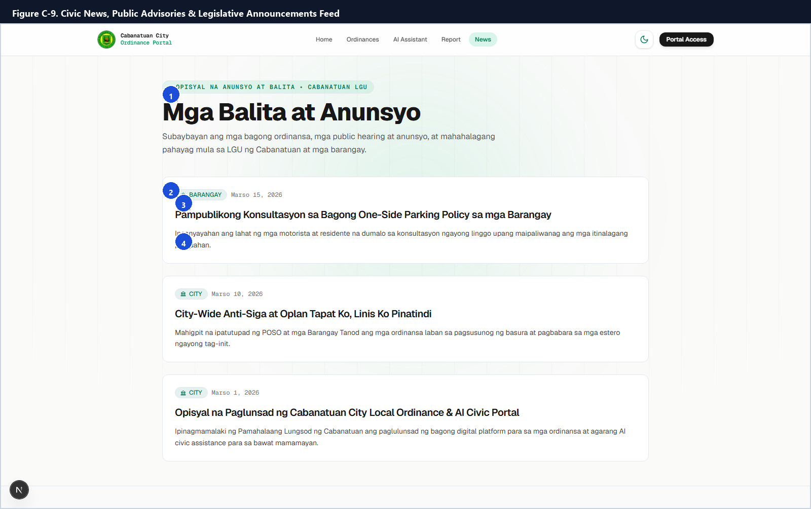

*[Figure/image placeholder: see linked image above if available]*

| No. | Field, Control, or Area — Detailed Technical Description |
|---|---|
| 1 | Official LGU Public Authority Badge — Authoritative badge verifying that published advisories originate from authenticated Sangguniang Panlungsod and City Mayor desks. |
| 2 | Official Executive Advisory Card — Card container housing publication details, category classification tag, and headline for prominent municipal updates. |
| 3 | Publication Date & Civic Category Badge — Attribution banner showing official posting date, sponsoring barangay or department, and functional category. |
| 4 | Executive Directive Content Narrative — Detailed body narrative of the advisory providing directives, compliance deadlines, implementation procedures, and public instructions. |

### Barangay Governance Console

### What the Barangay Executive Governance Dashboard Is For
The Barangay Executive Dashboard provides local village officials with a real-time operational overview of their community's legislative output, pending city approvals, and resident grievances.
Figure C-10. Barangay Executive Governance Dashboard
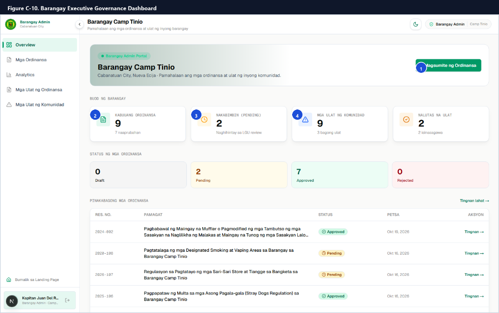

*[Figure/image placeholder: see linked image above if available]*

| No. | Field, Control, or Area — Detailed Technical Description |
|---|---|
| 1 | Submit New Ordinance Quick Action Button — Primary call-to-action button launching the digital ordinance registration and drafting workflow for local council measures. |
| 2 | Local Enacted Ordinances Metric Card — Real-time KPI card tracking the total count of officially enacted and codified barangay ordinances. |
| 3 | Pending Legislative Proposals Metric Card — Status metric card highlighting legislative drafts currently submitted to the Sangguniang Panlungsod for legal review. |
| 4 | Active Community Incident Reports Metric Card — Actionable alert card displaying the count of open resident grievances requiring barangay officer inspection and resolution. |

### Barangay Legislative Operations

### What the Barangay Ordinance Management & Status Tracking Roster Is For
The Ordinance Management module enables barangay legislative staff to maintain their local resolution records, monitor transmittal progress with the City Council, and initiate new proposals.
Figure C-11. Barangay Ordinance Management & Status Tracking Roster
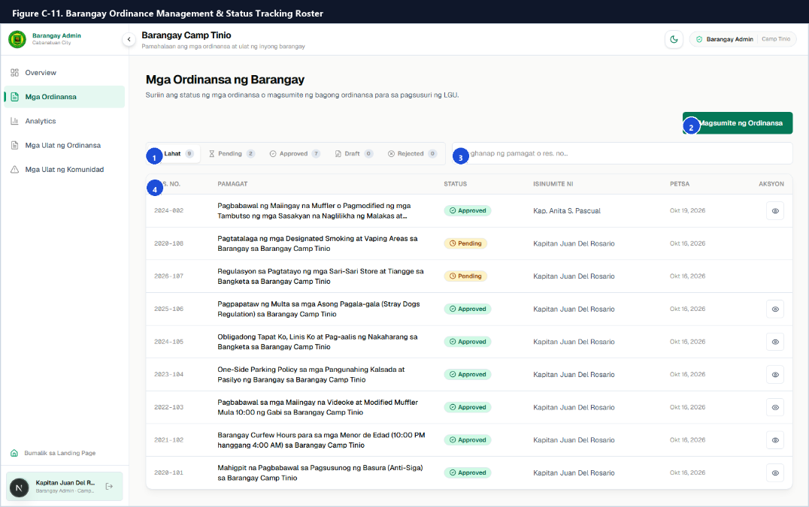

*[Figure/image placeholder: see linked image above if available]*

| No. | Field, Control, or Area — Detailed Technical Description |
|---|---|
| 1 | Legislative Status Filter Tabs — Segmented filter tabs filtering local ordinances across 'Lahat' (All), 'Pending' (Under Review), 'Approved' (Enacted), 'Draft', and 'Rejected'. |
| 2 | Create / Propose New Ordinance Action Button — Primary action button opening the full drafting modal to author a new barangay ordinance proposal. |
| 3 | Local Ordinance Keyword Search Input — Text field allowing secretaries to filter internal records instantly by resolution number, title keywords, or author. |
| 4 | Barangay Ordinance Records Table — Ledger table listing ordinance number, title, category, enactment date, status badge, and action triggers. |

### What the Barangay Ordinance Proposal & Legislative Drafting Modal Is For
This modal provides the formal drafting interface for new barangay legislative measures. Secretaries can manually enter legislative details or use integrated AI extraction to digitize existing paper ordinances.
Figure C-12. Barangay Ordinance Proposal & Legislative Drafting Modal
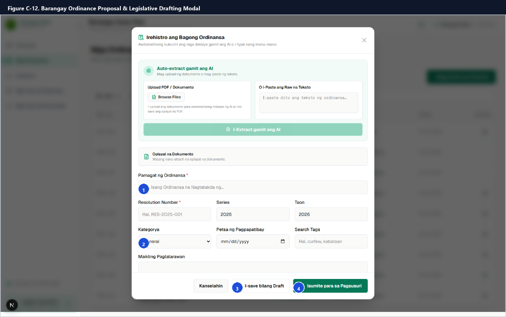

*[Figure/image placeholder: see linked image above if available]*

| No. | Field, Control, or Area — Detailed Technical Description |
|---|---|
| 1 | Proposed Ordinance Title Input Field — Mandatory form field capturing the formal statutory title of the proposed barangay measure. |
| 2 | Legislative Category Dropdown — Classification dropdown grouping the proposal under municipal functional sectors (e.g., General, Peace & Order, Sanitation). |
| 3 | Save as Draft Action Button — Action button saving active form data into editable draft storage for internal review without transmittal to city hall. |
| 4 | Submit to LGU for Approval Button — Primary transmittal CTA validating statutory requirements and submitting the measure to the Sangguniang Panlungsod. |

### What the AI-Powered Ordinance PDF Extraction & Auto-Structuring Suite Is For
Eliminating hours of manual re-typing, the AI Document Extraction tool ingests scanned PDF or image copies of physical signed barangay resolutions and automatically extracts structured metadata, articles, and penalties.
Figure C-13. AI-Powered Ordinance PDF Extraction & Auto-Structuring Suite
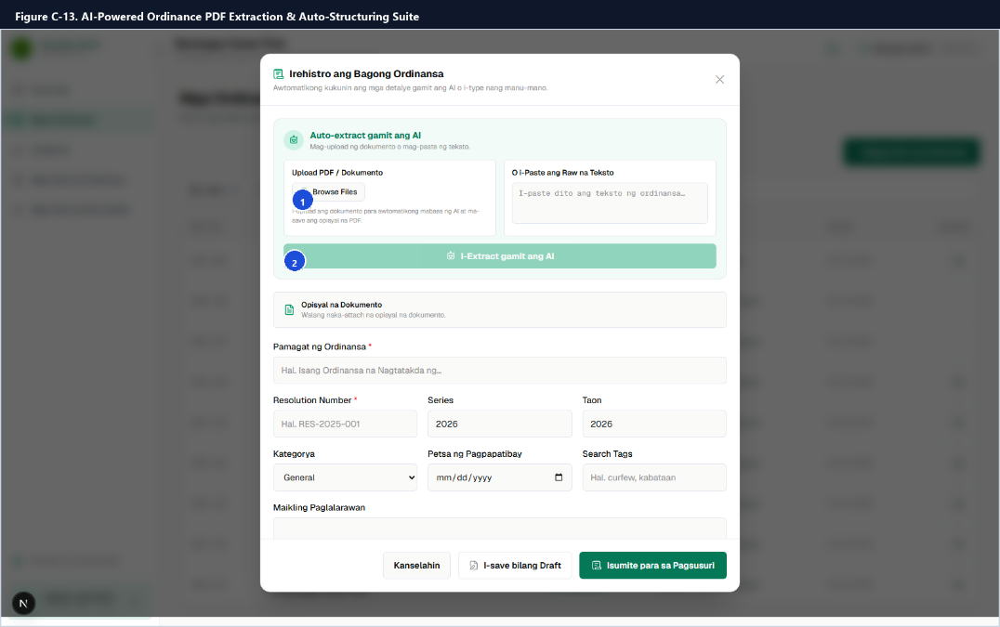

*[Figure/image placeholder: see linked image above if available]*

| No. | Field, Control, or Area — Detailed Technical Description |
|---|---|
| 1 | Scanned Document PDF / Image File Dropzone — Interactive dropzone accepting PDF scans and camera images of signed physical barangay council documents. |
| 2 | Execute Multimodal AI Parsing Button — Execution button dispatching uploaded files to Gemini AI for optical character recognition, article extraction, and penalty parsing. |

### Barangay Incident Triage & Resolution

### What the Barangay Community Incident Reports & Grievance Ledger Is For
The Barangay Community Reports ledger centralizes resident grievances filed through the portal. Officers can monitor incoming complaints, verify complainant details, and assign personnel for field investigation.
Figure C-14. Barangay Community Incident Reports & Grievance Ledger
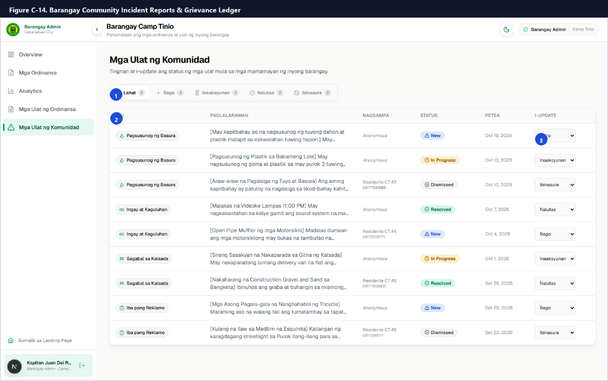

*[Figure/image placeholder: see linked image above if available]*

| No. | Field, Control, or Area — Detailed Technical Description |
|---|---|
| 1 | Status Filter Tabs — Filter tabs categorizing reports across 'Lahat' (All), 'Bago' (New), 'Inaaksyunan' (In Progress), 'Nalutas' (Resolved), and 'Ibinasura' (Dismissed). |
| 2 | Incident Reports Records Table — Master grievances table showing Reference ID, filing date, incident subject, category, reporter classification, and status. |
| 3 | Inline Status Triage & Resolution Dropdown Control — Direct interactive control on each row allowing officers to update status immediately upon taking action. |

### What the Barangay Incident Triage & Resolution Management Is For
When addressing resident grievances, officers inspect incident specifics, verify whether the report is anonymous, and record field actions taken by barangay tanods to close out the report.
Figure C-15. Barangay Incident Triage & Resolution Management
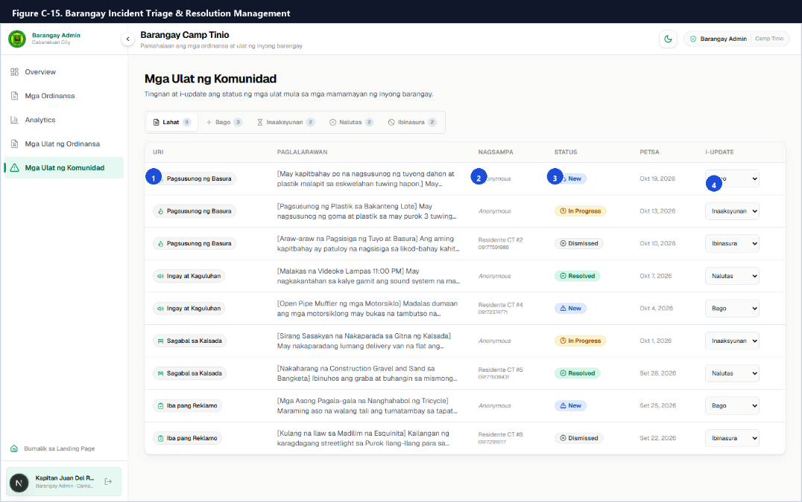

*[Figure/image placeholder: see linked image above if available]*

| No. | Field, Control, or Area — Detailed Technical Description |
|---|---|
| 1 | Target Incident Report Record Row — Focused grievance record row highlighting the specific incident being inspected and triaged. |
| 2 | Reporter Information & Anonymity Verification — Verification column displaying the complainant's identity or affirming protected anonymous whistleblower status. |
| 3 | Current Report Life-Cycle Status Badge — Visual badge reflecting the current progress of the incident from initial intake through final settlement. |
| 4 | Official Status Mutation & Triage Dropdown Selector — Dropdown selector executing status changes and updating the citizen tracking state in real time. |

### Barangay Analytical Intelligence

### What the Barangay Legislative Reporting & Volume Analytics Is For
This module aggregates barangay legislative productivity and resident incident patterns into standardized report summaries ready for council review and annual compliance audits.
Figure C-16. Barangay Legislative Reporting & Volume Analytics
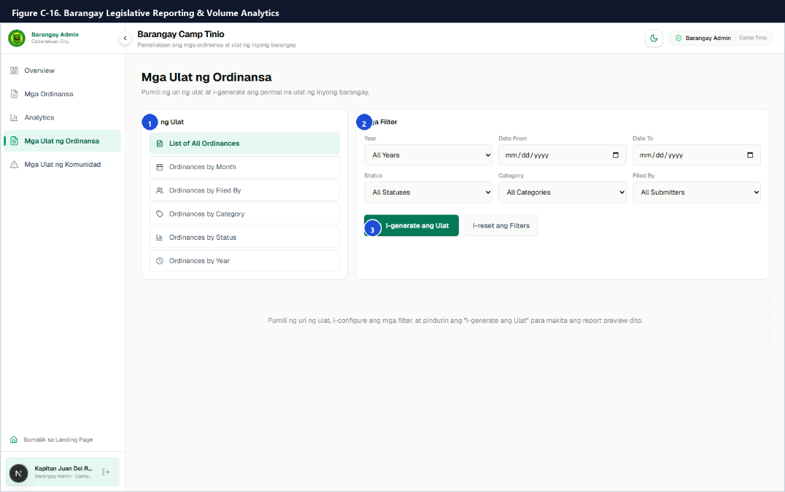

*[Figure/image placeholder: see linked image above if available]*

| No. | Field, Control, or Area — Detailed Technical Description |
|---|---|
| 1 | Report Type Structure Selector Card — Selection panel allowing officials to choose standardized report formats including Ordinance Rosters, Category Digests, and Grievance Summaries. |
| 2 | Multi-Criteria Filter Parameters Panel — Parameters panel configuring date horizons, enactment status, and category filters for the report compilation. |
| 3 | Generate Localized Report Action Button — Action trigger querying the database and generating a formatted on-screen report preview. |

### LGU City-Wide Administration

### What the LGU Executive Governance Dashboard & Legislative Pulse Is For
The LGU Executive Governance Dashboard serves as the central command console for city-wide legislative oversight. City executives can monitor municipal policy enactment rates, review incoming barangay measures, and assess legislative trends.
Figure C-17. LGU Executive Governance Dashboard & Legislative Pulse
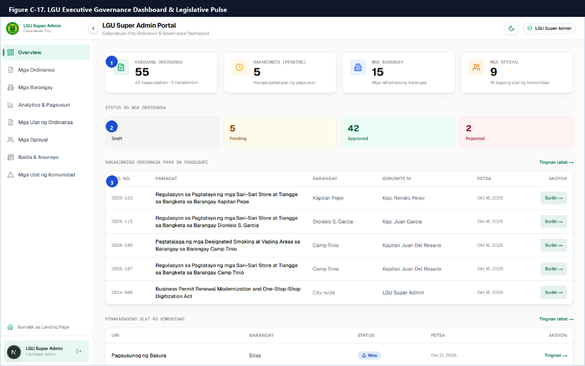

*[Figure/image placeholder: see linked image above if available]*

| No. | Field, Control, or Area — Detailed Technical Description |
|---|---|
| 1 | City-Wide KPI Cards — Metric cards tracking aggregate statistics: Total Codified Ordinances, Approved Measures, Pending Review Submissions, Drafts, and Connected Barangays. |
| 2 | Ordinance Status Life-Cycle Summary Grid — Consolidated breakdown tracking the flow of legislation through drafting, committee evaluation, mayoral review, and public enactment. |
| 3 | Recent City-Wide Legislative Activity Log — Chronological ledger showcasing newly enacted city policies, transmittal dates, and sponsoring officials. |

### What the LGU Central Legislative Repository & City Ordinance Archive Is For
The LGU Central Repository is the authoritative master database of all enacted municipal legislation in Cabanatuan City. Administrators manage city-wide enactments, evaluate pending barangay proposals, and codify new measures.
Figure C-18. LGU Central Legislative Repository & City Ordinance Archive
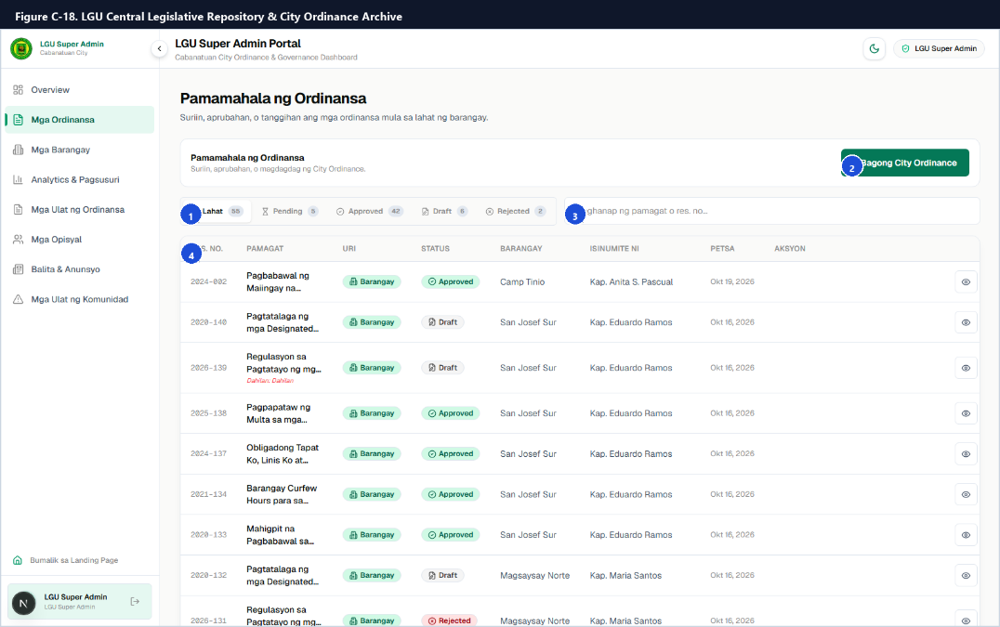

*[Figure/image placeholder: see linked image above if available]*

| No. | Field, Control, or Area — Detailed Technical Description |
|---|---|
| 1 | Accessible Status Filter Tabs with Live Record Counters — Filter tabs displaying live record tallies across 'Lahat', 'Enacted', 'In Review', and 'Rejected' ordinances. |
| 2 | Add City Ordinance Action Button — Primary action button launching the codification workflow for newly enacted Sangguniang Panlungsod city ordinances. |
| 3 | Instant City Ordinance Repository Search Input — Search field querying central ordinances by title, resolution number, sponsor, or legal summary. |
| 4 | City-Wide Ordinance Repository Master Table — Master ledger displaying ordinance metadata, jurisdiction tags (City vs Barangay), enactment dates, and administrative action menus. |

### Legislative Review & Ratification

### What the Legislative Review, Enactment & Official Approval Workflow Is For
Under the Local Government Code of 1991 (RA 7160), all barangay ordinances must undergo review by the Sangguniang Panlungsod to confirm statutory compliance. This modal facilitates the formal approval or return of submitted measures.
Figure C-19. Legislative Review, Enactment & Official Approval Workflow
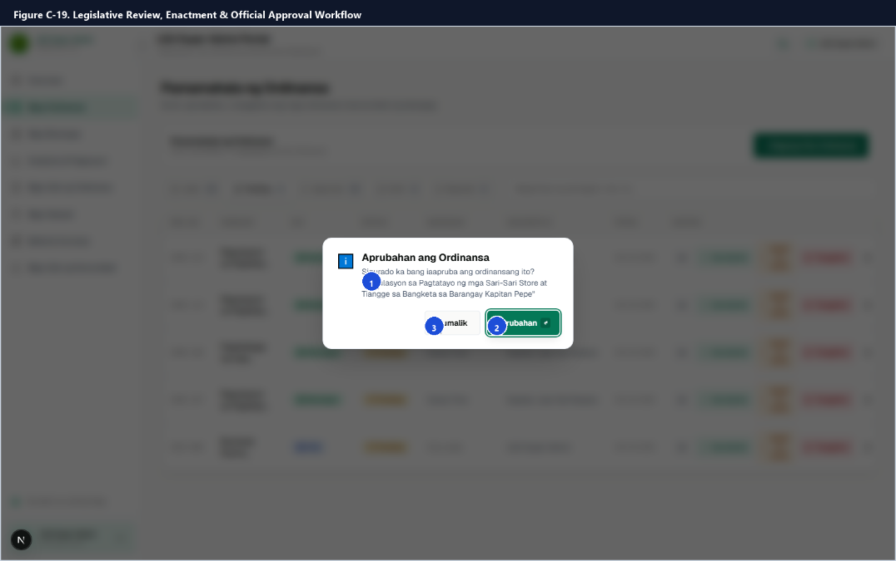

*[Figure/image placeholder: see linked image above if available]*

| No. | Field, Control, or Area — Detailed Technical Description |
|---|---|
| 1 | Pending Ordinance Title & Legal Enactment Notice — Review prompt displaying the title and jurisdiction of the proposed barangay measure undergoing council scrutiny. |
| 2 | Official Enactment / Approval Action Button ('Aprubahan') — Approval CTA enacting the measure, updating its status to 'Approved', and publishing it directly to the public legal repository. |
| 3 | Dismiss Review / Return Button ('Bumalik') — Action button returning the proposal to the originating barangay with feedback for legislative revision. |

### AI-Powered Archival Digitization

### What the LGU Legislative PDF AI Digitization & Ingestion Suite Is For
To digitize historical municipal records and newly signed council resolutions, the LGU ingestion suite processes multi-page scanned PDF documents with Gemini Multimodal AI to extract title, articles, sections, and penalties.
Figure C-20. LGU Legislative PDF AI Digitization & Ingestion Suite
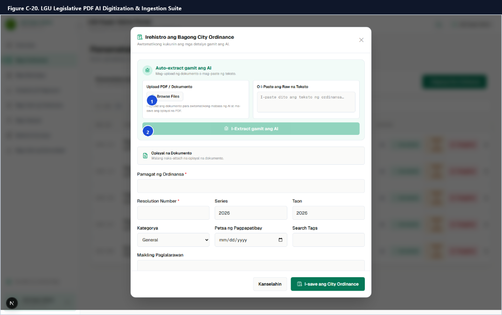

*[Figure/image placeholder: see linked image above if available]*

| No. | Field, Control, or Area — Detailed Technical Description |
|---|---|
| 1 | Official Scanned Resolution Upload Dropzone — Dropzone accepting high-resolution scans of signed municipal resolutions and certified ordinance documents. |
| 2 | Multimodal AI Parsing Execution Button — Trigger initiating AI optical character recognition, article segmentation, and penalty extraction. |

### User Administration & Security Governance

### What the Official User Accounts & Role-Based Access Control (RBAC) Management Is For
The User Management console oversees municipal user identities and system credentials. Super administrators provision official accounts for city staff and barangay secretaries, assigning granular permissions.
Figure C-21. Official User Accounts & Role-Based Access Control (RBAC) Management
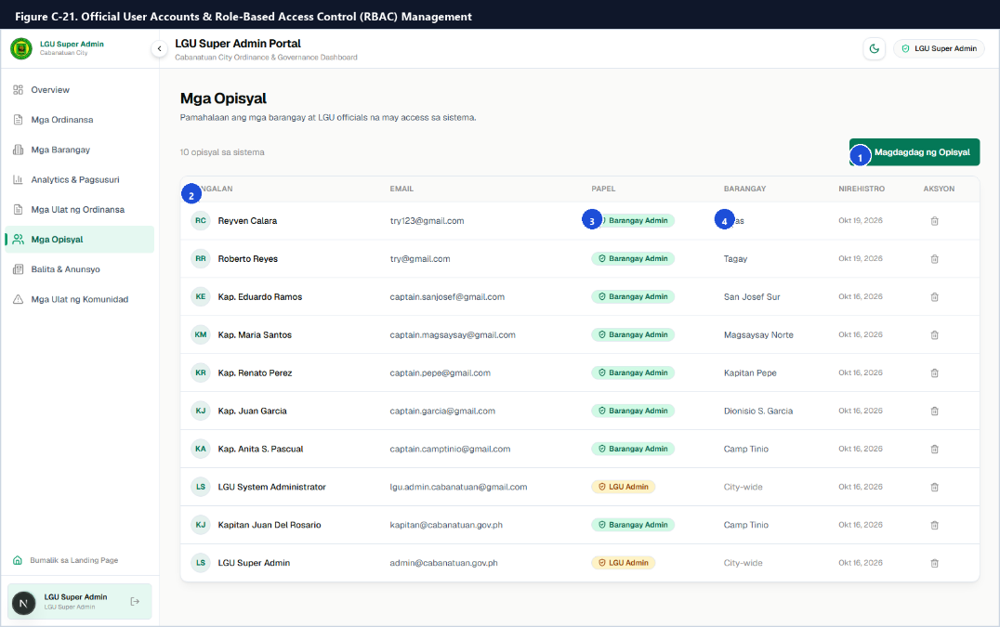

*[Figure/image placeholder: see linked image above if available]*

| No. | Field, Control, or Area — Detailed Technical Description |
|---|---|
| 1 | Register New Official Action Button ('Magdagdag ng Opisyal') — Action button opening the account creation modal to provision access for new government personnel. |
| 2 | Official Directory Table with Security Badges — Comprehensive roster of registered personnel displaying full name, official email, assigned role, and territory. |
| 3 | Role-Based Privilege Badges — Visual badges differentiating Super Administrator accounts from localized Barangay Administrator permissions. |
| 4 | Assigned Territorial Barangay Jurisdiction Tag — Scope tag specifying which of the 89 barangays the official is authorized to administer. |

### Barangay Accreditation & Directory Oversight

### What the 89-Barangay Municipal Directory & Accreditation Roster Is For
The Barangay Directory maintains authoritative records for all 89 political subdivisions of Cabanatuan City. Administrators manage hall contact information, track active officials, and monitor village onboarding.
Figure C-22. 89-Barangay Municipal Directory & Accreditation Roster
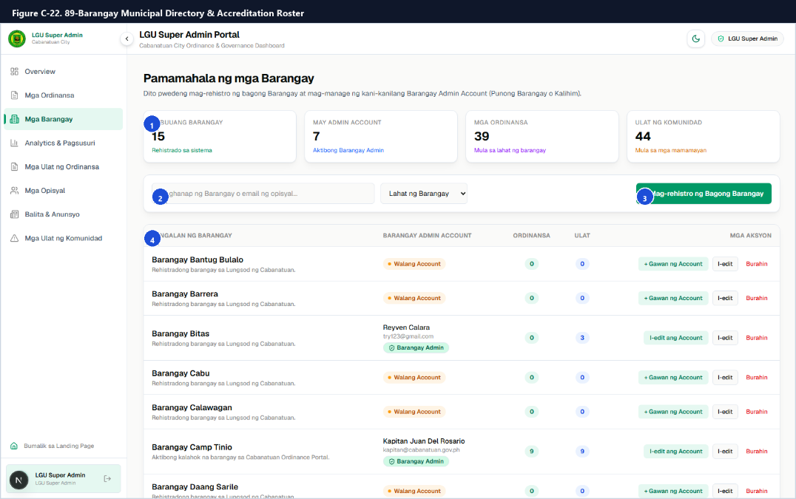

*[Figure/image placeholder: see linked image above if available]*

| No. | Field, Control, or Area — Detailed Technical Description |
|---|---|
| 1 | Barangay Participation & Onboarding Indicators — Status banner summarizing onboarding progress and active portal connectivity across city barangays. |
| 2 | Barangay Search & Filter Input Field — Search filter allowing officers to look up any barangay by name, district zone, or contact person. |
| 3 | Register New Barangay Action Button — Action button registering a newly accredited barangay or modifying jurisdictional boundaries. |
| 4 | Barangay Directory Table with Ordinance & Report Counts — Master directory table displaying barangay names, enacted local ordinances, open reports, and contact info. |

### City-Wide Grievance Monitoring

### What the City-wide Civic Incident Monitoring & Cross-Barangay Oversight Is For
This monitoring desk provides city leadership with cross-jurisdictional visibility over all resident grievances filed across the 89 barangays, identifying systemic issues requiring city intervention.
Figure C-23. City-wide Civic Incident Monitoring & Cross-Barangay Oversight
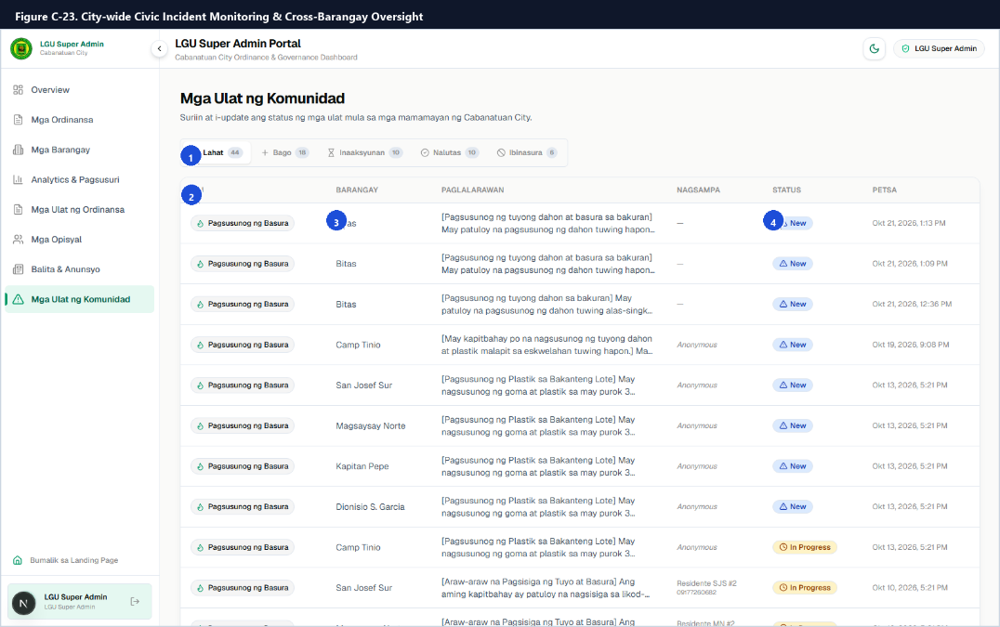

*[Figure/image placeholder: see linked image above if available]*

| No. | Field, Control, or Area — Detailed Technical Description |
|---|---|
| 1 | Resolution Status Filter Tabs — Filter tabs categorizing city grievances across 'Lahat', 'Bago', 'Inaaksyunan', 'Nalutas', and 'Ibinasura'. |
| 2 | Consolidated City-Wide Incident Records Table — Comprehensive table tracking complaint tracking numbers, filing timestamps, categories, and assigned barangays. |
| 3 | Originating Barangay Jurisdiction Identification — Jurisdiction column identifying the exact local village where the reported community incident occurred. |
| 4 | Current Operational Resolution Status Badge — Status badge reflecting whether the local barangay has initiated investigation or resolved the resident complaint. |

### Civic News & Public Communications Management

### What the City News Publishing & Public Advisory Broadcast Console Is For
The News Publishing console provides the City Public Information Office (PIO) with a centralized desk to compose and publish official public advisories, notices of newly enacted legislation, and emergency guidelines.
Figure C-24. City News Publishing & Public Advisory Broadcast Console
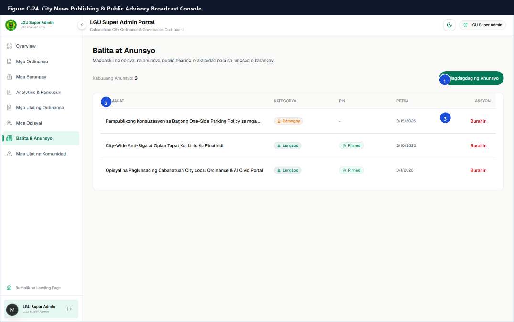

*[Figure/image placeholder: see linked image above if available]*

| No. | Field, Control, or Area — Detailed Technical Description |
|---|---|
| 1 | Publish New Advisory Action Button ('+ Magdagdag ng Anunsyo') — Primary call-to-action button opening the advisory drafting form to publish an official municipal announcement. |
| 2 | Published Public News & Advisories Table — Archive table listing all published public announcements, publication timestamps, and authoring offices. |
| 3 | Advisory Management Controls — Action triggers allowing PIO officers to edit broadcast text, manage active status, or unpublish outdated notices. |

### Legislative Reporting & Certified PDF Generation

### What the Official Legislative PDF Report Generator & Export Engine Is For
The Legislative Report Generator compiles comprehensive, certified municipal reports. Officials can generate legislative summaries, compliance digests, or category breakdowns and export them as formal PDF documents.
Figure C-25. Official Legislative PDF Report Generator & Export Engine
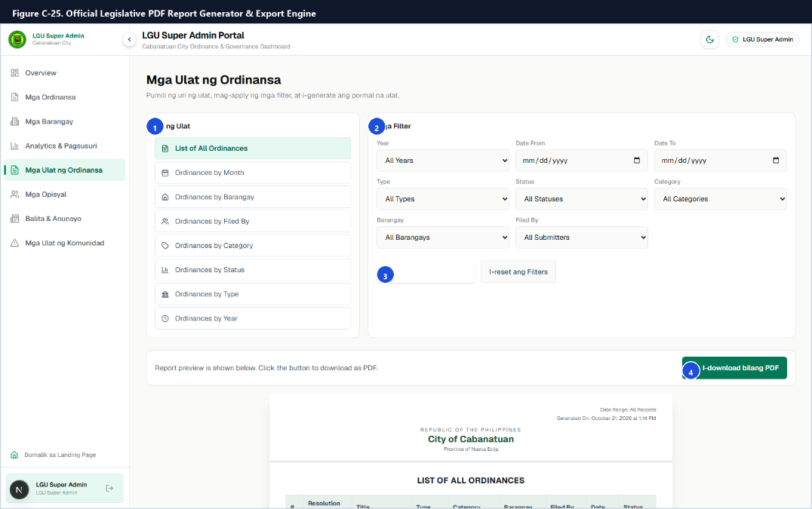

*[Figure/image placeholder: see linked image above if available]*

| No. | Field, Control, or Area — Detailed Technical Description |
|---|---|
| 1 | Legislative Report Structure Selector Card — Selection card allowing administrators to choose from 8 standardized report structures (e.g., List of All Ordinances, Ordinances by Month, Ordinances by Category). |
| 2 | Multi-Criteria Filter Parameters Panel — Configuration panel setting year, date range, status, category, and barangay origin parameters for compilation. |
| 3 | Execute Report Generation Action Button — Execution trigger querying the database and generating an on-screen preview of the compiled legislative report. |
| 4 | Export Formal PDF Document Action Button ('I-download bilang PDF') — Action button generating and downloading the certified, print-ready PDF legislative report with official letterhead. |

### Legislative Analytics & Visual Intelligence

### What the Legislative Analytics, Category Breakdown & Compliance Charts Is For
The Legislative Analytics suite provides interactive visual intelligence on municipal policy trends. Executives examine category frequency, approval ratios, and village submission rankings to inform future policy development.
Figure C-26. Legislative Analytics, Category Breakdown & Compliance Charts
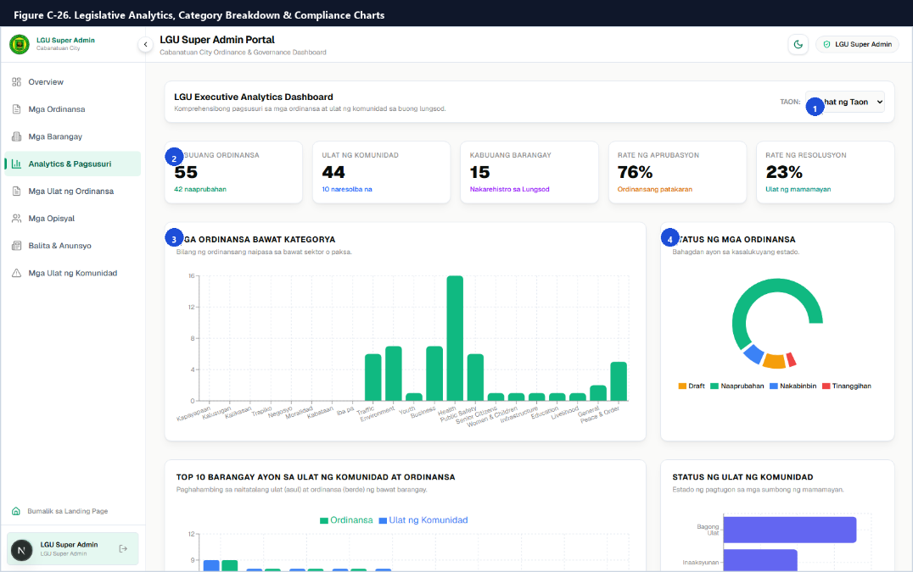

*[Figure/image placeholder: see linked image above if available]*

| No. | Field, Control, or Area — Detailed Technical Description |
|---|---|
| 1 | Legislative Year Filter Dropdown Selector — Dropdown menu filtering analytical datasets and charts by calendar or legislative year. |
| 2 | Executive Key Performance Indicators Summary Banner — Summary banner tracking city-wide legislative output, enactment velocity, and barangay participation metrics. |
| 3 | Policy Category Distribution Breakdown Chart — Interactive bar chart visualizing the frequency of enacted ordinances across civic policy categories. |
| 4 | Legislative Status Breakdown Distribution Chart — Donut/pie chart illustrating the proportion of enacted ordinances versus pending proposals and rejected measures. |

### Summary Checklist of All User Manual Figures
The following master index summarizes all twenty-six (26) user manual figures documented in Appendix C, including their target user roles and primary functional components:

| Figure Number | Document Section & Form Name | Primary Target Role | Key Components Covered |
|---|---|---|---|
| Figure C-1 | Public Welcome Portal & Legislative Search Gateway | Public / Citizens | Hero Ordinance Search, Search Execution, Ask AI Legal Assistant, Interactive 3D Ordinance Archive Canvas |
| Figure C-2 | Secure Multi-Role Portal Sign-In & Authentication | All Users / Barangay Officials / LGU Superadmins | Official Email Address, Encrypted Password, Sign In Primary Action CTA Button, Quick Role Preset Access Chips |
| Figure C-3 | Public Ordinance Explorer & Multi-Criteria Legal Filtering | Citizens / Public Users | Full-Text Legal Search, Jurisdiction Scope Segmented Switcher, Policy Category Filter, Legislative Enactment Year |
| Figure C-4 | Codified Ordinance Full Text & Articles Viewer | Citizens / Legal Researchers | Official Ordinance Title & Resolution Number, Legislative Metadata Bar, Executive Legal Summary & Plain-Language Digest, View Official Scanned PDF |
| Figure C-5 | Official Legislative PDF Document Reader Modal | Citizens / Legal Clerks | Embedded Digital PDF Document Canvas, Direct PDF File Download, Open in Dedicated Full-Screen Tab Button, Modal Dismiss / Close Action (Esc) |
| Figure C-6 | AI Legal Assistant Interactive Inquiry Console | Citizens / Public Users | Preset Quick Action Inquiry Buttons, Bilingual Question, Send Inquiry Execution, AI Legal Analysis & Verified Citation Feed |
| Figure C-7 | Citizen Community Incident & Violation Reporting Form | Residents / Whistleblowers | Emergency Hotline Numbers Banner, Incident Subject / Title, Assigned Barangay Jurisdiction, Incident Category Selector |
| Figure C-8 | Community Report Submission Confirmation & Incident Reference | Residents / Citizens | Official Submission Confirmation Alert Banner, Draft Auto-Save Status Bar, Reset & Clear Form |
| Figure C-9 | Civic News, Public Advisories & Legislative Announcements Feed | Public / Citizens | Official LGU Public Authority Badge, Official Executive Advisory Card, Publication Date & Civic Category Badge, Executive Directive Content Narrative |
| Figure C-10 | Barangay Executive Governance Dashboard | Barangay Captains / Barangay Administrators | Submit New Ordinance Quick, Local Enacted Ordinances Metric Card, Pending Legislative Proposals Metric Card, Active Community Incident Reports Metric Card |
| Figure C-11 | Barangay Ordinance Management & Status Tracking Roster | Barangay Secretaries / Councilors | Legislative Status Filter Tabs, Create / Propose New Ordinance, Local Ordinance Keyword Search Input, Barangay Ordinance Records Table |
| Figure C-12 | Barangay Ordinance Proposal & Legislative Drafting Modal | Barangay Secretaries / Committee Chairs | Proposed Ordinance Title, Legislative Category, Save as Draft, Submit to LGU for Approval Button |
| Figure C-13 | AI-Powered Ordinance PDF Extraction & Auto-Structuring Suite | Barangay Secretaries / Digitization Clerks | Scanned Document PDF / Image File Dropzone, Execute Multimodal AI Parsing Button |
| Figure C-14 | Barangay Community Incident Reports & Grievance Ledger | Barangay Peace & Order Officers / Tanods | Status Filter Tabs, Incident Reports Records Table, Inline Status Triage & Resolution Control |
| Figure C-15 | Barangay Incident Triage & Resolution Management | Barangay Desk Officers / Kagawads | Target Incident Report Record Row, Reporter Information & Anonymity Verification, Current Report Life-Cycle Status Badge, Official Status Mutation & Triage Selector |
| Figure C-16 | Barangay Legislative Reporting & Volume Analytics | Barangay Captains / Council Secretaries | Report Type Structure Selector Card, Multi-Criteria Filter Parameters Panel, Generate Localized Report |
| Figure C-17 | LGU Executive Governance Dashboard & Legislative Pulse | City Mayor / SP Presiding Officer / SuperAdmins | City-Wide KPI Cards, Ordinance Status Life-Cycle Summary Grid, Recent City-Wide Legislative Activity Log |
| Figure C-18 | LGU Central Legislative Repository & City Ordinance Archive | Sangguniang Panlungsod Legal Clerks / SuperAdmins | Accessible Status Filter Tabs with Live Record Counters, Add City Ordinance, Instant City Ordinance Repository Search Input, City-Wide Ordinance Repository Master Table |
| Figure C-19 | Legislative Review, Enactment & Official Approval Workflow | Sangguniang Panlungsod Review Committee / City Council | Pending Ordinance Title & Legal Enactment Notice, Official Enactment / Approval ('Aprubahan'), Dismiss Review / Return Button ('Bumalik') |
| Figure C-20 | LGU Legislative PDF AI Digitization & Ingestion Suite | City Legal Codifiers / Archival Staff | Official Scanned Resolution Upload Dropzone, Multimodal AI Parsing Execution Button |
| Figure C-21 | Official User Accounts & Role-Based Access Control (RBAC) Management | Super Administrators / IT Governance | Register New Official ('Magdagdag ng Opisyal'), Official Directory Table with Security Badges, Role-Based Privilege Badges, Assigned Territorial Barangay Jurisdiction Tag |
| Figure C-22 | 89-Barangay Municipal Directory & Accreditation Roster | LGU Executive Staff / DILG Officers | Barangay Participation & Onboarding Indicators, Barangay Search & Filter, Register New Barangay, Barangay Directory Table with Ordinance & Report Counts |
| Figure C-23 | City-wide Civic Incident Monitoring & Cross-Barangay Oversight | City Mayor's Action Center / CDRRMO / SuperAdmins | Resolution Status Filter Tabs, Consolidated City-Wide Incident Records Table, Originating Barangay Jurisdiction Identification, Current Operational Resolution Status Badge |
| Figure C-24 | City News Publishing & Public Advisory Broadcast Console | City Public Information Office (PIO) / SuperAdmins | Publish New Advisory ('+ Magdagdag ng Anunsyo'), Published Public News & Advisories Table, Advisory Management Controls |
| Figure C-25 | Official Legislative PDF Report Generator & Export Engine | Sangguniang Panlungsod Secretariat / Legal Researchers | Legislative Report Structure Selector Card, Multi-Criteria Filter Parameters Panel, Execute Report Generation, Export Formal PDF Document ('I-download bilang PDF') |
| Figure C-26 | Legislative Analytics, Category Breakdown & Compliance Charts | City Mayor / SP Committee on Laws / SuperAdmins | Legislative Year Filter Selector, Executive Key Performance Indicators Summary Banner, Policy Category Distribution Breakdown Chart, Legislative Status Breakdown Distribution Chart |
